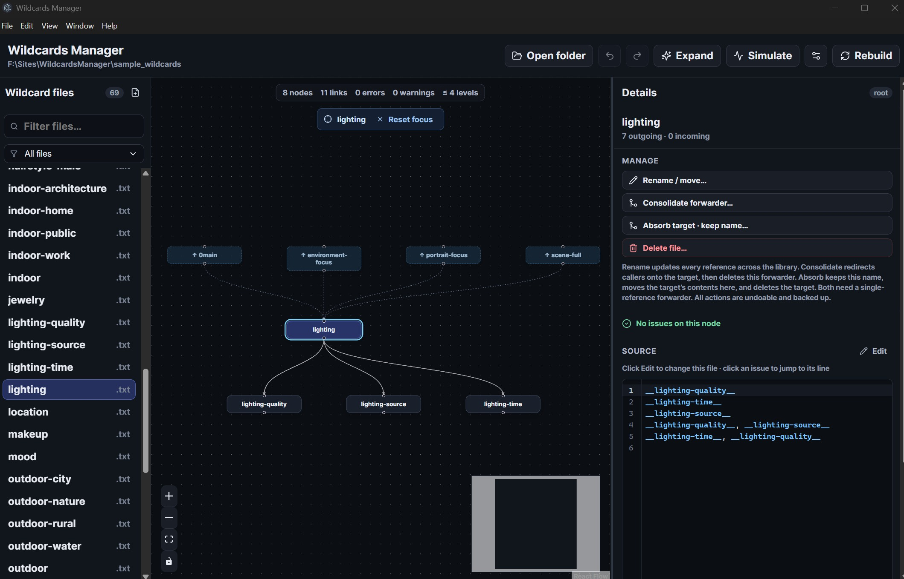

# Wildcards Manager

[](LICENSE.md)
[](https://creativecommons.org/licenses/by-nc-sa/4.0/)


[](https://github.com/aipower66669/WildcardsManager/releases/latest)

[Release notes](RELEASE_NOTES.md) · [Changelog](CHANGELOG.md)

A desktop graph editor, validator, simulator, and safe refactoring tool for Stable Diffusion / ComfyUI **Dynamic Prompts** wildcard libraries. Open a folder, explore dependencies as a graph, catch missing files and
cycles, edit wildcards in place, refactor references safely with undo, browse/download LoRAs and checkpoints from Civitai (queued downloads, LoRA download categories), browse **community Images** and Hugging Face Hub models, manage installed model folders, organize prompt folders (`!gen.txt` + samples), and drive ComfyUI generation from those prompts.

Built for wildcard libraries used by
[Stable Diffusion WebUI Dynamic Prompts](https://github.com/adieyal/sd-dynamic-prompts)
and [ComfyUI Dynamic Prompts](https://github.com/adieyal/comfyui-dynamicprompts).

> **License:** Noncommercial use only. Code is under
> [PolyForm Noncommercial 1.0.0](https://polyformproject.org/licenses/noncommercial/1.0.0)
> and the `sample_wildcards/` content is under
> [CC BY-NC-SA 4.0](https://creativecommons.org/licenses/by-nc-sa/4.0/).
> See [`LICENSE.md`](LICENSE.md).




## Why this exists

Large wildcard libraries become hard to reason about: missing files, recursive
loops, forwarder chains, and opaque nesting. Wildcards Manager turns that into a
browsable graph with validation, an editor, and undoable refactors — without
turning into a ComfyUI or A1111 plugin.

## Features

| Area | What you get |
| --- | --- |
| **Open & remember libraries** | Recursively index `.txt`, `.yaml`, `.yml`, and `.json`; restore the last library/file and window layout; keep recent roots; watch for filesystem changes and rebuild on demand |
| **Switch workspaces** | Top-level tabs for **Wildcard files**, **LoRA files**, **Checkpoint files**, **Prompts**, **Generation**, and **Search** — same app shell, resizable panels |
| **Generate with ComfyUI** | **Generation** tab: typed prompt or prompt-folder `!gen.txt`, style profiles, Edit/Save Workflow, collapsible last-output preview; needs ComfyUI + the LT node pack (Settings → AI) |
| **Search the library** | Toolbar search launcher + **Search** tab across wildcard names/content and LoRA / checkpoint filenames |
| **Explore dependencies** | Root-to-descendant graph plus direct callers; focused ancestor path with depth/breadth caps; drillable `+N more` frontiers; viewport culling; minimap, pan/zoom, and click-to-center on selection |
| **Choose a graph layout** | Persisted Default alphabetical grid or Optimized Dagre layered layout that reduces crossings and keeps related nodes closer |
| **Filter and classify** | Find files by name and filter by roots, leaves, standalone entries, empty/invalid files, or files that contain LoRA tags |
| **Validate by platform** | Choose ComfyUI or Stable Diffusion (Dynamic Prompts) in Settings; ComfyUI flags Dynamic Prompt logic inside `__wildcard__` names (e.g. `__where{|-indoor}__`), which SD accepts |
| **Validate and navigate** | Missing exact references, unmatched globs, cycles, malformed wildcard/brace/pipe/`$$` syntax, empty files, node vs other graph issues, and source-aware line/column jumps |
| **Check LoRAs** | Optional LoRA folder for `<lora:name:weight>` existence checks; search installed models by name; warn on invalid/empty tags and unused models; ignore expected unused LoRAs |
| **Manage LoRA / checkpoint folders** | List installed models (follows folder symlinks/junctions); filters (used/unused, sidecars, Civitai match, missing hash); identity panel with AutoV2, size, folder preview, and Civitai cover; embedded Civitai model page; LoRA reverse-refs into wildcards plus in-panel editing; **training-step series** (`Name_000250` …) for unused ignore and compact pick snippets; **LoRA download category manager** (folder + wildcard + weights) from LoRA or Wildcard tabs, including **Set/Edit as Category** on a selected wildcard |
| **Browse Civitai** | In-app browser for LoRAs, checkpoints, and **community Images**. **`civitai.com` = SFW catalog**; **`civitai.red` = NSFW catalog** (choose the site in Settings). Browse/search works without an API key; **many model downloads need an API key**. Detachable window; category/architecture/SDXL-family filters; **windowed catalog** with local search; Archive / Maybe / Notify; Installed via **AutoV2**; **persistent download queue** with Queued tab, pause/resume, **download console**; **LoRA download categories**; optional extra comment/prompt; **Shift+click Download**; Images: sort feeds, SFW/NSFW modes, tool filter, Download all (background + sort cycling), upload-time file dates |
| **Browse Hugging Face** | In-app Hub search with persisted filters and a download queue |
| **Keep library data with the library** | Per-library lists (Archive / Maybe / Notify / categories) and wildcards caches live in a sibling `<wildcardsBasename>.wcm/` folder (outside the ComfyUI-scanned tree); LoRA / checkpoint use `!.wcm/` and `!Thumbnails/` next to those roots; AppData stores path pointers and UI prefs only |
| **Update from inside the app** | Settings → App updates: point at your local `release/` folder, check for a newer installer, install and relaunch |
| **Repair diagnostics** | Create missing targets, remove broken references, use `# NO VALIDATION` for intentional exceptions, and resolve SCC cycle groups with ranked fixes, impact estimates, reachability warnings, and before/after previews |
| **Edit safely** | Always-on CodeMirror editor with autosave, live revalidation, highlighting/search for text/YAML/JSON, LoRA tag coloring, wildcard-key completion after `__`, context actions (open in graph / create / copy reference), or OS-default external editor; root-constrained atomic writes |
| **Refactor** | Create, rename/move, and delete with exact reference cleanup; consolidate forwarders; absorb targets; file-list and editor context menus; preview glob impact without silently rewriting ambiguous patterns |
| **Recover changes** | Grouped 50-entry session undo/redo plus best-effort timestamped pre-mutation backups and manifests |
| **Use structured data** | Strict YAML/JSON parsing; global nested mapping keys as first-class graph nodes; exact path and duplicate-key validation; scalar/list expansion and simulation |
| **Preview prompts** | Seeded weighted random expansion and bounded exhaustive expansion with nested variants/wildcards, globs, multi-select, custom separators, recursion protection, combination estimates, and copy-out |
| **Analyze reach and balance** | Seeded Monte Carlo simulation up to 1,000,000 runs; hit, visit, overall-reach, parent-share, glob fan-out, and sibling-balance overlays |
| **Test and distribute** | Validated 69-file SFW sample library, diagnostic fixtures, domain test suite, and packaging for Windows NSIS, macOS x64/arm64 DMG, and Linux AppImage |

## Quick start

Requirements: **Node.js 22.12+** and npm.

```powershell
git clone https://github.com/aipower66669/WildcardsManager.git
cd WildcardsManager
npm install
npm run dev
```

Then **Open folder** → `sample_wildcards/` → select `0main.txt` (or `portrait-focus.txt`).

```powershell
npm run check       # typecheck + vitest (same as GitHub Tests / Build gates)
npm run dist        # platform installer (win / mac / linux via CI tags)
```

## Sample library

The repo ships a demo at [`sample_wildcards/`](sample_wildcards/) (~69 files).
`0main` fans out through people, age, race, gendered clothes/hair, pose, location,
lighting, and style.

Regenerate with:

```powershell
node scripts/generate-sample-wildcards.mjs
```

For intentional broken examples, open [`fixtures/wildcards`](fixtures/wildcards)
(`root.txt` = missing ref, `loop-a.txt` = cycle,
`structured-invalid.yaml` = parse error). Valid YAML/JSON examples demonstrate
global nested mapping keys.

## Architecture

| Layer | Role |
| --- | --- |
| `src/main` | Filesystem, folder picker, watcher, IPC, backups |
| `src/preload` | Narrow typed `window.wcm` API |
| `src/domain` | Parser, resolver, graph, validators, refactor / cycle-fix planners |
| `src/renderer` | React + React Flow UI (no direct filesystem access) |
| `src/shared` | IPC contracts / DTOs |

See the [`docs/`](docs/) hub for the user guide, supported syntax, architecture,
development notes, troubleshooting, and the [roadmap](docs/roadmap.md).

## Contributing

PRs are welcome — especially bug fixes, clearer diagnostics, sample library
improvements, and packaging polish.

1. Fork the repository and create a branch from `main`.
2. Keep changes focused; match existing TypeScript / React style.
3. Put domain logic in `src/domain` with tests when behavior changes.
4. Run before opening a PR:

   ```powershell
   npm run check
   ```

5. Describe the *why* in the PR, not only the diff. Screenshots help for UI work.

Ideas that land well: unused-file reporting, structured-key compatibility cases,
split/merge tools, better fixtures, docs/screenshots, and CI packaging fixes. Check
[`docs/roadmap.md`](docs/roadmap.md) before large features so we do not duplicate work.

Bug reports are also useful — include OS, Node version, a minimal wildcard folder
(or fixture), and what you expected vs. what happened.

## Releases

See the [release notes](RELEASE_NOTES.md) for **v0.6** and the
[changelog](CHANGELOG.md) for the complete version history.

## License

This project is **noncommercial**:

- **Software** — [PolyForm Noncommercial License 1.0.0](https://polyformproject.org/licenses/noncommercial/1.0.0).
- **Sample library** (`sample_wildcards/`) — [CC BY-NC-SA 4.0](https://creativecommons.org/licenses/by-nc-sa/4.0/).

Full terms are in [`LICENSE.md`](LICENSE.md). For commercial licensing, contact
the copyright holder.
