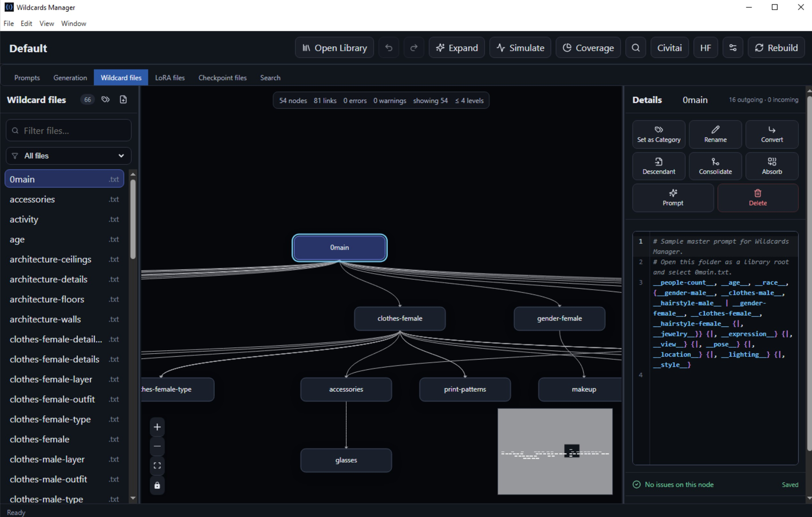
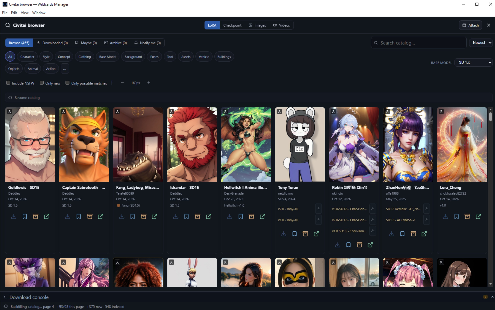
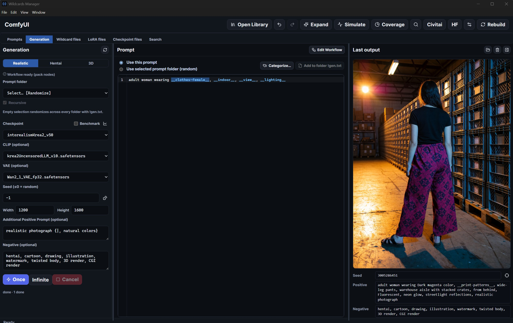

# Wildcards Manager

[](LICENSE.md)
[](https://creativecommons.org/licenses/by-nc-sa/4.0/)


[](https://github.com/aipower66669/WildcardsManager/releases/latest)

[Release notes](RELEASE_NOTES.md) · [Changelog](CHANGELOG.md)

A desktop graph editor, validator, simulator, and safe refactoring tool for Stable Diffusion / ComfyUI **Dynamic Prompts** wildcard libraries. Open a folder, explore dependencies as a graph, catch missing files and
cycles, edit wildcards in place, refactor references safely with undo, browse/download LoRAs and checkpoints from Civitai (queued downloads, LoRA download categories), browse **community Images** and Hugging Face Hub models, manage installed model folders, organize prompt folders (`!gen.txt` + samples), and drive ComfyUI generation from those prompts — **Krea 2**, or **SDXL, Pony, and Illustrious** (v0.9.1+) from one checkpoint graph with hires fix.

Built for wildcard libraries used by
[Stable Diffusion WebUI Dynamic Prompts](https://github.com/adieyal/sd-dynamic-prompts)
and [ComfyUI Dynamic Prompts](https://github.com/adieyal/comfyui-dynamicprompts).

## Need help with Wildcards Manager?

Before opening an issue or requesting support, try asking your preferred AI assistant.

We've prepared a comprehensive documentation file specifically designed for AI-assisted support, covering installation, features, configuration, troubleshooting, and technical details.

**[Wildcards Manager — Complete AI Documentation](https://github.com/aipower66669/WildcardsManager/blob/main/docs/all-in-one.md)**

1. [Download the documentation file](https://raw.githubusercontent.com/aipower66669/WildcardsManager/main/docs/all-in-one.md).
2. Upload it to ChatGPT, Claude, Gemini, or another AI assistant.
3. Ask your question about Wildcards Manager.

The documentation includes instructions for AI assistants to avoid guessing about unsupported features or undocumented behaviour.

If the assistant cannot resolve your issue, please [open a GitHub issue](https://github.com/aipower66669/WildcardsManager/issues) with the relevant error details.

> **License:** Noncommercial use only. Code is under
> [PolyForm Noncommercial 1.0.0](https://polyformproject.org/licenses/noncommercial/1.0.0)
> and the `sample_wildcards/` content is under
> [CC BY-NC-SA 4.0](https://creativecommons.org/licenses/by-nc-sa/4.0/).
> See [`LICENSE.md`](LICENSE.md).






## Why this exists

Large wildcard libraries become hard to reason about: missing files, recursive
loops, forwarder chains, and opaque nesting. Wildcards Manager turns that into a
browsable graph with validation, an editor, and undoable refactors — without
turning into a ComfyUI or A1111 plugin.

## Features

| Area | What you get |
| --- | --- |
| **Open & remember libraries** | Recursively index `.txt`, `.yaml`, `.yml`, and `.json`; restore the last library/file and window layout; keep recent roots; watch for filesystem changes and rebuild on demand |
| **Switch workspaces** | Top-level tabs for **Wildcard files**, **LoRA files**, **Checkpoint files**, **Prompts**, **Generation**, and **Search** — same app shell, resizable panels |
| **Generate with ComfyUI** | **Generation** tab: typed prompt or prompt-folder `!gen.txt`, three style profiles, a fixed seed that repeats on Once and Infinite, Edit/Save Workflow. Each library is **Krea 2** or **SDXL**. SDXL, Pony, and Illustrious share one checkpoint graph: replaceable VAE, CLIP skip (default 2), upscaler, scale factor, and a hires pass. Settings stay on that library and on Realistic / Anime / 3D. Install [`ComfyUI-Workflow/`](ComfyUI-Workflow/), open the matching graph, then **Save Workflow** ([steps](docs/user-guide.md#install-the-nodes-and-the-sample-graph)) |
| **Search the library** | Toolbar search launcher + **Search** tab across wildcard names/content and LoRA / checkpoint filenames |
| **Explore dependencies** | Root-to-descendant graph plus direct callers; focused ancestor path with depth/breadth caps; drillable `+N more` frontiers; viewport culling; minimap, pan/zoom, and click-to-center on selection |
| **Choose a graph layout** | Persisted Default alphabetical grid or Optimized Dagre layered layout that reduces crossings and keeps related nodes closer |
| **Filter and classify** | Find files by name and filter by roots, leaves, standalone entries, empty/invalid files, or files that contain LoRA tags |
| **Validate by platform** | Choose ComfyUI or Stable Diffusion (Dynamic Prompts) in Settings; ComfyUI flags Dynamic Prompt logic inside `__wildcard__` names (e.g. `__where{|-indoor}__`), which SD accepts |
| **Validate and navigate** | Missing exact references, unmatched globs, cycles, malformed wildcard/brace/pipe/`$$` syntax, empty files, node vs other graph issues, and source-aware line/column jumps |
| **Check LoRAs** | Optional LoRA folder for `<lora:name:weight>` existence checks; search installed models by name; warn on invalid/empty tags and unused models; ignore expected unused LoRAs |
| **Manage LoRA / checkpoint folders** | List installed models (follows folder symlinks/junctions); filters (used/unused, sidecars, Civitai match, missing hash); identity panel with AutoV2, size, folder preview, and Civitai cover; embedded Civitai model page; LoRA reverse-refs into wildcards plus in-panel editing; **training-step series** (`Name_000250` …) for unused ignore and compact pick snippets; **LoRA download category manager** (folder + wildcard + weights) from LoRA or Wildcard tabs, including **Set/Edit as Category** on a selected wildcard |
| **Browse Civitai** | In-app browser for LoRAs, checkpoints, and **community Images and Videos**. **`civitai.com` = SFW catalog**; **`civitai.red` = NSFW catalog** (choose the site in Settings). Browse/search works without an API key; **many model downloads need an API key**. Detachable window; category/architecture/SDXL-family filters; **windowed catalog** with local search; Archive / Maybe / Notify; Installed via **AutoV2**; **persistent download queue** with Queued tab, pause/resume, **download console**; **LoRA download categories**; optional extra comment/prompt; **Shift+click Download**; Images: sort feeds, SFW/NSFW modes, tool filter, Download all (background + sort cycling), upload-time file dates |
| **Browse Hugging Face** | In-app Hub search with persisted filters and a download queue |
| **Keep library data with the library** | Each library’s Archive, Maybe, Notify, and categories live in sibling `<wildcardsBasename>.wcm/libraries/<library id>/` (`civitai-loras.json`, `civitai-checkpoints.json`, `civitai-images.json`, `civitai-videos.json`, `huggingface.json`, and a small `library.json` for preferences). The `.wcm/library.json` file is a pointer. Each library’s Civitai catalog is `<wildcardsBasename>.wcm/cache/civitai-catalog/<library id>/`. LoRA / checkpoint roots use their own `!.wcm/` and `!Thumbnails/`. AppData stores path pointers and UI prefs only |
| **Update from inside the app** | Settings → App updates checks GitHub Releases when the folder is empty. Check for update only reports a newer installer. What's new and Install are separate buttons. A local `release/` folder overrides GitHub |
| **Repair diagnostics** | Create missing targets, remove broken references, use `# NO VALIDATION` for intentional exceptions, and resolve SCC cycle groups with ranked fixes, impact estimates, reachability warnings, and before/after previews |
| **Edit safely** | Always-on CodeMirror editor with autosave, live revalidation, highlighting/search for text/YAML/JSON, LoRA tag coloring, wildcard-key completion after `__`, context actions (open in graph / create / copy reference), or OS-default external editor; root-constrained atomic writes |
| **Refactor** | Create, rename/move, and delete with exact reference cleanup; consolidate forwarders; absorb targets; file-list and editor context menus; preview glob impact without silently rewriting ambiguous patterns |
| **Recover changes** | Grouped 50-entry session undo/redo plus best-effort timestamped pre-mutation backups and manifests |
| **Use structured data** | Strict YAML/JSON parsing; global nested mapping keys as first-class graph nodes; exact path and duplicate-key validation; scalar/list expansion and simulation |
| **Preview prompts** | Seeded weighted random expansion and bounded exhaustive expansion with nested variants/wildcards, globs, multi-select, custom separators, recursion protection, combination estimates, and copy-out |
| **Analyze reach and balance** | Seeded Monte Carlo simulation up to 1,000,000 runs; hit, visit, overall-reach, parent-share, glob fan-out, and sibling-balance overlays |
| **Test and distribute** | Validated 69-file SFW sample library, diagnostic fixtures, domain test suite, and a Windows NSIS installer on GitHub Releases |

## SDXL, Pony, and Illustrious

Library Manager sets each library’s generation family. **Krea 2** (the default) keeps Load Diffusion Model, Load CLIP, and Load VAE. **SDXL** uses one checkpoint file. Pony and Illustrious use that same graph: the checkpoint already contains the model, both text encoders, and the VAE.

On an SDXL library the Generation tab adds:

- **VAE** — blank keeps the VAE packed in the checkpoint; a picked file replaces it
- **CLIP skip** — default 2, the setting Pony and Illustrious were trained with; 1 keeps the last layer for base SDXL
- **Hires fix** — upscaler (default `4x_foolhardy_Remacri`), scale factor (default 1.5), and a second sampler at hires denoise 0.5
- **Sampler and Scheduler** — every name Comfy reports, shown as Comfy sends them, underscores included

Realistic, Anime, and 3D each keep their own checkpoint, size, and Options. Switching libraries restores that library’s three styles. Flux and other architectures still need a graph you adapt in ComfyUI before Save Workflow.

Open `ComfyUI-Workflow/WildcardManager-ComfyUI-SDXL-Generation-Workflow.json` in ComfyUI, set the library’s family to SDXL, and **Save Workflow**. The [install steps](docs/user-guide.md#install-the-nodes-and-the-sample-graph) list the node packs.

## Quick start

Requirements: **Node.js 22.12+** and npm.

```powershell
git clone https://github.com/aipower66669/WildcardsManager.git
cd WildcardsManager
npm install
npm run dev
```

Then **Open folder** → `sample_wildcards/` → select `0main.txt` (or `portrait-focus.txt`).

```powershell
npm run check       # typecheck + vitest (same gates as the tag workflow, before the installer)
npm run dist        # Windows installer (GitHub tags publish this .exe only)
```

## Sample library

The repo ships a demo at [`sample_wildcards/`](sample_wildcards/) (~69 files).
`0main` fans out through people, age, race, gendered clothes/hair, pose, location,
lighting, and style.

Regenerate with:

```powershell
node scripts/generate-sample-wildcards.mjs
```

For intentional broken examples, open [`fixtures/wildcards`](fixtures/wildcards)
(`root.txt` = missing ref, `loop-a.txt` = cycle,
`structured-invalid.yaml` = parse error). Valid YAML/JSON examples demonstrate
global nested mapping keys.

## Architecture

| Layer | Role |
| --- | --- |
| `src/main` | Filesystem, folder picker, watcher, IPC, backups |
| `src/preload` | Narrow typed `window.wcm` API |
| `src/domain` | Parser, resolver, graph, validators, refactor / cycle-fix planners |
| `src/renderer` | React + React Flow UI (no direct filesystem access) |
| `src/shared` | IPC contracts / DTOs |

See the [`docs/`](docs/) hub for the user guide, supported syntax, architecture,
development notes, troubleshooting, and the [roadmap](docs/roadmap.md).

## Contributing

This is a public project and it gets better when people who use it help shape
it. Code, docs, install notes, and guides all count. Contributions are accepted
under the same noncommercial terms as the repo ([`LICENSE.md`](LICENSE.md)).

The part that needs the most outside help right now is **getting started**:
installing the app, installing the ComfyUI nodes, loading the Krea 2 or SDXL
Generation workflow, and explaining the wildcard graph to someone who has not
opened the app before. If a step confused you, that is a useful contribution.

### Ways to help

- **Easier install and first run.** Clearer steps for the Windows installer,
  `npm run dev`, ComfyUI custom nodes, and
  [saving a Generation workflow](docs/user-guide.md#install-the-nodes-and-the-sample-graph).
  Screenshots of the screen you were stuck on are enough to start.
- **Guides.** A short article, a forum post, or a video that walks through
  opening a library, fixing a missing wildcard, or generating from a prompt
  folder. Link it so other people can find it (see below).
- **Bug reports.** Ask the [AI documentation](https://github.com/aipower66669/WildcardsManager/blob/main/docs/all-in-one.md) first. If that does not resolve it, open an
  [issue](https://github.com/aipower66669/WildcardsManager/issues) with the OS, app version, what you expected, what happened, and the error text. A
  minimal wildcard folder or one of the
  [`fixtures/wildcards`](fixtures/wildcards) cases is ideal.
- **Code.** Bug fixes, clearer diagnostics, sample-library improvements, tests,
  and packaging polish. Check [`docs/roadmap.md`](docs/roadmap.md) before a
  large feature so the work does not duplicate something already planned.
  Development setup is in [`docs/development.md`](docs/development.md).

### Guides, videos, and articles

Community guides will be listed here. To add one, open an
[issue](https://github.com/aipower66669/WildcardsManager/issues) with the link,
title, and a one-line description of what it covers — or open a pull request
that adds the link under this heading.

Topics that would help most:

- installing Wildcards Manager and opening `sample_wildcards/`
- installing `comfyui-lora-training` and getting the Krea 2 or SDXL Generation tab to queue
- how Dynamic Prompts wildcards, `!gen.txt` folders, and the graph fit together

Please keep linked material noncommercial-friendly and free of personal library
dumps (real LoRA trees, prompt folders, or model catalogs).

### Pull requests

1. Fork the repository and create a branch from `main`.
2. Keep the change focused. Match the existing TypeScript and React style.
3. Put domain logic in `src/domain`, with tests when behavior changes.
4. Run this before opening the PR:

   ```powershell
   npm run check
   ```

5. Describe the *why* in the PR, not only the diff. Screenshots help for UI
   and docs changes.

## Releases

See the [release notes](RELEASE_NOTES.md) for **v0.9.3** (Archive, Maybe, Notify, and LoRA categories stay with the library, not in AppData) and the
[changelog](CHANGELOG.md) for the complete version history.

## License

This project is **noncommercial**:

- **Software** — [PolyForm Noncommercial License 1.0.0](https://polyformproject.org/licenses/noncommercial/1.0.0).
- **Sample library** (`sample_wildcards/`) — [CC BY-NC-SA 4.0](https://creativecommons.org/licenses/by-nc-sa/4.0/).

Full terms are in [`LICENSE.md`](LICENSE.md). For commercial licensing, contact
the copyright holder.
