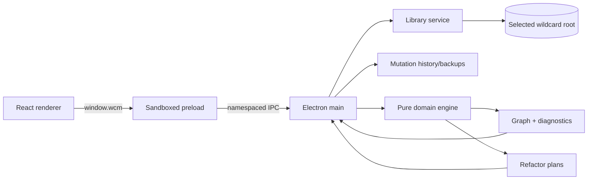
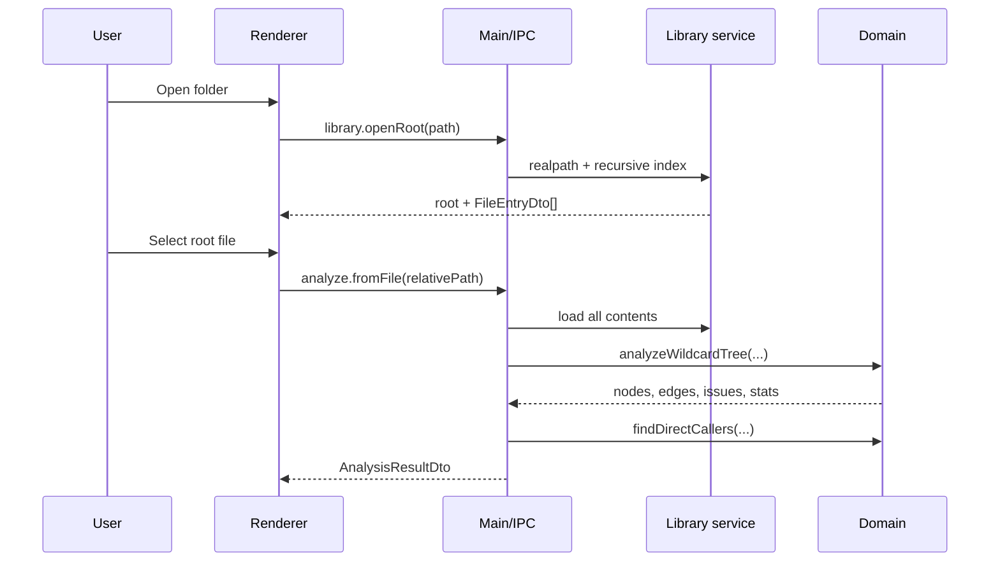

# Wildcards Manager — complete documentation

This file bundles the Markdown documents in `docs/` into one attachment for an AI assistant. Give this file to the model when you want help using Wildcards Manager, understanding its syntax, or troubleshooting a problem.

The separate files in this folder remain the sources. This bundle is a copy for convenience. When the bundle and the running app disagree, trust the app and the source code.

The documents through Roadmap are unchanged copies. **FAQ** is a copy of `docs/FAQ.md`. **Information for LLM models** exists only in this bundle: extra rules so an assistant can answer without inventing behavior.

Links written as `syntax.md` or `user-guide.md#…` are paths inside the `docs/` folder. In this file, use the heading with the same title. `https://` links are the ones that leave the document. The repository is [aipower66669/WildcardsManager](https://github.com/aipower66669/WildcardsManager). When two passages in this file disagree, **Information for LLM models** wins on the mechanical points it states. When this file and the source code disagree, the code wins.

## Question and symptom index

| Question or symptom | Heading in this file |
| --- | --- |
| Install, open a library, workspace tabs | Getting started |
| Day-to-day controls | User guide |
| Realistic / Anime / Hentai / 3D | Library Manager; Generation workspace |
| Editor comment and uncomment | Editor |
| What undo actually keeps | Undo, redo, and backups |
| Exact syntax, including failures | Supported syntax and compatibility; Examples that pass and fail |
| No library, missing files, odd globs | Troubleshooting (symptom table at the top of that section) |
| Civitai 401, retry pause, installed tag, missing snippet | Civitai download fails or is gated; the three download sections after it |
| Test succeeds, Generation refuses, Last output empty | ComfyUI answers Test but Generation is rejected; Last output stays empty after a successful ComfyUI image |
| LoRA file exists and something says missing | A LoRA exists but a warning or the loader says it is missing |
| Slow open or a freeze | The library is slow to open |
| Closing the window versus quitting | Civitai browser; FAQ “Do downloads keep going if I leave the browser?” |
| Direct answers | FAQ |
| Rules an assistant must not soften | Information for LLM models |

## Documents in this file

| Section | Source | What it covers |
| --- | --- | --- |
| Documentation | `docs/README.md` | How the docs are organized |
| Product | `docs/product.md` | Who the app is for, principles, and scope |
| Getting started | `docs/getting-started.md` | Install, open a library, workspace tabs, packaging |
| User guide | `docs/user-guide.md` | Day-to-day use of every major feature |
| Supported syntax | `docs/syntax.md` | Wildcard, glob, variant, and validation rules |
| Troubleshooting | `docs/troubleshooting.md` | Startup, graph, Civitai, models, updates |
| Architecture | `docs/architecture.md` | Process boundaries, data flow, and storage |
| Development | `docs/development.md` | Source layout, tests, and releases |
| Roadmap | `docs/roadmap.md` | Shipped work and later plans |
| FAQ | `docs/FAQ.md` | Common questions and answers |
| Information for LLM models | this file only | Compact rules for an assistant |

---

<!-- source: docs/README.md -->

# Documentation

Welcome to the Wildcards Manager documentation. Start with the path that matches
what you are trying to do.

## Using the app

- **[Getting started](getting-started.md)** — install, open the sample library,
  understand the workspace tabs (wildcards / LoRAs / checkpoints / prompts /
  generation / search), edit safely, and build a package.
- **[User guide](user-guide.md)** — complete guide to the graph, filters,
  diagnostics, editor, refactors, undo/backups, expansion, simulation,
  LoRA/checkpoint managers, Prompts / Generation, Civitai browse (models +
  Images), Hugging Face, library sidecars, and in-app updates.
- **[Supported syntax](syntax.md)** — exact wildcard, glob, variant, weight,
  multi-select, comment, and `# NO VALIDATION` behavior; compatibility limits.
- **[Troubleshooting](troubleshooting.md)** — common startup, graph, validation,
  editing, Civitai (SFW/NSFW site + API key, Images, downloads), model folders /
  symlinks, library sidecars, in-app updates, watcher, packaging, and platform
  problems.

## Understanding the project

- **[Product](product.md)** — audience, problems, principles, current scope, and
  non-goals.
- **[Architecture](architecture.md)** — Electron trust boundaries, domain
  pipeline, IPC, data flow, graph model, write safety, settings, and backups.
- **[Development](development.md)** — source layout, commands, tests,
  contribution workflow, packaging, and tagged releases.
- **[Roadmap](roadmap.md)** — shipped capabilities, current priorities, later
  opportunities, and release readiness.

## Repository resources

- [`../ComfyUI-Workflow/`](../ComfyUI-Workflow/) — `comfyui-lora-training` zip
  and the sample Generation graph. Install steps are in the
  [user guide](user-guide.md#install-the-nodes-and-the-sample-graph).
- [`../sample_wildcards/`](../sample_wildcards/) — healthy SFW example library.
- [`../fixtures/wildcards/`](../fixtures/wildcards/) — intentionally broken
  examples for diagnostics.
- [`screenshot.png`](screenshot.png) — README image; replace with a better
  capture without changing links.
- [`../RELEASE_NOTES.md`](../RELEASE_NOTES.md) — current public release (v0.8)
  overview, installation, and known limitations.
- [`../CHANGELOG.md`](../CHANGELOG.md) — version-by-version notable changes.
- [`../LICENSE.md`](../LICENSE.md) — software and sample-library licenses.

## Accuracy policy

Documentation describes the behavior in the current source tree, not every
feature available in A1111 or ComfyUI wildcard implementations. When docs and
code disagree, treat the tests and source as authoritative and please open a PR
to correct the docs.

[all-in-one.md](all-in-one.md) bundles these documents into the single help
file. Rebuild it whenever a source document changes so that copy stays current.
Its opening index is for that one file. Links such as `user-guide.md` are for
this folder; inside the bundle, follow the heading with the same title. When
this text and the source code disagree, the code wins.

---

<!-- source: docs/product.md -->

# Product

## Purpose

Wildcards Manager is a local desktop tool for people who maintain large
[Stable Diffusion WebUI Dynamic Prompts](https://github.com/adieyal/sd-dynamic-prompts)
or [ComfyUI Dynamic Prompts](https://github.com/adieyal/comfyui-dynamicprompts)
wildcard libraries.

Text files are easy to start and difficult to govern at scale. A mature library
can contain hundreds of nested references, globs, forwarders, variants, and
weights. Renaming one file can silently break callers; a recursion can hide
several levels deep; and uncommon branches can become effectively unreachable.
Wildcards Manager makes those relationships inspectable and changes safer.

## Who it is for

- prompt-library authors who organize reusable concepts in nested files;
- creators migrating or cleaning inherited wildcard packs;
- maintainers who need to rename, move, or remove concepts without searching by
  hand;
- users who want to understand prompt reach and balance before generating
  images;
- contributors testing wildcard syntax and tooling.

It assumes users are comfortable with plain-text wildcard files. Optional
**Generation** (ComfyUI) and **Prompts** folders support day-to-day prompting,
but the primary product surface remains library graphing, validation, and safe
refactoring.

## Core workflows

### Understand a library

Open any folder, select a wildcard as the root, and inspect direct callers,
transitive dependencies, globs, missing targets, and recursion in a focused
graph. File-role filters expose roots, leaves, standalone entries, invalid
files, and files that contain LoRA tags across the library. Optional LoRA-folder
validation warns when `<lora:…>` tags cannot be resolved. Dedicated **LoRA
files** and **Checkpoint files** tabs list installed models (including symlink
subfolders), show AutoV2 / Civitai identity, and for LoRAs reverse-link into
wildcard callers. The Civitai browser searches and downloads LoRAs/checkpoints
from **civitai.com** (SFW) or **civitai.red** (NSFW); browse works without a
key, while gated downloads need an API key from the selected site. LoRA
download categories append snippets to a chosen wildcard; Shift+click reuses
the last category. A **Search** tab covers wildcards and model filenames; a
**Prompts** tab manages prompt folders; a **Generation** tab drives ComfyUI
from typed prompts or `!gen.txt` folders.

### Diagnose and repair

Diagnostics keep source line, column, and token context. Users can jump to the
editor, create a missing target, remove an unresolved name throughout the
library, or use a ranked Cycle Resolver.

### Refactor safely

The app supports editing, creating, rename/move, deleting with inbound-reference
cleanup, forwarder consolidation, and target absorption. Plans are previewed;
exact references are rewritten as a grouped operation; each file write uses
atomic replace, changes are backed up on a best-effort basis, and many
mutations remain undoable within the session (see the user guide for which
operations currently clear history).

### Preview behavior

Bounded exhaustive expansion answers “what can this prompt produce?” Seeded
random expansion makes examples reproducible. Monte Carlo simulation answers
“how often does this branch get reached?” and highlights imbalanced siblings.

## Product principles

1. **Local-first.** The selected folder is the canonical library. No account,
   cloud service, or central database is required. Wildcards app lists/caches
   travel as a sibling `<basename>.wcm/` folder; LoRA/checkpoint use in-tree
   `!.wcm/` / `!Thumbnails/`.
2. **Explain before changing.** Mutating refactors show impact, affected files,
   and warnings before confirmation.
3. **Reversible by default.** App writes use per-file atomic replace, attempt
   a pre-change backup, and keep an in-session undo stack where the UI does
   not reopen the library afterward.
4. **Analysis remains useful at scale.** Validation runs over the full
   dependency graph while the UI draws a focused, depth- and breadth-capped view.
5. **Be precise about compatibility.** The app documents its Dynamic Prompts
   subset rather than claiming parity with every A1111/ComfyUI implementation.
6. **Keep domain logic portable.** Parsing, analysis, expansion, simulation,
   and refactor planning remain pure TypeScript outside Electron/React.

## Current scope

Shipped today:

- recursive `.txt` indexing plus parsed YAML/JSON global mapping keys;
- dependency graph with direct callers and focused navigation;
- missing, glob, cycle, variant, wildcard, and empty-file diagnostics;
- CodeMirror source viewing/editing and issue navigation;
- create, rename/move, delete, consolidate, absorb, and targeted quick fixes;
- 50-entry session undo/redo and disk backups;
- seeded random and bounded exhaustive text/YAML/JSON expansion;
- seeded Monte Carlo reach/balance analysis;
- persisted recent roots, last file, panel width, and simulation defaults;
- Windows x64 NSIS installer, built and attached by the tagged release workflow
  (macOS and Linux are not published or tested);
- Civitai browser for LoRAs/checkpoints (`civitai.com` SFW / `civitai.red` NSFW;
  API key required for many gated downloads; queued downloads, categories,
  Shift+click, extra comment/prompt, download console);
- LoRA and Checkpoint file managers (list, filters, identity, embedded page,
  LoRA reverse-refs and training-step series; symlink-aware folder walk);
- Global search across wildcards and model folders; Prompts workspace; Generation
  tab (ComfyUI + LT node pack, per-style KSampler options, reproducible seeds);
- Civitai Images / Videos Download all with feed frontiers and Browse catch-up;
- Library Manager (multiple libraries, path migration), LoRA training-series
  previews, LM Studio prompt assist, checkpoint ratings, blocked authors;
- Per-library sidecars (wildcards sibling `.wcm/`; model-root `!.wcm` /
  `!Thumbnails`);
- a deterministic, validated, SFW sample library.

See [roadmap.md](roadmap.md) for planned work.

## Boundaries and non-goals

- It does not claim to be a full ComfyUI or AUTOMATIC1111 front-end; Generation
  is a focused queue + workflow helper, not a studio replacement.
- It is not a ComfyUI custom node or AUTOMATIC1111 extension.
- It does not claim complete `sd-dynamic-prompts` syntax compatibility.
- YAML/JSON nested keys cannot yet be renamed or edited as independent
  refactor targets.
- It does not silently modify a library or rewrite ambiguous glob expressions.
- It is not a hosted library synchronization or collaboration service.
- It does not currently provide persistent undo history, signed installers,
  auto-update, folder-level refactors, split/merge, or bulk cleanup.

## Success criteria

The product succeeds when a maintainer can open an unfamiliar library, identify
its structure and faults, perform a broad rename or cleanup confidently, verify
that the graph remains valid, and undo if the result is wrong—without resorting
to manual global search/replace.

---

<!-- source: docs/getting-started.md -->

# Getting started

This guide takes you from installation to opening a library, reading its graph,
editing a file, and producing a packaged desktop app.

## Choose how to run it

### Downloaded release

Tagged releases publish a Windows x64 NSIS installer (`.exe`). There is no
macOS or Linux download. Those systems have not been tested. Running from
source might work there, but that is untested.

The Windows build is unsigned. SmartScreen may warn before first launch.

### Run from source

Requirements:

- Node.js 22.12 or newer
- npm
- Git (recommended)

```powershell
git clone <repository-url>
cd WildcardsManager
npm ci
npm run dev
```

Use `npm install` instead of `npm ci` only when intentionally updating
dependencies.

## Open your first library

1. Click **Open folder**.
2. Choose the directory that acts as the wildcard root. References are resolved
   relative to this directory.
3. Select a file in the left sidebar to make it the graph root.
4. Click nodes to inspect their source and dependencies.

The app indexes `.txt`, `.yaml`, `.yml`, and `.json` recursively. Hidden entries
whose names start with `.` are skipped.

For a known-good demonstration:

1. Open the repository's `sample_wildcards/` directory.
2. Select `0main.txt` for the broad graph or `portrait-focus.txt` for a smaller
   graph.
3. Confirm that the header reports no errors or warnings.

The leading `0` keeps `0main` near the top of sorted file lists without using
`!`, which some ComfyUI Dynamic Prompts setups reject in filenames.

## Understand the workspace

The main window has these top-level tabs:

| Tab | Purpose |
| --- | --- |
| **Wildcard files** | Graph editor for your Dynamic Prompts library |
| **LoRA files** | Browse the configured LoRA folder, match Civitai, see which wildcards use each model |
| **Checkpoint files** | Browse the configured checkpoint folder and Civitai match |
| **Prompts** | Prompt folders (`!gen.txt` + samples); rename / delete / add folders; validate gens |
| **Generation** | ComfyUI generation from a typed prompt or prompt folder (Settings → AI) |
| **Search** | Find wildcard names/content and LoRA / checkpoint filenames |

The window title is the open library and the selected tab, separated by an
em dash: `Library name — Prompts Library`, `Library name — Image Generation`,
`Library name — Wildcards file manager`, `Library name — LoRAs file manager`,
`Library name — Checkpoints file manager`, or `Library name — Advanced Search`.

The toolbar **Search** (magnifying glass) opens a quick launcher into the same
search. Wildcards lists (Archive, Maybe, Notify, LoRA download categories) and
caches live in a sibling `<wildcardsBasename>.wcm/` folder beside your wildcards
root (not inside it). LoRA / checkpoint apps data use `!.wcm/` and
`!Thumbnails/` next to those folders. Civitai community image downloads use a
configured **images folder** (Settings) and an AppData download registry.

### Civitai / updates extras

- Top bar **Civitai** → **Images** or **Videos** for community gallery
  browse/download. Set the matching folder in Settings first.
- **Hugging Face** button for Hub search/downloads (token under Settings → AI
  when a repo is gated). Click a repo name to open its page in the side panel.
  Download saves a `.safetensors` file when the repo has one, named from the
  repo id (`org/name` → `org-name.safetensors`).
- **Settings → General → App updates** checks GitHub Releases when the folder
  is empty. **Check for update** only reports a newer installer. **What's new**
  is a separate button for that version's notes. **Install** downloads it.
  A folder you set overrides GitHub. Check, install, and **What's new** stay
  in that folder and do not contact GitHub. **What's new** reads
  `RELEASE_NOTES.md` there, or in the folder above it.

### Generation

The app queues ComfyUI. It does not ship a ComfyUI install. The sample graph
is a **Krea 2** example. The app itself is not limited to Krea 2: another
architecture needs a graph you adapt in ComfyUI before you save it. Nodes and
that graph are in [`ComfyUI-Workflow/`](../ComfyUI-Workflow/). The
[user guide](user-guide.md#install-the-nodes-and-the-sample-graph) names every
extra pack, with links.

1. Unzip `ComfyUI-Workflow/comfyui-lora-training.zip` into ComfyUI
   `custom_nodes/` so you get `custom_nodes/comfyui-lora-training/`.
2. Unzip `ComfyUI-Workflow/comfyui-custom-save-node.zip` into ComfyUI
   `custom_nodes/` so you get `custom_nodes/comfyui-custom-save-node/`. That
   zip is the sample’s `SaveImageToFolder` node. Restart ComfyUI.
3. Install the other custom nodes that graph uses (Dynamic Prompts, LoRA tag
   loader, Corza LoRA loader, and the Krea 2 enhancer), then restart ComfyUI
   again. The user guide has the repository links. A red node on the canvas
   means one of those packs is still missing.
4. In ComfyUI, open
   `ComfyUI-Workflow/WildcardManager-ComfyUI-Generation-Workflow.json`. The
   sample expects Krea 2 UNET / CLIP / VAE filenames — change those loader
   widgets if your Krea 2 files differ. For a different architecture, replace
   the loaders, not only the filenames.
5. In the app: **Settings → AI** host, port, and **Test**. **Test** only checks
   that ComfyUI answers. Library Manager: prompts folder and a Generation
   output folder per style.
6. **Generation → Save Workflow** (this stores the graph the app will queue).
   Then **Settings → AI → Check install**. That reads the saved graph and
   reports missing prompt, seed, or save nodes. It does not scan ComfyUI for
   missing custom nodes, and it cannot run before the save.
7. Generate from **Use this prompt** or a prompt folder with `!gen.txt`. A
   short typed prompt and **Once** should put an image in the style output
   folder. The Prompts tab has the same **Once**, **Infinite**, and **Cancel**
   actions as square icons on the `!gen.txt` title bar; they queue the folder
   you are editing. Each style tab has **Generation** and **Options**. Options holds
   CLIP, VAE, and KSampler steps, CFG, sampler, scheduler, and denoise. A
   fixed seed repeats the same image on Once and Infinite. Folder-mode `/New`
   is optional under **Settings → AI** and is off until you turn it on.

### Wildcard files (three columns)

- **Files:** search the library, filter by graph role, create a file, or choose a
  new root.
- **Graph:** inspect callers, dependencies, missing references, cycles, and
  branches hidden by the depth/breadth display limits.
- **Details:** read node statistics, manage files, inspect diagnostics, and edit
  source.

The graph is deliberately a focused view, not an attempt to draw every node at
readable size. Click a node to make it the focus; it is panned to the center
without changing the current zoom. Dashed frontier nodes indicate branches that
continue beyond the visible cone. **Reset focus** returns to the root view.

### LoRA / Checkpoint files

Configure **LoRA folder** and **checkpoint folder** in Settings (or Library
manager). Each model tab lists files under that root — including **folder
symlinks / junctions** to other drives — with search and filters. Selecting a
model shows identity (AutoV2 hash, size, folder preview image, Civitai cover)
and an embedded Civitai page when a catalog match exists. On **LoRA files**, you
also see which wildcard files reference the model and can open/edit those
callers in the middle panel.

See the [user guide](user-guide.md#lora-and-checkpoint-file-managers) for
filters and hash sidecars.

## Try validation and quick fixes

Open `fixtures/wildcards/` to see intentional problems:

- `root.txt` demonstrates a missing reference.
- `loop-a.txt` demonstrates a recursive cycle through `loop-b.txt`.
- `structured.yaml` and `structured-data.json` demonstrate valid global mapping
  keys; `structured-invalid.yaml` demonstrates a parse error.

Clicking an issue selects the relevant node and jumps to its source line.
Missing references can be resolved by creating the file or removing every exact
occurrence. Cycle issues open the Cycle Resolver, which ranks candidate edge
removals and previews the before/after text.

## Optional: browse Civitai

After opening a library, use the toolbar **Civitai** button to search LoRAs and
checkpoints.

1. In **Settings**, set **Site** to **civitai.com** (SFW catalog) or
   **civitai.red** (NSFW catalog).
2. Set **LoRA folder** / **checkpoint folder** for downloads.
3. Add an **API key** from the same site if you need gated downloads (browse
   works without a key; many downloads return 401 without one).

See the [user guide](user-guide.md#civitai-browser) for Archive / Queued /
Notify lists, LoRA download categories, Shift+click download, detachable window,
filters, and clipboard snippets.

## Edit safely

1. Select a real file node.
2. Click **Edit** in the Source section.
3. Make changes. `Ctrl+F` opens editor search.
4. Click **Save**.

Saving is an undoable mutation. The graph and issue list rebuild immediately.
Use the toolbar buttons or:

- `Ctrl+Z` — undo
- `Ctrl+Y` or `Ctrl+Shift+Z` — redo

Undo history stores up to 50 operations for the current app session and resets
when another library is opened. Best-effort pre-mutation backups are written
under Electron's per-user `userData/backups/` directory and survive restarts.

## Preview prompts

**Expand** follows the tab you are on:

- **Wildcard files:** with a text or structured file selected, expand that file.
- **Prompts:** expand the selected folder’s `!gen.txt`. Every decoded line is a
  prompt (the same lines Coverage walks), including unsaved editor text.
- **Generation:** expand the single prompt **Once** would queue. The dialog
  uses the Generation seed, **Use this prompt** or **Use selected prompt
  folder** (including Randomize and Recursive), applies this library’s
  checkpoint prompt substitutions, then shows wildcard expansions of that
  line. Additional positive text is included. Seed `≤ 0` rolls a new
  seed each time you click Generate, the same way Once does.
- **LoRA files, Checkpoint files, and Search:** Expand switches to **Wildcard
  files** and expands the selected wildcard file.

**Simulate** always runs on **Wildcard files** and switches to that tab.
**Coverage** always opens on **Generation** and switches to that tab.

Inside the dialog:

- **Random:** generate repeatable samples from a numeric seed; weights affect
  selection.
- **Exhaustive:** enumerate combinations until the requested result limit.

The requested count is clamped to 1–2,000. Combination estimates saturate at one
billion, and the dialog marks truncated output. YAML/JSON scalar/list values use
the same nested-reference and variant expansion pipeline as text values.

## Simulate reach and balance

Click the settings button beside **Simulate** to choose an iteration count and
seed. The defaults (10,000 runs, seed 1) are persisted. **Simulate** overlays:

- each node's overall reach rate;
- hits and total visits;
- parent-relative selection share;
- a red-to-green sibling-balance color.

Simulation accepts 1–1,000,000 iterations. It follows the same expansion rules
for text and structured scalar/list values and stops safely at recursion.

## Build locally

```powershell
npm run typecheck
npm test
npm run build
```

Package the Windows installer:

```powershell
npm run dist
npm run dist:win
```

Artifacts are written to `release/`. GitHub releases attach that Windows
installer only. `npm run dist:mac` and `npm run dist:linux` exist in
`package.json` and have not been tested. They are not published.

## Next reading

- [User guide](user-guide.md)
- [Supported syntax and compatibility](syntax.md)
- [Troubleshooting](troubleshooting.md)
- [Development guide](development.md)

---

<!-- source: docs/user-guide.md -->

# User guide

## Library model

A library is one user-selected directory. Text-file paths become wildcard keys;
YAML/JSON files contribute keys from their nested mappings:

```text
library/
  colors.txt              -> colors
  clothing/hats.txt       -> clothing/hats
  collections.yaml        -> keys declared inside the document

library.wcm/              -> sibling app-data folder (not scanned by ComfyUI DP)
  library.json            -> per-library lists, download categories, prompt substitutions
  validation.json
  prompt-coverage.json    -> Prompts Coverage simulation report
  backups/
  cache/                  -> catalog / hash caches
```

References omit extensions: `__colors__`, `__clothing/hats__`. Both `/` and `\`
inside references are normalized to `/`.

The selected directory remains the source of truth for wildcard **content**.
Wildcards Manager does not copy the library into a database. Wildcards app data
lives in a **sibling** `<basename>.wcm/` folder so ComfyUI Dynamic Prompts (which
recursively scans the wildcards root) never sees it. LoRA and checkpoint roots
still use in-tree `!.wcm` / `!Thumbnails` for models.json, download queues, and
previews.

**AppData** (`%AppData%/Roaming/wildcards-manager` on Windows) stores path
pointers, UI preferences, and the Civitai API key — not Archive / Maybe /
Notify lists or category definitions. `npm run dev` and the installed app
share that folder: startup pins it, and if an older build left files under
`Wildcards Manager`, files the shared folder does not already have are copied
in once. Opening an older install migrates library datasets into the folder
sidecars automatically (including moving any legacy in-tree `!.wcm` / `!Cache`
under wildcards into the sibling layout).

## Library Manager

**Library Manager** (toolbar) holds more than one library. Each library has its
own wildcards root, model folders, Civitai site (`civitai.com` or
`civitai.red`), and validation platform (ComfyUI or Stable Diffusion). Switching
libraries reloads that library’s sidecar lists; it does not mix them.

Folder pointers on a library:

| Pointer | Used for |
| --- | --- |
| **Wildcards folder** | Dynamic Prompts library (the graph) |
| **LoRA folder** | Installed LoRAs, existence checks, downloads |
| **Checkpoint folder** | Installed checkpoints and benchmark source files |
| **LoRA training library** | Dataset folders with `dataset.json` for multi-step LoRA series previews |
| **Prompts folder** | `!gen.txt` trees and sample images (shared by every Generation style) |
| **Generation output (Realistic / Hentai / 3D)** | Where that style writes images. The Generation tab labels the middle profile **Anime**; this folder and the stored id `hentai` are that same profile. Realistic may fall back to the Prompts folder. Anime/Hentai and 3D need their own roots before you generate with that style |
| **Checkpoint Benchmark folder** | WCG samples and `benchmark-stats.json` from Generation → Benchmark |
| **Images folder** / **Videos folder** | Civitai community downloads (`<folder>/<base model>/…`), set in Settings |

**Migrate library paths…** rewrites those pointers when a whole tree
changes drive or parent — for example `D:\ComfyUI\…` to `E:\AI\ComfyUI\…`.
Preview the plan first. Paths outside the old prefix stay put unless you set an
override for that field. The tool rewrites folder pointers and stored absolute
paths (master images, recent roots, training root). It does not move the files
on disk; move the folders yourself, then apply the plan.

## Files sidebar

Typing in **Filter files…** matches keys/paths. The mode selector narrows the
whole library using distinct file-to-file references:

- **All files:** every indexed wildcard.
- **Roots · no parents:** no other file references the file.
- **Leaves · no children:** the file references no existing file.
- **Standalone:** neither inbound nor outbound references.
- **Empty / invalid:** syntax, empty-file, or unresolved-reference issues are
  owned by the file.
- **Has LoRA tags:** the file contains at least one complete
  `<lora:name:weight>` tag (comment lines ignored).

Self-references do not affect root/leaf classification. The plus button creates
a file relative to the open root; `.txt` is added when no supported extension is
provided.

Selecting a file performs a complete dependency analysis from that root and
remembers it for the next launch.

## Dependency graph

### Nodes

- **Root:** the file selected in the sidebar.
- **File:** a resolved `.txt` dependency.
- **YAML/JSON key:** a validated global mapping path from a structured file.
- **Glob:** an intermediate node that fans out to every matching file.
- **Missing:** an unresolved exact reference or glob with no matches.
- **Caller:** a synthetic level `-1` node for a file that directly references
  the current root.

Caller nodes make it possible to move upward through a library. Clicking one
reanalyzes that caller as the new root.

### Edges

Each edge preserves the source line, column, and wildcard token that produced
it. Cycle edges are highlighted and animated. The graph header reports full
analysis totals even when the drawing is focused.

### Layout styles

Open **Settings** from the toolbar to choose a persisted graph layout:

- **Default:** the original fixed, alphabetical grid.
- **Optimized:** Dagre's layered layout, which reduces crossings and keeps
  connected nodes closer while retaining top-to-bottom dependency flow.

Optimized is selected by default for new user profiles.

Settings also let you choose an optional **LoRA models** folder. When set,
Wildcards Manager recursively indexes `.safetensors`, `.ckpt`, and `.pt` files
(following folder symlinks/junctions) and warns when an A1111/Forge
`<lora:name:weight>` tag cannot be resolved by relative path or basename
(case-insensitive). The folder path is stored only in your user profile
settings, not in the repository. A separate **checkpoint folder** setting is
used for downloads and the Checkpoint files workspace. An **images folder** is
required for Civitai community Images downloads.

**Settings → General → App updates** checks the public
[GitHub Releases](https://github.com/aipower66669/WildcardsManager/releases)
when the folder is empty. **Check for update** only looks for a newer installer
and does not open a window. **What's new** is a separate button that opens that
version's release notes. **Install** downloads the installer, closes the app, and runs it
(leave **Run** checked to relaunch). A folder you choose overrides GitHub:
check, download, and **What's new** stay on that folder and do not contact
GitHub. **What's new** reads `RELEASE_NOTES.md` in the folder or in the folder
above it. Installers are `latest.yml` or
`WildcardsManager-<version>-win-x64.exe`.

### LoRA and Checkpoint file managers

Use the main-window tabs **LoRA files** and **Checkpoint files** (alongside
**Wildcard files**) after configuring the matching folders in Settings.

#### Shared layout

- **Left:** searchable model list with filters and a rescan control.
- **Middle:** identity for the selected file — relative path, AutoV2 hash, size,
  Civitai link when matched, folder preview (same-stem `.jpg` / `.png`), and
  Civitai cover (from catalog / preview cache). Hover titles for short help.
- **Right:** embedded Civitai model page when a page URL is known (same
  `persist:civitai-preview` session as the Browse preview webview).

Folder indexing **follows directory symlinks and Windows junctions**, so models
stored on another drive but linked under the configured root appear in the list.

#### LoRA files

Filters: all · referenced in wildcards · unused · has image/JSON sidecar ·
matched on Civitai.

Also shows:

- reference count / unused badge in the list;
- issues for the selected LoRA (e.g. unused);
- **Referencing wildcards** — open a caller and edit it in the middle panel.

Companion `.json` sidecars are not shown in the LoRA details panel (they are
rarely useful for LoRAs).

**Training-step series:** basenames like `Character_000250` / `Character_000500`
(or `-` separators) are treated as one series. You can ignore unused for the
whole series, and the UI can build a compact Dynamic Prompts pick such as
`<lora:Character_000000{250|500}:…>` when copying a local series snippet.

#### Checkpoint files

Filters: all · has image/JSON sidecar · matched on Civitai · missing AutoV2
hash.

Shows companion sidecar JSON when present. Before hashing large weight files,
the app reads a sibling **`ModelName.txt`** (same stem as the model file — not
`ModelName.safetensors.txt`) for `HASH256` / `SHA256` / `AutoV2` lines and
derives AutoV2 from those when available.

Checkpoints can take a local **half-star rating** stored in that model root’s
`!.wcm/models.json` (not in AppData). Each file has a **Use in this library**
tick, on by default. Untick a model this library should not run: it leaves
that library’s Generation checkpoint list and is skipped by its Benchmark.
Another library that shares the same checkpoint folder keeps its own tick.
Those paths are `ignoredCheckpoints` in the library’s `library.json` (the
sibling `<wildcards folder name>.wcm` next to the wildcards root). A bare
filename matches that file in any subfolder. The right pane has a **Benchmark** tab
when Generation → Benchmark has written samples for that file, and a
**Website** tab for the embedded Civitai page.

#### LoRA training series

Point **LoRA training library** at the dataset root. A multi-step series
(`Name_000250`, `Name_000500`, …) can show the validation images recorded in
that dataset’s `dataset.json`. Open a thumb to view the file. This is a
preview of training output, not a trainer.

### Prompts workspace

The **Prompts** tab manages prompt folders under the configured prompts root
(`!gen.txt` plus sample images where present):

- Browse the folder tree; right-click for **Rename**, **Delete** (confirmed),
  and **Add sub-folder** (creates `New folder` then inline rename). Use **+**
  beside the root path for a top-level folder.
- Edit `!gen.txt` with the same wildcard editor; **Validate** checks every gen
  file for missing / invalid wildcards. Prefix a line with `[TESTING]` to force
  Generation to always pick that prompt (tag is stripped before expand) so you
  can debug one line without commenting out the others. Prefix with `[xN]`,
  `[W=N]`, or `[WEIGHT=N]` (integer N) to weigh that prompt — decode expands it
  into N copies so it is relatively more likely to be picked (tag stripped).
- **Coverage** (toolbar) switches to **Generation** and runs a background
  simulation over **every** decoded prompt line in every `!gen.txt`: each line
  is expanded with the usual Monte Carlo wildcard walk (`iterations` times,
  same seed setting as Analyze
  simulation). It reports which wildcard **files** are never reached, which are
  hot / over-used, and which prompt folders drive them. The run uses a worker
  thread so the UI stays responsive; close the dialog anytime — the toolbar
  shows live percent until it finishes. Results persist as
  `prompt-coverage.json` in the wildcards sibling `.wcm` sidecar. Use
  **Ignore** on Never Used (or on a wildcard’s manage toolbar / context menu)
  to hide tool or rare files from that list; ignored keys survive later Coverage
  re-runs.
- The right panel switches between **Samples** (random images from the selected
  folder) and **Last output** (same live Generation preview — category, seed,
  prompts). Use Last output while editing prompts during a run without leaving
  this tab. Collapse the panel (toolbar icon) for more editor room — while
  collapsed, selecting a folder does **not** scan for samples.
- The `!gen.txt` title bar has three square buttons on the right: **Once**
  (lightning, blue), **Infinite** (infinity, the same dark button as
  Generation), and **Cancel** (square, red). Hover each one for the tooltip.
  **Once** and **Infinite** save the editor, point Generation at this folder,
  and queue that `!gen.txt` with the current Generation style, checkpoint,
  seed, and Recursive setting. **Cancel** stops the run and interrupts the
  image in progress. Style, checkpoint, seed, and Recursive stay on the
  **Generation** tab.

### Generation workspace

The **Generation** tab queues jobs against a running ComfyUI instance
(**Settings → AI**: host, **Test** for the server, **Check install** after
**Save Workflow**):

- **Use this prompt** (typed, with the same `!gen.txt` multi-line rules) or a
  selected prompt folder. **Recursive** sits on the Prompt folder line. With a
  folder selected, on includes that folder and sub-folders that have
  `!gen.txt`; off uses only that folder. **Select… [Randomize]** (no folder)
  picks a folder from the seed.
- Style profiles (**Realistic** / **Anime** / **3D**). The middle button says
  **Anime**. Library Manager names that profile’s output folder **Generation
  output (Hentai)** and stores the id `hentai`. Each profile has
  **Generation** (prompt folder, checkpoint, seed, size, additional positive,
  negative) and **Options** (CLIP, VAE, Steps, CFG, Sampler, Scheduler,
  Denoise). Values are not shared across the three styles. Hover a label for
  a short explanation. Additional Positive and Negative use the same prompt
  editor as **Use this prompt** (wildcard highlighting and `__` completion).
  They resize vertically, and that height is remembered.
- Seed **1 or higher** repeats the same image on **Once** and **Infinite**:
  the same dropdown and the same Recursive setting pick the same folder and
  the same line. Seed **0 or below** (the dice) rolls a new seed from the
  clock on every image. The shuffle button writes one random number into Seed
  and keeps that number. The crosshair on Last output copies only the seed.
  An empty `!gen.txt` error names the folder; Infinite skips that image and
  continues.
- Each style has its own Generation output root in **Library Manager**
  (Realistic defaults to the Prompts folder). Folder mode writes
  `{styleOutput}/{prompt folder}`. **Settings → AI → Save folder-mode images
  in a New subfolder** adds `/New` and is off until you turn it on. The app
  does not create that folder; the ComfyUI save node does when it writes the
  image. Typed prompts write to the style root.
- **Benchmark** (checkbox next to Checkpoint) walks every `.safetensors` file in
  the library Checkpoint folder that is still ticked **Use in this library**.
  Set **Checkpoint Benchmark folder** in Library
  Manager first. Each job writes one WCG image under
  `{benchmarkRoot}/{fileStem}/` (duplicate stems share a folder). **Once** = one
  image; **Infinite** continues until every checkpoint has **10** images (or
  Cancel). Deleting a sample image drops that timing and leaves the slot open,
  so the next Benchmark run replaces it. Each saved timing is the sampler’s own steps, from the first step
  through the last, so model load and the file save are not part of the number.
  A run that never reports that full range is not saved — the image is removed
  and the benchmark tries again. Every saved timing is drawn. The blue average
  and the min–max bar use only the **5 fastest** runs. Timings land in
  `{benchmarkRoot}/benchmark-stats.json`. Those samples
  also appear on **Checkpoint files** in the right pane **Benchmark** tab
  (selected by default when samples exist; **Website** is the Civitai page).
  Use the graph button next to the Benchmark checkbox for a sortable avg-time
  line graph (movable/resizable window). Filter the names (case-insensitive).
  Rating order prefers `field_rating` on each sample folder’s `mfe_meta`
  stream. When that stream has no rating, it uses the half-star rating from
  the Checkpoint tab. A 5-star catalog rating sorts and weighs the same as an
  ADS rating of 10. Folders with neither rating are hidden, and the number
  under each point is the rating that was used. Weight order mixes that
  rating with the average time: 100 means the checkpoint
  is both the fastest and the highest rated, and a fast weak result or a slow
  top-rated one scores lower. The weight is drawn under each point.
  The name filter and the sort are remembered when the window is closed.
  Hover a point for the name, click to
  load that checkpoint in the dropdown.
- **Edit Workflow** / **Save Workflow** for the Comfy graph. **Save Workflow**
  writes the graph the app queues. Until that file exists, Generation has
  nothing to run. The prompt toolbar, next to **Edit Workflow**, stays quiet
  when the graph is ready. It shows a warning when no workflow is saved, and
  the missing node names when the saved graph cannot run.
- **Last output** preview can be collapsed for long unattended runs. Under the
  image, **Category** is the prompt folder that produced it (parents as a
  breadcrumb — useful when Randomize picked a sub-folder), then **Positive**
  and **Negative** from the file’s generation metadata (`parameters` /
  `comment` — same source My File Explorer uses). Use the folder icon to
  reveal that image, or the trash icon to delete it.
- **Categorize** appends the current prompt into a chosen folder’s `!gen.txt`.
- **Substitutions** (next to Categorize) edits this library’s prompt
  replacements. Drag the title to move the window, drag the corner to resize,
  or double-click the title to maximize — the size is remembered. Before wildcards expand, each rule whose keyword is in the
  selected checkpoint’s file name (case-insensitive; folders and the extension
  are ignored) replaces every exact Find text. That applies to **Use this
  prompt** and to the line picked from the selected prompt folder. Example:
  model contains `Kroma`, find `__loraname__`, replace
  `__loraname-KromaVersion__`. A Benchmark run uses the checkpoint being
  timed. Rules are stored as `promptSubstitutions` in that library’s
  `library.json`.

Generation can start ComfyUI from the launch shortcut in **Settings → AI** when
the server is offline. The saved graph lives under
`%AppData%/Roaming/wildcards-manager/` (`comfy-workflow.json`: API graph plus
LiteGraph UI JSON). The Windows installer does not install ComfyUI or custom
nodes.

#### Install the nodes and the sample graph

The supplied graph is a **Krea 2** example. Wildcards Manager is not limited
to Krea 2. SDXL, Flux, and other architectures need a graph you adapt in
ComfyUI (different loaders and model files) before **Save Workflow**. Swapping
only the filenames on this sample is not enough for a different architecture.

The repo ships the two node packs and that graph in
[`ComfyUI-Workflow/`](../ComfyUI-Workflow/):

| File | What it is |
| --- | --- |
| `comfyui-lora-training.zip` | The LT custom-node pack (same files as [`comfyui-lora-training/`](../comfyui-lora-training/) in a clone) |
| `comfyui-custom-save-node.zip` | The sample’s save node, class `SaveImageToFolder` (display name **Save Image To Folder**) |
| `WildcardManager-ComfyUI-Generation-Workflow.json` | A Krea 2 ComfyUI graph already wired to those nodes |

1. **Install the two packs from this repo.** Unzip both zips into ComfyUI’s
   `custom_nodes` folder so you get
   `custom_nodes/comfyui-lora-training/` (that folder must contain
   `__init__.py` and `nodes.py`) and
   `custom_nodes/comfyui-custom-save-node/` (that folder must contain
   `__init__.py`). From a git clone you can copy or symlink
   `comfyui-lora-training/` the same way. Do not search ComfyUI Manager for
   another `SaveImageToFolder`: this zip is the one the sample graph uses.
   Restart ComfyUI. If ComfyUI says that pack failed to import, its Python is
   missing `piexif` and the node stays missing until you install it and
   restart. Use ComfyUI’s own Python: `pip install piexif` in that environment.
   On the official Windows portable build, from the folder that contains
   `python_embeded`, run `python_embeded\python.exe -m pip install piexif`.
2. **Install the other packs the sample graph uses**, then restart ComfyUI
   again. ComfyUI Manager can install these by repository:
   - [ComfyUI Dynamic Prompts](https://github.com/adieyal/comfyui-dynamicprompts)
     (`DPRandomGenerator`) — also what expands your wildcard files inside ComfyUI
   - [badjeff/comfyui_lora_tag_loader](https://github.com/badjeff/comfyui_lora_tag_loader)
     (`LoraTagLoader`) — turns `<lora:name:weight>` tags in the prompt into
     loaded LoRAs
   - [CoreyCorza/comfyui-lora-loader](https://github.com/CoreyCorza/comfyui-lora-loader)
     (`CorzaCleanAppliedLoRAs`)
   - [capitan01R/ComfyUI-Krea2T-Enhancer](https://github.com/capitan01R/ComfyUI-Krea2T-Enhancer)
     (`ComfyUI-Krea2T-Enhancer`) — Krea 2 only; skip it if you replace this
     graph with another architecture
3. **Load the graph in ComfyUI.** Drag
   `WildcardManager-ComfyUI-Generation-Workflow.json` onto the canvas, or use
   the workflow menu to open it. A red node means that pack is still missing;
   install it and restart before you continue. The LT nodes are already
   connected: Prompt → Dynamic Prompts → LoRA tag loader, Negative, Seed →
   sampler, Model → UNET loader, CLIP and VAE → their loaders, Width and
   Height → Empty Latent, Output Folder and Output Filename → Save Image to
   Folder. Steps, CFG, Sampler, Scheduler, and Denoise are optional: convert
   those KSampler widgets to inputs and connect **LT · Steps**, **LT · CFG**,
   **LT · Sampler**, **LT · Scheduler**, and **LT · Denoise** if you want the
   Options tab to drive them.
4. **Point the loaders at models you have.** The sample ships with these Krea 2
   filenames:
   - UNET `krea2_turbo_fp8_scaled.safetensors`
   - CLIP `qwen3vl_4b_fp8_scaled.safetensors` (CLIP type `krea2`)
   - VAE `Wan2_1_VAE_fp32.safetensors`

   If those files are not in your ComfyUI model folders, change the loader
   widgets (or let the app’s checkpoint / CLIP / VAE fields supply names you
   do have). Leave the LT nodes connected to the loader inputs.
5. **In Wildcards Manager, connect and save, in this order:**
   - **Settings → AI:** ComfyUI host and port, optional launch shortcut, then
     **Test**. **Test** only checks that the server answers (latency and how
     many node classes it reported). It does not look at your graph.
   - **Library Manager:** prompts folder, and a Generation output root for each
     style you use (Realistic, Anime, 3D). The Anime tab writes to **Generation
     output (Hentai)**. Realistic defaults to the prompts folder.
   - **Generation → Save Workflow.** That copies the open ComfyUI graph into
     the app. Use **Edit Workflow** later when you change the graph in ComfyUI,
     then save again.
   - **Settings → AI → Check install**, after that save. **Check install**
     reads the saved graph only. It asks whether **LT · Prompt**, **LT · Seed**,
     and a save node are present. It does not scan ComfyUI for missing custom
     nodes, and it has nothing to check until **Save Workflow** has succeeded.
     Before a save it says there is no saved workflow yet.
6. **Generate once to confirm.** Type a short prompt such as
   `a red apple on a wooden table`, choose **Use this prompt**, and click
   **Once**. The image should show under **Last output** and land in that
   style’s output folder. A missing-node error on the ComfyUI canvas is still
   an install problem. An error that names a wildcard or a LoRA is a library
   problem, not a missing node.

Required nodes on any graph you save yourself: **LT · Prompt**, **LT · Seed**,
and a save node the app can find (**LT · Save Output**, or a node whose class
name contains `SaveImage`, which is what `SaveImageToFolder` in
`comfyui-custom-save-node.zip` is). Optional LT nodes the app fills in when
they are present: Negative, Model, CLIP, VAE, Width, Height, Steps, CFG,
Sampler, Scheduler, Denoise, Output Folder, Output Filename. A blank Sampler
or Scheduler leaves the name already on that node. Wiring notes are in
[`comfyui-lora-training/README.md`](../comfyui-lora-training/README.md).

### LM Studio prompt assist

On a wildcard’s details pane, **Prompt** opens a local LM Studio assist
(OpenAI-compatible server). Configure host, model, and an optional API key
under **Settings → AI → LM Studio**, then Test.

Presets (add variations, and the others in the dialog) plus a free-text
instruction propose a new file body. Saved prompts are a personal library of
those instructions. **Nothing is written until you apply the proposal** into
the open editor. The assist reads the editor draft, not a hidden copy on disk.

### Search workspace

Use the toolbar **Search** button (magnifying glass) or the **Search** tab to
find:

- wildcard **file names / paths**;
- wildcard **file content** (line + snippet);
- **LoRA** and **checkpoint** filenames under the configured model folders.

Toggle scopes in the launcher or on the Search tab. Opening a hit jumps to the
matching workspace (wildcard editor, LoRA, or Checkpoint).

### Civitai browser

Use the topbar **Civitai** button to search and download LoRAs and checkpoints,
or switch to **Images** for the community gallery. A separate **Hugging Face**
control opens Hub search/downloads. Hub results are cards: the repo name,
stats, and **Download** / **Archive** sit together on the card. Clicking the
repo name opens that Hub page in a side panel inside the Hugging Face window.
The external-link icon still opens it in the system browser. Drag the divider
to resize the panel, and use the collapse button to hide it. **Download**
prefers a `.safetensors` weight when the repo has one, so a trainer leftover
such as `optimizer.bin` is not the file that is saved. The saved name is the
repo id with `/` replaced by `-`: `misapapa71/model-rinka-krea2` and
`pytorch_lora_weights.safetensors` become
`misapapa71-model-rinka-krea2.safetensors`. A finished download leaves Browse
and appears on **Downloaded**, between Browse and Archive. **Show in search**
puts that repo back in Browse and leaves the file on disk. The LoRA category
on that download dialog is the last one you queued, the same memory Civitai
downloads use.

#### SFW vs NSFW sites

In **Settings → Civitai → Site**, pick the catalog that matches what you want:

| Site | Catalog |
| --- | --- |
| **civitai.com** | SFW-oriented catalog — prefer this for work-safe browsing |
| **civitai.red** | NSFW catalog — use when you intentionally want mature models |

The site choice controls which API and account the app talks to for **models**.
The Images tab has its own **SFW only / SFW + NSFW / NSFW only** content filter.

#### API key (browse vs download)

- **Browse and search** work without an API key.
- **Many model downloads require an API key.** Creators can require login; without a
  key those files fail with `401 Unauthorized` (“requires you to be logged in”).
- Create the key on the **same site** you selected (`civitai.com` or
  `civitai.red`), paste it under **Settings → Civitai → API key**, and save.

Also configure **LoRA folder**, **checkpoint folder**, and (for Images)
**images folder** before downloading.

#### Window and lists

- Prefer a separate window? Click **Detach** in the browser header (it reopens
  detached next time). **Attach** docks it back as a modal. Size, position,
  maximized state, and attach/detach preference are remembered. Closing the
  Civitai window does not quit the app. Closing the main window with nothing
  queued does: it closes the Civitai window and quits. If model downloads are
  still queued, a dialog offers **Keep downloading (close UI)**, **Quit and
  stop downloads**, or **Cancel**. Keep downloading closes the windows, leaves
  a tray icon, and keeps the process running until you open the app from the
  tray or choose **Quit (stop downloads)**. The queue finishing does not quit
  by itself. **File → Close UI & keep downloading** (`Ctrl+Shift+W`) is the
  same choice when a queue is active. Images or Videos **Download all**, with
  no model queue, hides the main window and keeps that job running, without
  that dialog. **Quit** stops transfers. A large partial file starts over on
  the next launch.
- Mode chips: **LoRA**, **Checkpoint**, **Images**, **Videos** (remembered per library).
- Model tabs: **Browse**, **Queued**, **Downloaded**, **Maybe**, **Archive**,
  **Notify me**. Badges and status tags include **New**, **Installed** (local
  file match by **AutoV2** hash or filename; or manually marked), **Archived**,
  **Possible match** (similar name — verify or **Mark as installed**).
- **Archive** removes a model from Browse; open the **Archive** tab to
  unarchive or download ones you skipped. **Archive shown** only archives
  on-screen reviewed cards (not the rest of the catalog index).
- Browse filters (persisted): site category tags (Character, Style, Concept, …),
  architecture (SD 1.5, SDXL, Flux, Krea 2, WAN/Video, Other), hide installed,
  only new, only possible matches.
- Early-access models: **Notify me** moves them to the **Notify me** tab
  (hidden from Browse). Countdown labels refresh about once a minute. Use
  **Check availability** there; when unlocked they show as available so you can
  download, then **Remove** from the list.
- **Queued** lists every waiting job (it ignores Browse category filters so the
  grid matches the badge). Transient network failures **pause** the queue
  (~60s auto-retry + manual Resume) instead of wiping it.
- The collapsible **download console** at the bottom of the browser shows a live
  log (filter by level, search, copy) for API waits, retries, and transfers.
- Card size − / + is persisted. Catalog cards load cover-cropped thumbs
  (`w512-…`); new downloads also store untouched CDN bytes as `full-…` next to
  them under `!Thumbnails/`. Older size-tagged thumbs remain valid cache hits.

#### Images tab

- Sort feeds: **Newest**, **Most Reactions**, **Most Comments**, **Most
  Collected** (each is a separate Civitai API ranking, not a local reorder).
- Content: **SFW only** / **SFW + NSFW** / **NSFW only**; optional **Created
  with…** tool filter.
- Architecture / SDXL family chips apply as base-model filters.
- **Download** saves under `<imagesFolder>/<baseModel>/…`. Already-downloaded
  ids are tracked in AppData (changing the images folder does not reset the
  counter).
- **Download all** walks the current feed, skips archived/downloaded cards,
  archives after save, and continues in the background if you switch to LoRA /
  Checkpoint. When a feed has nothing left (or is already caught up from a
  prior run), it shows a **summary panel** (how far back, counts, duration),
  pauses **5 minutes**, then cycles to the next sort. Per-feed **tip
  watermarks** remember how far Newest (and ranked sorts after a full exhaust)
  have been covered so later runs only pull new tip posts. On Browse, if catch-up
  holds too early, use **Continue to end** to ignore the tip for that walk.
- Saved files get **Date modified** set to the creator’s Civitai upload time.
- Sub-tabs: Browse / Downloaded / Archive; filters are remembered.

#### Videos tab

Same shape as Images, aimed at community **videos**:

- Set **Videos folder** in Settings. Files land under
  `<videosFolder>/<base model>/…`.
- Sort feeds, SFW/NSFW mode, and **Download all** with the same per-feed tip
  watermarks and catch-up summary as Images.
- Downloaded ids are tracked separately from images. Changing the videos folder
  does not clear that registry.
- **Blocked authors** (Settings → Civitai) hide that creator’s model and media
  cards. Blocking is per library.

#### LoRA download categories and the download dialog

Name a destination once: LoRA **subfolder** + **wildcard file** + default
**weights**. Manage categories from the Wildcard or LoRA tabs (tags button),
from a selected wildcard (**Set as Category** / **Edit as Category**), or
**Manage…** in the download dialog.

When downloading a LoRA:

1. Pick a category (last used is remembered) and optionally edit weights.
2. Optionally fill **Extra comment** (note between the Civitai URL comment and
   the `<lora:…>` line) and **Extra prompt** (text after trained-word triggers).
3. Confirm — the snippet is appended to the category wildcard (undoable).
   Downloads do not copy the reference to the clipboard (use Copy on the
   categorize-unused dialog if you need a manual paste).

**Shift+click Download** on a card skips the dialog and queues with the same
defaults as opening the dialog and confirming immediately (preferred
non–early-access file, last category, default weights — no extra
comment/prompt).

Checkpoints keep a folder-only picker (no wildcard append).

When a category is used, the LoRA snippet looks like:

```text
# https://civitai.com/models/<id>/<slug>
# optional extra comment line(s)
<lora:filename:{0.8|0.9|1|1}> {1-2$$trigger1 | trigger2} optional extra prompt
```

Paste that into a wildcard file. Multiple trigger words become a Dynamic Prompts
multi-select pick; a single trigger stays plain. Trigger words come from Civitai
when present; otherwise the `<lora:…>` line stands alone.

### Focus and navigation

Only the focus node's ancestor path and a capped descendant cone are drawn
(depth, per-parent breadth, and total visible-node limits). This keeps large
libraries navigable while validation still runs over the full dependency graph.

- Click a node to select and focus it.
- The viewport pans to center the node while preserving zoom.
- Dashed `+N more` frontier nodes represent hidden descendants (depth or
  breadth cuts); click to drill into that branch.
- Very wide roots may start at one level until you drill in.
- Use **Reset focus** to return to the root.
- Pan, zoom, fit, or navigate through the minimap with React Flow controls
  (the minimap is hidden when the drawn cone is very large).

The splitter before the details panel can be dragged. Keyboard users can focus
it and use Left/Right, Home/End, or double-click to reset. Width is persisted.

## Diagnostics

The Details panel shows issues on the selected node and all issues reachable
from the analysis root. The wildcard editor fills the height under the file
actions. When the node and the graph are clear, **No issues on this node**,
**All issues (0)**, **Graph is valid**, and **Refresh** share one line. When
either list has issues, that list grows under the editor and scrolls once it
reaches about half the panel, so the editor stays at least that tall. Use
**Refresh** to re-scan without changing the selected node or graph focus.

| Code | Meaning |
| --- | --- |
| `missing_file` | An exact wildcard target does not exist |
| `glob_no_match` | A glob matched no files |
| `cycle` | A reference closes a recursive path |
| `unclosed_wildcard` | Opening `__` has no closing `__` |
| `unbalanced_brace` | `{` / `}` structure is invalid |
| `bad_multiselect` | `$` / `$$` inside `{…}` is malformed |
| `orphan_pipe` | `|` occurs outside `{…}` |
| `unsupported_wildcard_logic` | Dynamic Prompt logic inside `__…__` on a ComfyUI library |
| `empty_file` | No active non-comment lines |
| `read_error` | A file/graph limit or unsupported structured expansion was encountered |
| `missing_lora` | A `<lora:…>` tag does not match any model in the configured LoRA folder |
| `invalid_lora` | A `<lora:…>` tag is missing a model name (e.g. `<lora:>`) |
| `unused_lora` | A LoRA file exists on disk but is not referenced by any wildcard file |

Click an issue to focus its node and jump to the recorded source line. A missing
issue jumps to the referring parent because the missing node has no source file.

### Missing references

Two quick fixes are available:

- **Create file…** creates the expected relative path (default `.txt`).
- **Remove all references…** removes tokens with the same normalized exact
  name throughout the library.

Both are grouped, undoable mutations.

### Cycle Resolver

The resolver groups strongly connected nodes, ranks single-edge removals
safest-first, and reports:

- token removal versus whole-line removal;
- estimated impact;
- whether the edit breaks all cycles in that group;
- nodes that may become unreachable;
- before/after source.

Choose **Open in editor** for manual work or **Apply selected fix** to perform the
previewed change.

## Editor

The CodeMirror editor provides:

- line numbers and active-line highlighting;
- `Ctrl+F` search (`Esc` closes search);
- right-click **Comment** / **Uncomment** puts or removes `# ` at the start of
  each selected line (the current line when nothing is selected);
- wildcard/variant/weight/multiselect highlighting for `.txt`;
- native YAML and JSON highlighting;
- issue-line highlighting and line/column jumps.

Changes are written only when **Save** is pressed. Cancel discards the current
editor buffer.

## File operations

### Rename / move

Enter a new extensionless key such as `clothing/headwear/hats`. The original
extension is retained. A live preview lists affected exact references and blocks
collisions or invalid names.

Exact references are rewritten case-insensitively. Globs are deliberately not
rewritten because changing a file can alter a glob's match set; the preview
warns which files contain matching globs.

### Delete

Deleting removes the file and strips inbound exact references, including
structured nested references that resolve to that host. Matching globs remain
unchanged and are reported as warnings.

### Consolidate forwarder

A simple forwarder has exactly one active non-comment line and that line is one
non-glob wildcard:

```text
__new-name__
```

Consolidation rewrites callers of the forwarder to `__new-name__`, then deletes
the forwarder.

### Absorb target, keep name

For the same simple-forwarder shape, Absorb performs the inverse naming choice:
it keeps the forwarder's filename, copies the target's content into it, rewrites
target references to the kept name, and deletes the target.

Always inspect impact previews. Both operations can affect many files.

## Undo, redo, and backups

Save, missing-reference cleanup, and cycle fix each become one history entry.
Create, rename, delete, consolidate, and absorb do not stay undoable: they
reopen the library and clear the undo stack, including the change just applied.

- History is in memory, capped at 50 entries, and scoped to the open library
  session.
- Opening a library resets history. Create, rename, delete, consolidate, and
  absorb currently reopen the library afterward, so they also clear prior undo
  entries (the just-applied change is not kept as an undoable step either).
  Save, missing-reference cleanup, and cycle fixes refresh without resetting
  history.
- New mutations clear the redo stack.
- Before applying a mutation, the app attempts to store changed files and a
  manifest in `userData/backups/<root-hash>/<timestamp>_<id>/`.
- Backups are best-effort; backup failure does not cancel the mutation.

Undo/redo triggers a file-list refresh and graph reanalysis.

## Expansion

The expansion engine reads active `.txt` lines, resolves nested wildcards and
globs, expands nested variants, supports weights and multi-select ranges, and
guards against recursion/depth runaway.

Random mode uses weighted choices and a deterministic seed. Exhaustive mode
enumerates choices but does not attach probability. Missing references remain
literal and produce a warning. See [syntax.md](syntax.md) for exact semantics.

## Simulation

Simulation performs seeded random walks without building output strings. It
counts:

- **hit:** iterations where a node appeared at least once;
- **visit:** total selections, which can exceed iterations;
- **reach:** hits divided by iterations;
- **parent share:** edge visits divided by parent visits.

The sibling color score compares each child's parent share with the most common
sibling. A node reachable through several parents uses its worst balance score,
helping expose a branch that is rare in any context.

## Automatic refresh and persistence

The main process watches the selected root and debounces filesystem changes by
250 ms. Recursive watching is attempted first; platforms without it fall back
to watching the root directory only. **Rebuild** always refreshes manually.

The app remembers up to 12 recent roots, the last root/file, details-panel width,
graph layout style, and simulation settings in Electron
`userData/settings.json`.

## Important limits

- YAML/JSON keys are global mapping paths; their physical filename is not a
  prefix. Nested-key rename/edit refactors are not yet available.
- This is a subset of `sd-dynamic-prompts`, not a drop-in implementation of
  every A1111 or ComfyUI extension feature.
- Glob semantics differ from upstream fuzzy matching; see [syntax.md](syntax.md).
- Undo does not survive restart, although backup files do.
- Folder-level refactors, split/merge, bulk cleanup, and a dedicated unused-file
  report are not implemented.

---

<!-- source: docs/syntax.md -->

# Supported syntax and compatibility

Wildcards Manager targets the common syntax family used by
[`sd-dynamic-prompts`](https://github.com/adieyal/sd-dynamic-prompts/blob/main/docs/SYNTAX.md)
and [ComfyUI Dynamic Prompts](https://github.com/adieyal/comfyui-dynamicprompts).
It validates and expands a documented subset; it is not a complete replacement
for either runtime.

## Text wildcard files

For `.txt`, each non-empty, non-comment line is one candidate. A line may contain
literal text, nested wildcard references, and variants:

```text
red
deep blue
{warm|cool} __color__
```

Leading/trailing whitespace is ignored by expansion. Lines whose trimmed form
starts with `#` are comments and are excluded from references and output.

## Wildcard references

```text
__colors__
__clothing/hats__
__artists\ink__
```

- References are relative to the selected library root.
- `.txt`, `.yaml`, `.yml`, and `.json` extensions are omitted.
- Backslashes are normalized to `/`; leading slashes are removed.
- Exact-case lookup is attempted first, followed by case-insensitive lookup.
- Wildcards can appear inside wildcard files and variant options.
- The graph records line/column and reports missing targets.

Example mapping:

```text
__clothing/hats__ -> <root>/clothing/hats.txt
```

## Globs

```text
__colors*__
__artists/*__
__artists/**__
```

Wildcards Manager uses anchored path glob semantics:

- `*` matches zero or more characters **within one path segment**.
- `**` matches across directory separators at any depth.
- Matches are case-insensitive.
- A glob produces an intermediate graph node and fans out to every matching
  file.
- A glob with no matches reports `glob_no_match`.

Examples:

```text
artists/ink.txt
artists/paint.txt
artists/history/modern.txt
```

- `__artists/*__` matches `ink` and `paint`, not `history/modern`.
- `__artists/**__` matches all three.

Upstream A1111 Dynamic Prompts uses fuzzy glob matching where a single `*` may
cross directories. Prefer `**` for “everything below this folder” when writing a
library intended to work predictably in both places.

Only `*` and `**` are interpreted by this app. Character classes (`[a-z]`) and
single-character `?` glob syntax are not implemented.

## Variants inside wildcard names (Stable Diffusion)

Stable Diffusion Dynamic Prompts can place a variant group inside the
`__…__` body. Options are concatenated onto the base name before lookup:

```text
__where{|-indoor}__
__color(|-basic)__
```

These are equivalent to `{__where__|__where-indoor__}` and
`{__color__|__color-basic__}`. Parentheses are used when `{`/`}` are remapped
in Dynamic Prompts settings.

Wildcards Manager expands these for **Stable Diffusion** libraries (graph,
validation, expansion). **ComfyUI** libraries flag them as
`unsupported_wildcard_logic` and do not invent a missing file for the literal
name. Set the target per library under **Manage libraries…**.

## Variants

```text
{red|green|blue}
{a|{b|c}|d}
portrait in {__indoor__|__outdoor__}
```

Options are split on top-level `|`; nested braces are respected. A `|` outside a
variant reports the `orphan_pipe` warning.

## Weighted variants

```text
{5::common|1::rare|unweighted}
```

Weights precede `::` and may be integers or decimals. Unweighted options use
weight `1`.

- Random expansion and simulation use weights.
- Exhaustive expansion enumerates options without probabilities.
- Graph validation tracks references in every option regardless of weight.

## Multi-select variants

```text
{2$$red|green|blue}
{1-2$$red|green|blue}
{-2$$red|green|blue}
{2-$$red|green|blue}
{$$red|green|blue}
{2$$ and $$red|green|blue}
{2$$ $$red|green|blue}
{2$$-$$red|green|blue}
{2$$ + $$red|green|blue}
```

Semantics:

- `N$$` selects exactly `N`.
- `N-M$$` selects between `N` and `M`.
- `-M$$` has an open lower bound.
- `N-$$` has an open upper bound.
- Bare `$$` ranges across zero to the option count in this app.
- A second `$$` encloses a custom separator; otherwise `, ` is used.
- Counts are clamped to the number of available options.
- Exhaustive mode produces unordered combinations; random mode samples without
  replacement.

Malformed `$` / `$$$` runs and structurally invalid ranges **inside `{…}`**
produce `bad_multiselect`. A `$` outside braces (for example a LoRA trigger
word) is literal text, not multi-select.

## Validation escape hatch

Place the marker on the **physical first line** (a UTF-8 BOM is tolerated):

```text
# NO VALIDATION
```

Matching is case-insensitive and leading whitespace is allowed. Additional text
after the marker is accepted because matching uses “starts with”.

Effects:

- syntax and empty-file issues from that file are suppressed;
- unresolved references from it do not create missing nodes/edges/issues;
- resolvable references still appear and expand in the graph;
- the file remains indexed, editable, and visible.

Use this for files that intentionally contain extension-specific syntax. It does
not make unsupported syntax executable by the expansion engine.

## Structured files

YAML and JSON documents contribute global wildcard keys from their mapping
paths. The physical filename is not part of the wildcard name:

```yaml
# collections.yaml
styles:
  painting:
    - oil
    - watercolor
  sketch: pencil
```

This defines `__styles/painting__` and `__styles/sketch__`, not
`__collections/styles/painting__`. Mapping paths become first-class graph nodes.
Scalar values and lists of scalar values can contain variants and nested
wildcard references and participate in expansion and simulation.

Documents must contain a top-level mapping. Keys must be non-empty scalar values
without `/`; list items must be scalar values. Invalid documents, duplicate
global keys, unsupported values, and references to absent paths are reported.
Locations use the YAML parser's source ranges where available; JSON is validated
strictly before its compatible syntax tree is traversed.

Renaming a YAML/JSON file does not rename its global mapping keys or rewrite
references. Deleting the host file removes exact references to keys it owns.
Editing or renaming an individual nested key remains a manual source edit.

## Reported structural issues

- unmatched `__` → `unclosed_wildcard`;
- unmatched braces → `unbalanced_brace`;
- malformed `$` / `$$` **inside `{…}`** → `bad_multiselect`;
- top-level `|` → `orphan_pipe`;
- no active lines → `empty_file`;
- unresolved exact reference → `missing_file`;
- unmatched glob → `glob_no_match`;
- active recursion path → `cycle`.

## Expansion safety limits

- Maximum returned samples: 2,000.
- Default recursion depth: 25.
- Combination estimates saturate at 1,000,000,000.
- Recursion is stopped and reported instead of looping indefinitely.
- Missing targets remain as literal `__name__` text in expansion output.

## Examples that pass and fail

| Situation | Accepted | Rejected or different | Why |
| --- | --- | --- | --- |
| One path segment | `__artists/*__` matches `artists/ink` | the same pattern does not match `artists/history/modern` | `*` stays inside one segment |
| Any depth | `__artists/**__` matches `artists/history/modern` | a single `*` is not a substitute | `**` crosses directories |
| Comment | a line `# hat, red` is ignored | `hat # note` stays active | the trimmed line must start with `#` |
| Multi-select | `{2$$red\|green\|blue}` | `{2$red\|green}` inside braces | a broken `$` run inside `{…}` is `bad_multiselect` |
| Dollar in a trigger | `trigger$word` stays literal text | it is not read as multi-select | `$` outside braces is literal |
| Simple forwarder | one active line `__new-name__`, with comments allowed above it | `prefix __new-name__`, two refs, or a glob | Consolidate and Absorb need exactly one non-glob ref |
| YAML value | a list of strings under a mapping key | a nested mapping that never reaches a scalar or a list of scalars | only those values expand |
| Missing target | the graph reports `missing_file` | expansion does not drop the token | the sample still contains `__name__` |
| Validation escape | `# NO VALIDATION` on line 1 | the same words on line 2 | the marker is the physical first line only |

## Not implemented

- Jinja2 templates;
- prompt variables such as `${name=value}`;
- explicit/cyclical wildcard samplers such as `__~name__` and `__@name__`;
- Magic Prompt / “I'm Feeling Lucky”;
- configurable wildcard/variant delimiters;
- complete fuzzy-glob parity with A1111;
- extension-specific syntax from every ComfyUI wildcard node.

When compatibility matters, validate the final library in the exact extension
and version that will execute it.

---

<!-- source: docs/troubleshooting.md -->

# Troubleshooting

Start from the symptom, then the check, then the remedy in the section it names.
Do not delete AppData, a `.wcm` sidecar, or a model folder to “reset” a problem
unless that section says what the deletion removes.

| Symptom | Section |
| --- | --- |
| No library on launch | [The app opens with no library](#the-app-opens-with-no-library) |
| Expected wildcard file is absent | [My files do not appear](#my-files-do-not-appear) |
| A wildcard you can see is reported missing | [A valid wildcard is shown as missing](#a-valid-wildcard-is-shown-as-missing) |
| Glob matches more or less than A1111 | [A glob matches differently in A1111/ComfyUI](#a-glob-matches-differently-in-a1111comfyui) |
| Civitai download returns 401 | [Civitai download fails or is gated](#civitai-download-fails-or-is-gated) |
| Downloads pause and retry | [Civitai downloads keep pausing and retrying](#civitai-downloads-keep-pausing-and-retrying) |
| A finished download is not marked installed | [A finished download is not listed as installed](#a-finished-download-is-not-listed-as-installed) |
| The wildcard file did not gain a LoRA line | [A LoRA download did not change the wildcard file](#a-lora-download-did-not-change-the-wildcard-file) |
| **Test** succeeds and Generation still refuses | [ComfyUI answers Test but Generation is rejected](#comfyui-answers-test-but-generation-is-rejected) |
| ComfyUI saved an image and Last output is empty | [Last output stays empty after a successful ComfyUI image](#last-output-stays-empty-after-a-successful-comfyui-image) |
| A LoRA file exists and something still says missing | [A LoRA exists but a warning or the loader says it is missing](#a-lora-exists-but-a-warning-or-the-loader-says-it-is-missing) |
| Opening a library is slow or the window freezes | [The library is slow to open](#the-library-is-slow-to-open) |

## The app opens with no library

Choose **Open folder** and select the wildcard root itself—not a single file.
The app restores the previous root only when that directory still exists and is
readable.

If a removed/moved root keeps appearing, open another valid folder. Recent-root
settings live in Electron's `userData/settings.json`.

## My files do not appear

Only `.txt`, `.yaml`, `.yml`, and `.json` are indexed. Files/directories whose
names begin with `.` are skipped.

Check that:

- the expected file is under the selected root;
- the extension is supported;
- the process can read the file;
- you have not enabled a restrictive file filter;
- the search field is empty.

Click **Rebuild** after external changes. Recursive filesystem watching is not
available on every platform; the fallback watcher only sees root-level events.

## A valid wildcard is shown as missing

Resolution is relative to the open root and extensions are omitted:

```text
library/clothing/hats.txt -> __clothing/hats__
```

Things to check:

- path spelling and folder level;
- accidental doubled underscores inside the wildcard name;
- whether you opened a parent/child directory instead of the true library root;
- whether the reference relies on extension-specific syntax not supported here;
- whether a YAML/JSON reference incorrectly includes the physical filename;
- whether the YAML/JSON mapping path exists and contains scalar/list values;
- whether another structured file defines the same global key.

Exact lookup is case-insensitive, so letter case alone normally is not the cause.

## A glob matches differently in A1111/ComfyUI

Wildcards Manager treats `*` as one path segment and `**` as recursive:

```text
__artists/*__   # direct children
__artists/**__  # all depths
```

A1111 Dynamic Prompts uses fuzzier glob behavior and may let one `*` cross
directories. See [syntax.md](syntax.md#globs). Always test final prompts in the
exact extension/version that will execute them.

## The graph looks incomplete

The drawing shows the ancestor path plus a capped focus cone below the focused
node (depth, children per parent, and total visible nodes). This display limit
does not limit validation.

- Click a dashed `+N more` node to continue into that branch (depth or breadth cut).
- Use **Reset focus** to return to the root.
- Use React Flow's fit control or minimap (minimap hides on very wide views).
- Select another file in the left sidebar to analyze from a different root.

Very wide roots may open at **1 level** with a status notice until you drill in.
The stats bar shows `showing N`, `breadth limited`, and `cut` when the cone is
capped.

The domain graph has a 5,000-node safety cap. Crossing it produces a `read_error`
warning and truncates analysis.

## The app freezes on launch or when opening a root file

A high fan-out root used to try to draw thousands of nodes and hang the UI. The
graph is now breadth-capped; if you still have an older build stuck on restore:

1. Quit the app.
2. Edit Electron `userData/settings.json` and remove or null `lastRootFile`
   (keep `lastRoot` if you want the library path).
3. Relaunch, then open a smaller file from the file list.

In current builds you can also use **Settings → Clear last file** so the next
launch restores only the library folder.

## Civitai: SFW vs NSFW and API key

Wildcards Manager talks to one Civitai site at a time (**Settings → Civitai →
Site**):

| Site | Meaning |
| --- | --- |
| **civitai.com** | SFW-oriented catalog |
| **civitai.red** | NSFW catalog |

Use the site that matches the content you want. Browse/search does not need an
API key. **Downloads often do:** if a creator requires login, download fails with
`401 Unauthorized` (message like “requires you to be logged in”) until you add a
key from that same site’s account under **Settings → Civitai → API key**.

## Civitai download fails or is gated

1. Confirm the correct **site** is selected (`civitai.com` vs `civitai.red`).
2. Create an API key in your account on that site, paste it under
   **Settings → Civitai → API key**, and save.
3. Confirm a **LoRA folder** or **checkpoint folder** is configured for that
   model type.
4. If the model is early-access or otherwise restricted on Civitai’s side,
   the key alone may not be enough until the listing unlocks.

Archived models only disappear from the in-app Browse list; they remain on
Civitai. Use the **Archive** tab, then **Unarchive**.

**Shift+click Download** skips the options dialog and uses the last LoRA
category / defaults — open the dialog once if you need to change category,
weights, or extra comment/prompt.

## Civitai downloads keep pausing and retrying

A transient network error pauses the model queue for about 60 seconds, then
retries. **Resume** starts the queue sooner. The download console at the bottom
of the browser is the log of API waits, retries, and transfers. That pause is
the retry behavior; it does not mean the job was deleted.

`401 Unauthorized` is not this case. It stops on authentication. Add a key from
the same site, as in the section above.

## A finished download is not listed as installed

**Installed** means the local file matched by **AutoV2** hash or by filename, or
you used **Mark as installed**. **Possible match** is a similar name. Open the
file and confirm it before treating that tag as proof.

Check the destination next:

- LoRA and checkpoint weights go to the folders in **Library Manager**, not to
  an arbitrary path you had open in Explorer.
- **Archive** hides a model from Browse. It is still on the **Archive** tab.
- Hugging Face moves a finished repo from Browse to **Downloaded**. **Show in
  search** puts it back on Browse and does not delete the file.

If the LoRA or Checkpoint file list is empty and the files are on another
drive, see [LoRA / checkpoint list is missing models on another
drive](#lora--checkpoint-list-is-missing-models-on-another-drive).

## A LoRA download did not change the wildcard file

A checkpoint download never appends a wildcard line. A LoRA download appends
only when the chosen category names a wildcard file. The line is written into
that file. It is not copied to the clipboard.

If that stem is already in the file, a later download of the same stem does not
append again. **Shift+click Download** uses the last category, default weights,
and no extra comment or prompt, so the line can be shorter than the one you
expected from a filled-in dialog.

## Civitai Images: download disabled or “already downloaded” wrong

1. Set an **images folder** under Settings (Library / Civitai paths) before
   downloading.
2. Downloaded tracking lives in AppData (`downloaded-civitai-images.json`), not
   as a folder scan — changing the images folder does not reset the counter.
3. If you pointed at a new empty folder after downloading elsewhere, open
   Settings once on the old images folder (or restore AppData) so migration can
   merge a legacy `!.wcm/downloaded-images.json` if present.

**Videos** use the same pattern with a **videos folder** and a separate download
registry. A missing videos folder disables video download the same way a missing
images folder disables image download.

**Download all** continues in the background when you leave the Images tab; use
**Stop** on Images (or wait for the between-sort pause) to halt it.

If Browse says **Caught up through … (tip watermark)** but you know there are
older unarchived cards, click **Continue to end** once — that run ignores the
tip and keeps paging. Tip watermarks only advance when a walk truly reaches
the end of the Civitai feed.

## Generation tab will not start / workflow missing nodes

1. Set **Settings → AI** ComfyUI host/port and use **Test**. **Test** only
   checks that the server answers. **Check install** comes after **Save
   Workflow**: it reads the saved graph for prompt, seed, and a save node. It
   does not scan ComfyUI for missing custom nodes. Before a save it says there
   is no saved workflow yet.
2. Install both zips from [`ComfyUI-Workflow/`](../ComfyUI-Workflow/) and
   restart ComfyUI:
   - `comfyui-lora-training.zip` → `custom_nodes/comfyui-lora-training/`
   - `comfyui-custom-save-node.zip` → `custom_nodes/comfyui-custom-save-node/`
     (class `SaveImageToFolder`). If ComfyUI says that pack failed to import,
     install `piexif` with ComfyUI’s own Python (`pip install piexif`, or on
     the official Windows portable build
     `python_embeded\python.exe -m pip install piexif` from the folder that
     contains `python_embeded`) and restart.
   If Options (Steps, CFG, Sampler, Scheduler, Denoise) does nothing, the
   saved graph does not have those LT nodes yet — add them, **Save Workflow**,
   and restart ComfyUI after replacing the LT pack.
   Red nodes on the canvas are packs that are still missing. The sample graph
   also needs [ComfyUI Dynamic Prompts](https://github.com/adieyal/comfyui-dynamicprompts),
   [badjeff/comfyui_lora_tag_loader](https://github.com/badjeff/comfyui_lora_tag_loader),
   [CoreyCorza/comfyui-lora-loader](https://github.com/CoreyCorza/comfyui-lora-loader),
   and, for this Krea 2 graph,
   [capitan01R/ComfyUI-Krea2T-Enhancer](https://github.com/capitan01R/ComfyUI-Krea2T-Enhancer).
   Install steps are in the
   [user guide](user-guide.md#install-the-nodes-and-the-sample-graph).
3. Open `WildcardManager-ComfyUI-Generation-Workflow.json` in ComfyUI. It is a
   Krea 2 graph. Change the UNET, CLIP, and VAE filenames when your Krea 2
   files differ. For another architecture, adapt the loaders, then
   **Save Workflow** in the Generation tab. That writes
   `%AppData%/Roaming/wildcards-manager/comfy-workflow.json`. Generation has
   no graph until that save succeeds. If you edit the graph later, save again.
   Then run **Check install**.
4. If the queue starts and then reports no output image, the save node is not
   receiving **LT · Output Folder** / **LT · Output Filename**. The sample
   graph already wires those into `SaveImageToFolder` from
   `comfyui-custom-save-node.zip`.
5. Configure a **prompts folder** if you generate from folder `!gen.txt` lines.
   Typed prompts still need a style output folder in Library Manager.
6. A first check: **Use this prompt**, a short line such as
   `a red apple on a wooden table`, **Once**. The image should appear under
   Last output and in the style output folder. A red node in ComfyUI is still
   an install problem. An error that names a wildcard or a LoRA is a library
   problem.

## ComfyUI answers Test but Generation is rejected

**Test** only checks that the server answers. **Check install** reads the saved
workflow for **LT · Prompt**, **LT · Seed**, and a save node. It does not look
for missing custom-node packs. A red node on the ComfyUI canvas is how a
missing pack shows up.

Work down this list:

1. **Save Workflow** has never succeeded. Generation has no graph yet, and
   **Check install** says there is no saved workflow.
2. The saved graph is missing one of those three roles. The status next to
   **Edit Workflow** names what is missing. A ready graph shows no status.
3. The style has no output folder. Realistic can use the Prompts folder.
   **Anime** (Library Manager: **Generation output (Hentai)**) and **3D**
   cannot. Set the folder before generating with that style.
4. The prompt source is a folder whose `!gen.txt` is empty or missing. The
   error names that folder. Infinite skips that image and continues.
5. ComfyUI rejects the prompt after the queue starts. Read the ComfyUI error.
   A missing UNET, CLIP, VAE, or custom node is ComfyUI’s install, not a
   wildcard-graph failure. Install steps are in the section above.

## Last output stays empty after a successful ComfyUI image

**Last output** is the preview the app loaded from the folder it sent as
**LT · Output Folder** after the job. If the save node did not receive
**LT · Output Folder** and **LT · Output Filename**, ComfyUI can still write an
image somewhere else and this pane stays empty. The sample graph wires those
into `SaveImageToFolder`.

Deleting that preview file clears **Last output**.

## A LoRA exists but a warning or the loader says it is missing

Decide which of the three checks failed. They do not share a folder.

| Check | What it looks at | What to verify |
| --- | --- | --- |
| LoRA files list | **Library Manager → LoRA folder**, including symlinks and junctions. Extensions `.safetensors`, `.ckpt`, `.pt` | The file is inside that root. Rescan after you change the folder |
| Wildcard validation | `<lora:name>` in a wildcard file, against that same folder, by relative path or file name, case-insensitive. Comments are ignored | The tag’s name matches a file. `<lora:>` with no name is `invalid_lora`, not a missing file. A tag inside a `#` comment is not checked |
| ComfyUI loader | ComfyUI’s own LoRA directory, after this app has written the tag into the prompt | ComfyUI’s `models/loras` (or the extra paths it scans) contains the file. A file this app lists can still be missing inside ComfyUI |

A `missing_lora` warning is the second row. A ComfyUI error or a red loader
node that names the file is the third row.

## The library is slow to open

The drawing is capped (depth, children per parent, and total visible nodes).
That cap does not limit validation. The analyzed graph stops at 5,000 nodes and
reports a `read_error` if it has to truncate.

If an older build hangs while restoring one huge root file, use
**Settings → Clear last file**, or remove `lastRootFile` from
`userData/settings.json` as described under
[The app freezes on launch or when opening a root
file](#the-app-freezes-on-launch-or-when-opening-a-root-file). Leave
`library.json` and the wildcard files in place.

## In-app update finds nothing / Install does nothing

1. With the update folder empty, **Check for update** uses the public GitHub
   Releases page. A folder you set overrides that and must contain `latest.yml`
   and/or `WildcardsManager-<version>-win-x64.exe`.
2. The installer version must be **newer** than the running app (Settings shows
   the running version). **Check for update** does not open notes. **What's new**
   is the button that opens that version's release notes. With a folder set, those notes come from
   `RELEASE_NOTES.md` in that folder or the folder above it, and the app does
   not ask GitHub.
3. **Install update** downloads the GitHub installer when no folder is set,
   then closes the app and launches the NSIS UI — leave **Run Wildcards
   Manager** checked at the end. Unsigned SmartScreen prompts are expected.

## Archive / Maybe / Notify lists disappeared or look empty

Those lists are stored per wildcards root in the sibling
`<basename>.wcm/library.json` (not inside the wildcards folder, and not in
AppData). Each library is separate — copying another library’s file overwrites
the wrong tree. After upgrading, let the app finish its one-time migrations
(AppData → sidecars, and in-tree `!.wcm`/`!Cache` → sibling `.wcm`), then
restart. If a running older build and a newer build both write settings, prefer
quitting all instances before restoring from backup.

## LoRA / checkpoint list is missing models on another drive

Folder **symlinks** and Windows **directory junctions** under the configured
LoRA or checkpoint root are followed when building the list. If models still
do not appear:

1. Confirm the symlink target exists and is readable by your user account.
2. Click the rescan control on the LoRA / Checkpoint tab (indexes cache briefly).
3. Restart the app after changing Settings folder paths.
4. Confirm the files use a supported extension (`.safetensors`, `.ckpt`, `.pt`).

Broken or cyclic links are skipped; check Explorer/Finder that the link opens.

## Checkpoint shows “hash pending” despite a `.txt` hash file

The sidecar must be named like the model **stem** only, e.g.
`MyModel.txt` beside `MyModel.safetensors` — not `MyModel.safetensors.txt`.
The file should contain a `HASH256`, `SHA256`, or `AutoV2` line the app can
parse. Otherwise the full weight file is hashed in the background.

## Clicking a node changes the graph

Clicking selects and focuses the node, then pans it to the viewport center
without changing zoom. Focusing intentionally redraws the visible four-level
window. Clicking a direct caller makes that file the new root.

## An issue points at the wrong source

Missing nodes have no source file, so selecting a missing-reference issue opens
the referring parent at the recorded line. Cycle issues can belong to both ends
of a recursive edge; the Cycle Resolver shows the concrete file/line for each
candidate edit.

If external editing changed line numbers, click **Rebuild** before navigating.

## `# NO VALIDATION` does not work

The marker must start the physical first line (leading spaces and UTF-8 BOM are
allowed):

```text
# NO VALIDATION
```

It is case-insensitive. A blank line or another comment before it prevents the
marker from applying. It suppresses validation/missing output but does not add
runtime support for custom syntax.

## Rename/delete left a glob unchanged

This is deliberate. Exact references can be rewritten unambiguously; a glob is
a pattern whose match set may grow, shrink, or still remain valid after a file
change. Preview warnings identify files whose globs currently match the affected
key. Review those manually.

## Consolidate or Absorb is unavailable

These operations require a simple forwarder: exactly one active, non-comment
line containing exactly one non-glob reference.

Valid:

```text
# old compatibility alias
__new/location__
```

Not valid:

```text
prefix __new/location__
__first__
__second__
__folder/**__
```

Consolidate can proceed with a missing target but warns that rewritten callers
will remain unresolved. Absorb requires the target file to exist.

## Undo is unavailable after restart, changing libraries, or some refactors

Undo history is intentionally session-only and resets when a library opens.
Create, rename, delete, consolidate, and absorb reopen the library to rebuild
the file list and graph, which also clears the in-memory undo stack. Prefer
disk backups under `userData` if you need to recover those changes. Save,
missing-reference cleanup, and cycle fixes do not reset history.

Disk backups survive restarts, but there is no in-app backup browser yet.

Look under the platform-specific Electron `userData` directory:

```text
backups/<12-character-root-hash>/<timestamp>_<operation-id>/
```

Each backup includes pre-mutation files that existed and `manifest.json`.
Backup creation is best-effort and is not a replacement for version control.

## Expansion produces literal `__name__`

Missing references are preserved literally and reported in the Expand dialog.
Recursion also stops safely rather than looping. Ensure the target resolves.
YAML/JSON roots enumerate the scalar/list values declared by their nested keys;
invalid documents or mapping-only keys with no values produce diagnostics.

## Random output differs from exhaustive output

This is expected:

- random mode uses option weights and a seeded PRNG;
- exhaustive mode enumerates unique index combinations and does not model
  probability;
- count is a returned-sample limit, not a promise that every sample is unique;
- the combination estimate saturates at one billion.

Reusing the same root, files, seed, and count should reproduce random output.

## Simulation percentages look surprising

Three values answer different questions:

- **reach:** iterations where a node appeared at least once;
- **visits:** every selection, including repeated selections;
- **of parent:** edge visits divided by parent visits.

A parent share can exceed 100% if a template references the same child multiple
times per parent expansion. The color is a sibling-relative balance score, not
overall popularity.

## The development build fails

Start clean:

```powershell
node --version
npm ci
npm run typecheck
npm test
npm run build
```

Use Node 22.12+ as documented. `out/`, `release/`, and `node_modules/` are
generated and gitignored.

## Packaging succeeds but the OS warns

The Windows package is unsigned. SmartScreen warnings are expected. Signing is
a roadmap item. In-app **App updates** downloads the newer Windows installer
from GitHub Releases when the update folder is empty. A folder you set still
launches the installer already in that folder.

A version tag builds the Windows installer in GitHub Actions and attaches the
`.exe` to that release. macOS and Linux have no published build and have not
been tested. Running from source on those systems might work.

## Reporting a bug

Include:

- operating system and app/repository version;
- Node version if running from source;
- minimum wildcard files needed to reproduce;
- selected library root and graph root (paths may be anonymized);
- expected and actual behavior;
- screenshot/error text;
- whether the issue also occurs after **Rebuild**.

Do not attach private or sensitive wildcard libraries without reviewing them.

---

<!-- source: docs/architecture.md -->

# Architecture

## System shape

Wildcards Manager is a single-package Electron application with a pure domain
core.



The wildcard directory—not application state—is canonical for **content**.
Settings pointers and UI prefs live under Electron `userData`; per-library
datasets (lists, categories, catalogs, hashes, thumbnails) live in folder
sidecars beside each wildcards / LoRA / checkpoint root.

## Trust boundaries

### Renderer (`src/renderer`)

React owns presentation and ephemeral UI state:

- file search/filter;
- graph focus and layout;
- selected node/source;
- modal previews and confirmations;
- editor buffer;
- simulation overlay.

It has no Node.js integration or direct filesystem access. The BrowserWindow
uses `contextIsolation: true`, `nodeIntegration: false`, and `sandbox: true`.

### Preload (`src/preload`)

The preload bridge exposes one typed object, `window.wcm`, through
`contextBridge`. It maps capability-oriented methods to fixed IPC channel names
from `src/shared/contracts.ts`; it does not expose generic IPC primitives.

Capabilities are grouped as library, analyze, file, expand, simulate, refactor,
history, UI settings, and watch.

### Main process (`src/main`)

The main process:

- authorizes and remembers the selected folder;
- reads/writes wildcard files;
- registers/validates IPC requests;
- starts/stops the filesystem watcher;
- loads settings and recent roots;
- turns pure refactor plans into grouped mutations;
- manages undo/redo and backups;
- delegates graph/expansion/simulation to the domain engine.

### Domain (`src/domain`)

The domain layer has no Electron or UI imports. It operates on `LibraryFile`
values and returns data/plans. This keeps parsing, graph construction,
expansion, simulation, and refactoring independently testable.

## Data flow: open and analyze



The graph builder indexes keys, parses active lines, resolves references, and
walks dependencies iteratively. A traversal-path array detects true recursion;
a separate fully-expanded set prevents duplicate work.

The domain graph defaults to a 5,000-node cap. The renderer independently limits
the drawing to the focus path plus a depth- and breadth-capped descendant cone.

## Graph representation

Node kinds:

- `root`: selected file;
- `file`: resolved text wildcard;
- `yamlKey`: validated global mapping path owned by a structured file;
- `glob`: pattern fan-out;
- `missing`: unresolved target.

The main analysis service adds synthetic direct-caller nodes at depth `-1`.

Edges preserve `from`, `to`, one-based line/column, source snippet, and cycle
status. Duplicate edges are distinguished by source position.

## Parsing and resolution pipeline

1. `parseRefs.ts` normalizes text lines, extracts `__…__`, and attaches
   line/column.
2. `structured.ts` validates YAML/JSON and flattens nested mappings into global
   keys while preserving host files and source locations.
3. `parseVariants.ts` validates depth-aware braces, pipes, and `$$`.
4. `resolveWildcard.ts` indexes text files plus structured keys and performs
   exact, case-insensitive, and glob resolution.
5. `buildGraph.ts` creates graph nodes/edges and aggregates issues.
6. `analyze.ts` calculates counts.
7. `analyzeService.ts` adds callers and maps domain types to IPC DTOs.

`# NO VALIDATION` is handled in parsing/graph/reference-stat paths: valid
references remain traversable while diagnostics and unresolved targets owned by
that file are suppressed.

## Write safety and path containment

All reads/writes flow through `libraryService`:

1. the selected root is resolved with `realpath`;
2. candidate paths are resolved;
3. `path.relative(realRoot, candidate)` must not start with `..` or be absolute;
4. writes/deletes require `.txt`, `.yaml`, `.yml`, or `.json`;
5. writes create a process-specific temporary sibling and rename it over the
   target.

This protects the renderer from arbitrary path access. Symlink/path behavior
still relies on the operating-system filesystem and should be covered by future
security tests.

## Refactor planning and application

Rename, delete, consolidate, absorb, missing cleanup, and cycle fixes are split
into:

- **pure plan:** validate preconditions, calculate rewritten text, affected
  files/counts, collisions, and warnings;
- **service preview:** map the plan to a DTO for the modal;
- **mutation:** re-run/validate the plan and apply all file operations as one
  history entry.

Exact wildcard tokens are rewritten case-insensitively. Globs are never
rewritten; plans report currently matching glob users.

## Mutation history and backups

`applyMutation(label, ops)`:

1. collapses duplicate target paths (last operation wins);
2. snapshots every before state;
3. constructs the desired after state;
4. attempts a timestamped backup;
5. applies file operations;
6. pushes one entry onto the undo stack and clears redo.

History is process memory, capped at 50, and reset on library open. Create,
rename, delete, consolidate, and absorb reopen the library after the mutation,
which clears this stack, including the entry just pushed. Save,
missing-reference cleanup, and cycle fix do not reopen the library. Undo restores
before snapshots; redo restores after snapshots.

Backups are stored under:

```text
userData/backups/<sha1-root-prefix>/<timestamp>_<id>/
```

Only files that existed before are copied; `manifest.json` records all paths and
whether each existed. Backup failure is swallowed intentionally and does not
block mutation.

## Expansion and simulation

`expand.ts` tokenizes literal, variant, and wildcard segments:

- random expansion uses a Mulberry32 seed and weighted sampling;
- exhaustive expansion uses generators and bounded collection;
- combination arithmetic saturates at one billion;
- recursion uses active key paths and a default depth cap of 25;
- structured scalar/list values use the same expansion pipeline as text lines.

Simulation reuses random traversal but records visits instead of output text.
`simulateBalance.ts` derives sibling-relative scores used by the renderer.

## Settings, library sidecars, and filesystem watching

`settingsStore.ts` atomically persists **AppData** pointers and prefs:

- up to 12 recent roots;
- last root and selected file;
- details-panel width;
- simulation iterations and seed;
- Civitai site, API key, download folder **paths**, browse UI prefs, and window
  bounds.

Per-library **datasets** are written next to the user’s folders, for example:

| Location | Contents |
| --- | --- |
| Sibling `<wildcardsBasename>.wcm/library.json` | Archive / Maybe / Notify / marked-installed, LoRA download categories, generation prompt substitutions |
| Same sibling `validation.json`, `backups/` | Validation cache, mutation backups |
| Same sibling `cache/` | Paged Civitai catalog, slim AutoV2 index, hash-miss cache |
| `<lora or checkpoint>/!.wcm/models.json` | Hashes, ratings, manual Civitai links |
| `!Thumbnails/` under model roots | Cover-crop catalog thumbs (`w512-…`) plus full CDN bytes for new downloads (`full-…`) |
| `<lora or checkpoint>/!.wcm/download-queue.json` | Persistent download queue |

Wildcards sidecars are **outside** the content root so ComfyUI Dynamic Prompts
does not index them. Legacy in-tree `!.wcm` / `!Cache` under wildcards are
moved to the sibling on launch (`wildcardsSidecarMigration.ts`).
`libraryDataMigration.ts` also moves legacy AppData blobs into these sidecars
(idempotent). Writes to `library.json` refuse to replace non-empty membership /
category lists with empty in-memory snapshots (empty-clobber guard).

LoRA and checkpoint indexes (`loraService` / `checkpointService`) walk the
configured roots with symlink-aware directory traversal (`modelFolderWalk`) so
junctions and folder links to other volumes are included. AutoV2 hashes are
cached in the model-root store; checkpoints may also read sibling stem `.txt`
hash sidecars before full-file hashing.

The watcher tries recursive `fs.watch`, falls back to non-recursive watch, and
debounces notifications by 250 ms. Renderer refresh reloads the file list,
reference stats, history state, and current graph.

## Build and packaging

Electron-Vite emits separate bundles:

```text
out/main/index.js
out/preload/index.cjs
out/renderer/index.html + assets
```

Electron Builder packages those bundles plus `sample_wildcards/` as an external
resource. The published target is Windows x64 NSIS. `package.json` also lists
macOS DMG and Linux AppImage targets. GitHub Actions does not build them, they
have not been tested, and there is no macOS or Linux download.

## Testing boundaries

Vitest currently runs `src/domain/**/*.test.ts` in Node. Coverage includes graph
analysis/parser/resolution, expansion/simulation, refactor plans, cycle fixes,
and sample-library health. There are no automated renderer, IPC integration, or
packaged-app end-to-end tests yet.

See [development.md](development.md) for commands and contribution guidance.

---

<!-- source: docs/development.md -->

# Development guide

## Prerequisites

- Node.js 22.12+
- npm
- Git
- A desktop environment capable of running Electron

Install exactly from the lockfile:

```powershell
npm ci
```

## Commands

| Command | Purpose |
| --- | --- |
| `npm run dev` | Electron-Vite development mode |
| `npm run build` | Build main, preload, and renderer into `out/` |
| `npm run preview` | Preview the production Electron bundle |
| `npm run typecheck` | Strict TypeScript check without output |
| `npm test` | Run all domain tests once |
| `npm run check` | Same gates as GitHub `tests.yml` / build: typecheck then vitest |
| `npm run test:watch` | Run Vitest interactively |
| `npm run dist` | Build/package for the current OS |
| `npm run dist:win` | Windows x64 NSIS (the installer GitHub publishes) |
| `npm run dist:mac` | macOS DMG target in the electron-builder config; untested, not published |
| `npm run dist:linux` | Linux AppImage target in the electron-builder config; untested, not published |

Generated directories (`node_modules/`, `out/`, `release/`, `dist/`) are
gitignored.

## Source map

```text
src/
  domain/      pure parser, resolver, graph, expansion, simulation, plans
  main/        Electron window, IPC, filesystem, watcher, settings, mutations
  preload/     typed contextBridge implementation
  renderer/    React UI, React Flow graph, CodeMirror editor
  shared/      IPC names and DTO/API contracts
```

Important files:

- `src/shared/contracts.ts` — stable IPC vocabulary and cross-process types.
- `src/main/ipc.ts` — runtime argument checks and service dispatch.
- `src/main/libraryService.ts` — authorized root and filesystem operations.
- `src/main/mutationService.ts` — grouped writes, backups, undo/redo.
- `src/main/refactorService.ts` — pure-plan-to-mutation orchestration.
- `src/main/libraryLocalState.ts` — sibling `<basename>.wcm/library.json`.
- `src/main/libraryDataMigration.ts` — AppData → folder-sidecar migration.
- `src/main/wildcardsSidecarMigration.ts` — in-tree `!.wcm`/`!Cache` → sibling.
- `src/domain/librarySidecarPaths.ts` — wildcards sibling `.wcm` + model-root
  `!.wcm` / `!Thumbnails` paths.
- `src/domain/buildGraph.ts` — dependency traversal and diagnostics.
- `src/domain/expand.ts` — exhaustive/random expansion and simulation.
- `src/renderer/App.tsx` — main product workflow.
- `src/renderer/WildcardEditor.tsx` — editor integration.
- `src/renderer/CivitaiBrowserModal.tsx` — Civitai browse / download UI.

See [architecture.md](architecture.md) before changing process boundaries.
Schema changes to library sidecars need an idempotent migration (in-app and/or
`scripts/`) — see project Cursor rules for the access + migration policy.

## Development workflow

1. Create a focused branch.
2. Run `npm ci`.
3. Start `npm run dev`.
4. Put reusable behavior in `src/domain` whenever it does not require Electron.
5. Add/update tests for behavior changes.
6. Run:

   ```powershell
   npm run check
   npm run build
   ```

7. For renderer changes, exercise a healthy sample and broken fixture manually.
8. Describe why the PR is needed, behavioral effects, test evidence, and
   screenshots for UI changes.

## Domain conventions

### Pure planning

Potentially broad refactors should calculate a complete plan before touching
disk. Plans should contain:

- `canX` and a human-readable blocking reason;
- normalized source/target keys and paths;
- per-file replacement text and occurrence counts;
- aggregate impact;
- warnings for ambiguity (especially globs).

The main service should run/validate the plan again when applying it and use one
`applyMutation` call.

### Paths and keys

- DTO paths use `/` separators.
- Keys omit `.txt`, `.yaml`, `.yml`, `.json`.
- Never use string-prefix containment for filesystem authorization.
- Do not bypass `libraryService` for user-library writes.
- Refuse unsupported extensions.

### Diagnostics

Use issue codes from `domain/types.ts` and `shared/contracts.ts`. Preserve
one-based line/column and a concise snippet whenever available. Keep issues
navigable from the renderer.

### Compatibility

Do not assume all Dynamic Prompts implementations behave identically. Add
documented tests for each supported construct and note semantic differences in
[syntax.md](syntax.md).

## Tests

Vitest is configured for:

```text
src/domain/**/*.test.ts
```

Current suites cover:

- parsing, validation, normalization, resolution, graph/cycles;
- YAML/JSON mapping keys, source locations, expansion, simulation, and host
  refactor semantics;
- random/exhaustive expansion and Monte Carlo statistics;
- rename/delete/consolidate/absorb/reference cleanup;
- cycle grouping, ranking, and source edits;
- deterministic sample-library validity and SFW vocabulary checks.

Use small `LibraryFile` fixtures and assert plans/results rather than touching
disk in domain tests.

Gaps worth contributing:

- renderer component tests;
- IPC/service integration tests with temporary roots;
- path containment/symlink tests;
- Electron startup and packaged-app smoke tests;
- cross-platform watcher behavior;
- collision/precedence compatibility tests across multiple upstream versions.

## Sample library

`scripts/generate-sample-wildcards.mjs` deletes and deterministically rewrites
`sample_wildcards/`. Treat edits inside the generated folder as disposable;
update the generator, run it, then run tests.

```powershell
node scripts/generate-sample-wildcards.mjs
npm test
```

`sampleWildcards.test.ts` requires more than 50 files, `0main`, no missing/cycle
issues from `0main`, no invalid files, required concept branches, and no obvious
NSFW terms.

## Build architecture

`electron.vite.config.ts` builds:

- main as ESM;
- preload as CommonJS (`index.cjs`);
- renderer as React/Vite static assets.

Electron Builder reads `package.json#build`, includes only `out/**/*` and
`package.json` in the app archive, and places `sample_wildcards/` in packaged
resources.

Artifacts follow:

```text
WildcardsManager-<version>-<os>-<arch>.<ext>
```

Local `npm run dist` / `dist:win` / `dist:mac` / `dist:linux` **auto-increment
the patch** (`0.8.0` → `0.8.1`) before building so in-app **Check for update**
sees a newer installer, then **delete older** `WildcardsManager-*` artifacts in
`release/` (keeps only the current version’s `.exe` / `.blockmap` / etc.). CI
skips the bump (`GITHUB_ACTIONS` / `CI`) so tagged releases keep the version
that matches the tag. To package the current version without bumping:
`npm run dist:nobump`.

There is currently no signing certificate for the Windows installer. In-app
updates download that Windows build from GitHub Releases when Settings →
App updates has no folder. A configured `release/` folder still overrides
that and launches the installer already on disk.

## CI and releases

`.github/workflows/tests.yml` runs `npm ci`, typecheck, and tests on Windows and
Ubuntu for pushes/PRs to `dev`, `main`, or `master`.

`.github/workflows/release.yml` runs on version tags (`v*`) and on manual
dispatch. A tag push typechecks and tests, then builds the Windows NSIS
installer (`npm run build:win`, no version bump) and attaches
`WildcardsManager-*.exe`, the blockmap, and `latest.yml` to that GitHub
Release, using `RELEASE_NOTES.md` as the body. Manual dispatch only runs the
check. macOS and Linux are not built or tested. There is no installer to
download for those systems. Running from source there might work.

Before tagging:

1. set `package.json` version to the release you want (or rely on local
   `npm run dist` patch bumps during dogfooding, then set the final
   Major.Minor.0 / .Z explicitly before the tag);
2. run tests/typecheck locally if you want them before the tag (the tag workflow
   runs them again, then builds the Windows installer);
3. move completed entries from `CHANGELOG.md`'s Unreleased section into the new
   version and update `RELEASE_NOTES.md`;
4. commit and push (include the version bump);
5. create and push the tag:

   ```powershell
   git tag v0.8.0
   git push origin v0.8.0
   ```

`CHANGELOG.md` is the permanent version history and follows Keep a Changelog.
`RELEASE_NOTES.md` is the user-facing overview for the current public release.

## Documentation

Documentation lives in `docs/`; repository-facing summary/contribution guidance
lives in `README.md`. Keep links relative. When behavior changes:

- update [user-guide.md](user-guide.md);
- update [syntax.md](syntax.md) for language semantics;
- update [architecture.md](architecture.md) for boundaries/data flow;
- move roadmap items from planned to shipped;
- rebuild [all-in-one.md](all-in-one.md) in the same change.

`all-in-one.md` is the ultimate user help file: one copy of the docs plus the
**Information for LLM models** section. Every `<!-- source: docs/... -->` block
must stay a verbatim copy of that source. Update the LLM section when a
mechanical rule (paths, seeds, settings keys, updates, generation fields)
would otherwise be wrong. A behavior or docs change is incomplete until this
file matches.

When a change adds a menu command, a persisted settings key, a diagnostic code,
or an error string a user can see, name it in the user guide or in
troubleshooting in that same change. There is no coverage test that fails the
build when a new code is missing from the docs; that check is part of the docs
update.

The README image is `docs/screenshot.png`; replacing that file preserves the
link.

## Licensing

Code and docs use PolyForm Noncommercial 1.0.0. `sample_wildcards/` uses
CC BY-NC-SA 4.0. Contributions are accepted under those applicable terms. See
[`../LICENSE.md`](../LICENSE.md).

---

<!-- source: docs/roadmap.md -->

# Roadmap

The project has moved well beyond its original read-only MVP. This roadmap is
organized by current product value rather than preserving obsolete phase labels.

Status key: **Shipped**, **Next**, **Later**, **Considering**.

## Shipped

### Library browsing and graph

- Recursive indexing of `.txt`, `.yaml`, `.yml`, and `.json`.
- Recent roots, startup restoration, and last-root-file persistence.
- Root selection, direct-caller nodes, transitive dependency graph.
- Focused view with ancestor path, depth/breadth-capped cone, `+N more` frontiers
  nodes, minimap, pan/zoom, and click-to-center without zoom changes.
- Persisted Default grid and optimized Dagre layered graph layouts.
- Filters for all, roots, leaves, standalone, empty/invalid files, and files
  with LoRA tags.
- Optional user-configured LoRA folder with `<lora:name:weight>` existence
  warnings.
- Debounced filesystem refresh and manual Rebuild.
- Civitai browser (v0.2+): `civitai.com` (SFW) / `civitai.red` (NSFW) site
  picker; optional API key for gated downloads; detachable window; category and
  architecture filters; Archive / Maybe / Notify me lists; download
  categories, queue UI, LoRA clipboard snippets, Shift+click quick queue,
  optional extra comment/prompt, and download console.
- Large-catalog browse (v0.3+): paged on-disk cache, windowed cards, local
  search, AutoV2 installed matching, Archive shown, card size control; slim
  AutoV2 index; cover-crop thumbs with full CDN bytes kept for new downloads.
- LoRA / Checkpoint file managers (main tabs): folder lists with symlink /
  junction follow-through; used/unused and Civitai filters; identity + previews;
  embedded model page; LoRA reverse-refs into wildcards; training-step series;
  checkpoint hash `.txt` sidecars for AutoV2.
- LoRA download categories (v0.4): folder + wildcard + weights; Set/Edit as
  Category from a selected wildcard.
- Persistent download queue with Queued tab and pause/resume (v0.4).
- Library sidecars: wildcards data in sibling `<basename>.wcm/` (outside the
  ComfyUI DP scan tree); LoRA/checkpoint `!.wcm` / `!Thumbnails`; AppData holds
  pointers only.
- Global **Search** tab / launcher (wildcards + models).
- **Prompts** workspace — folder CRUD, `!gen.txt` validation, collapsible
  samples (v0.6).
- **Generation** tab — ComfyUI queue, Edit/Save Workflow, style profiles,
  categorize into prompts (v0.6). v0.8 adds per-style Options (CLIP, VAE,
  KSampler), a fixed seed that repeats on Once and Infinite, and an optional
  New output subfolder.
- **Civitai Images and Videos** browse/download/archive + background Download
  all (v0.5); feed frontiers / Browse catch-up (v0.6).
- **Library Manager** with multiple libraries, per-style generation output
  roots, checkpoint benchmark folder, LoRA training library, and path migration
  when a tree moves (documented in v0.7).
- **LM Studio** prompt assist on the wildcard editor (local server; writes only
  after you apply a proposal).
- Checkpoint half-star ratings; blocked Civitai authors.
- **Hugging Face Hub** browser and download queue (v0.5).
- **In-app updates** from GitHub Releases by default, with **What's new**
  release notes before install. A local electron-builder `release/` folder
  still overrides that, including **What's new**, which then reads
  `RELEASE_NOTES.md` and does not contact GitHub (folder support shipped in
  v0.5; GitHub in v0.8).

### Validation and diagnostics

- Missing exact references and unmatched globs.
- Direct and indirect cycle detection using active traversal paths.
- Unclosed wildcard, unbalanced brace, malformed multiselect, orphan pipe, and
  empty/comment-only file diagnostics.
- Source line/column navigation.
- First-line `# NO VALIDATION` escape hatch.
- Create-missing and remove-missing-reference actions.
- Cycle Resolver with SCC grouping, ranked edge removals, impact estimates,
  reachability warnings, and before/after preview.

### Editing and refactoring

- CodeMirror editor with `.txt`, YAML, and JSON highlighting, search, and
  wildcard-key completion after `__`.
- Atomic writes constrained to the authorized root.
- Create and delete with exact inbound-reference cleanup.
- Rename/move with collision checks and exact reference rewriting.
- Consolidate forwarder and Absorb target/keep name workflows.
- Glob-impact warnings; ambiguous globs are never rewritten silently.
- Grouped undo/redo (50 entries per session).
- Best-effort timestamped pre-mutation backups with manifests.

### Analysis

- Seeded random `.txt` expansion with weights.
- Bounded exhaustive expansion, nested variants/wildcards, globs, multi-select,
  custom separators, recursion protection, and copy-out.
- Saturating combination estimates and 2,000-result cap.
- Seeded Monte Carlo simulation (up to 1,000,000 runs).
- Node hit/visit/reach statistics, parent shares, and sibling-balance overlay.

### Structured YAML/JSON

- Strict document parsing and validation with source-aware diagnostics.
- Global nested mapping paths as first-class graph nodes, independent of the
  physical filename.
- Exact key-path verification and duplicate-key detection across documents.
- Scalar/list expansion and Monte Carlo simulation, including nested references.
- Defined host-file refactor semantics: rename preserves mapping keys; delete
  cleans references to owned keys; nested-key edits remain manual.
- Manual fixtures and domain compatibility tests for YAML and JSON.

### Quality, samples, and distribution

- Domain tests for parsing/graph, expansion/simulation, refactors, cycle fixes,
  and the shipped sample library.
- Deterministic 69-file SFW `sample_wildcards/` with `0main`.
- Windows NSIS packaging. electron-builder also lists macOS DMG and Linux
  AppImage targets; those are not built, not tested, and not published.
- Test workflow on Windows/Linux for pushes and pull requests.
- Tagged `v*` release workflow: Windows NSIS installer attached to the GitHub
  Release (`RELEASE_NOTES.md` is the body).
- User/developer documentation and README screenshot.
- PolyForm Noncommercial licensing for code and CC BY-NC-SA for sample content.

## Next priorities

### 1. Dedicated library health report

- Unused/unreachable files from one or more chosen roots.
- Root candidates and disconnected components.
- Forwarder chains and redundant aliases.
- Cycle groups independent of a selected root.
- Missing-reference summary grouped by target and caller.
- Exportable report (JSON/Markdown) for CI or issue attachments.

The existing file-role filters and simulation data provide much of the domain
foundation but not a single report.

### 2. Refactor breadth

- Split selected lines into a new wildcard and insert a reference.
- Merge multiple files with caller rewrites and deduplication preview.
- Rename/move a folder prefix across all contained keys.
- Multi-file selection and batch operations.
- Opt-in cleanup actions: trim, remove blank duplicates, sort, normalize EOL.
- Preview every operation as a diff before applying.

### 3. Recovery and history

- Persist undo/redo metadata across restarts.
- In-app backup browser and restore workflow.
- Configurable backup retention/cleanup.
- Surface backup failures instead of silently continuing with only a best-effort
  guarantee.
- Optional library change log.

### 4. Compatibility test matrix

- Golden fixtures from supported A1111/ComfyUI syntax.
- Explicit tests for known semantic differences (especially globbing).
- Versioned compatibility document by extension.
- Optional compatibility mode where semantics can be selected.
- Better diagnostics for recognized-but-unsupported constructs.

## Later improvements

### User experience

- Adjustable graph depth settings.
- Further large-library graph profiling (depth/breadth caps, viewport culling,
  and dagre/minimap thresholds already shipped).
- Better keyboard navigation and accessibility audit.
- Tabs or history for recently inspected roots/nodes.
- In-app find callers/find references (global Search covers filename/content;
  dedicated callers UX still later).
- Configurable themes and font sizes.
- Replace placeholder screenshot and add short animated demonstrations.
- Deeper Generation UX (batch presets, history browser, multi-workflow profiles).

### Analysis and validation

- Distribution comparison between expected weights and Monte Carlo results.
- Seeded prompt snapshots for regression testing a library.
- Library-level lint configuration.
- Duplicate/near-duplicate content detection.

### Integration

- Command-line validator/report generator using the pure domain engine.
- CI action for wildcard-library repositories.
- Import/export helpers for common collection layouts.
- Optional extension APIs, without turning the desktop app itself into a
  ComfyUI/A1111 plugin.

## Release and project readiness

Already available: Windows installer workflow, artifacts, README, detailed
docs, dual licensing, contribution guidance, changelog, and v0.2 release notes.

Still needed for a polished public release:

- replace the placeholder copyright holder with the legal name/organization;
- finish Windows icon packaging and signing (icons landed in-tree);
- code-sign the Windows build;
- test first tagged artifacts on clean machines;
- add issue and PR templates;
- optionally add dependency/update automation;
- consider auto-update only after signing and release channels are stable.

## Explicit non-goals

- Image generation or model execution.
- Becoming a ComfyUI custom node or AUTOMATIC1111 extension.
- Claiming support for every Dynamic Prompts/Jinja/extension feature.
- Silent mutation or automatic glob rewriting.
- Cloud-hosted library storage, accounts, or collaboration.
- Commercial use under the repository's current license without a separate
  agreement.

## Safety invariants

Future write features should preserve the current rules:

1. user action and a readable preview before broad mutation;
2. paths constrained to the selected real root;
3. supported wildcard extensions only;
4. atomic writes;
5. one grouped history entry per user operation;
6. pre-change backup attempt;
7. graph/list refresh and revalidation after mutation;
8. ambiguous patterns reported, never guessed.

---

<!-- source: docs/FAQ.md -->

# Frequently asked questions

Answers describe Wildcards Manager as it works in the current source tree. If this file and the running app disagree, trust the app.

## Install and where things are saved

### 1. What is Wildcards Manager?

A local desktop app for people who keep large Dynamic Prompts wildcard libraries for Stable Diffusion WebUI or ComfyUI. It shows how files reference each other, validates a documented syntax subset, and can edit the library with previews. It also browses local LoRAs and checkpoints, downloads from Civitai and Hugging Face, and can queue image generation through a ComfyUI server you already run.

### 2. Does the app generate images by itself?

No. Generation sends a job to ComfyUI. The Windows installer does not install ComfyUI, models, or custom nodes. You install those, point **Settings → AI** at the server, and **Save Workflow** so the app has a graph to queue.

### 3. Which installers exist?

GitHub releases publish a Windows x64 NSIS `.exe` only. The release workflow does not build macOS or Linux packages, and those systems have not been tested. The app might run there from source, but there is no installer to download. The Windows build is unsigned, so SmartScreen may warn on first launch.

With no folder under **Settings → General → App updates**, **Check for update** uses the public [GitHub Releases](https://github.com/aipower66669/WildcardsManager/releases) and only reports whether a newer installer exists. It does not open a window. **What's new** is a separate button for that version's release notes. **Install** downloads the installer, closes the app, and runs it. A folder you set yourself overrides GitHub: the check, the installer, and **What's new** stay in that folder and do not contact GitHub. **What's new** reads `RELEASE_NOTES.md` there, or in the folder above it.

### 4. How do I run it from source?

Install Node.js 22.12 or newer, then `npm ci` and `npm run dev` in the project folder. Use `npm install` only when you mean to update dependencies.

### 5. Do `npm run dev` and the installed app share settings?

Yes. Startup pins Electron `userData` and `sessionData` to `%AppData%/Roaming/wildcards-manager` on Windows (the platform app-data directory plus `wildcards-manager` elsewhere). If an older build left files in a folder named `Wildcards Manager`, files the shared folder does not already have are copied in once. Files already in the shared folder stay as they are.

### 6. Where do settings live?

App preferences, folder pointers, window geometry, the Civitai API key, the Hugging Face token, and the generation form live under that `wildcards-manager` folder (`settings.json`, `generation-form.json`, `comfy-workflow.json`, `comfy-settings.json`, and similar). Archive, Maybe, Notify, categories, prompt substitutions, and ignored checkpoints live in the library sidecar, not in AppData.

### 7. What folder should I open as the library?

The wildcard root itself, not a single file and not a parent that merely contains the library. References such as `__clothing/hats__` resolve relative to that root. **Open folder** starts a library; **Library Manager** can hold more than one.

### 8. Which files are indexed?

`.txt`, `.yaml`, `.yml`, and `.json`, recursively. Names that start with `.` are skipped. Utility folders the app writes (`!.wcm`, `!Cache`, `!Thumbnails`) are not wildcard content. Wildcard app data is kept in a sibling folder so it is outside the tree ComfyUI Dynamic Prompts scans.

### 9. How do I try a known-good library?

Open the repository’s `sample_wildcards/` folder and select `0main.txt`. The leading `0` sorts it near the top. Some ComfyUI Dynamic Prompts setups reject `!` in file names, which is why the sample does not use that prefix. `fixtures/wildcards/` is intentionally broken and is for diagnostics, not a starting library.

### 10. What are the main tabs?

**Wildcard files** (graph and editor), **LoRA files**, **Checkpoint files**, **Prompts** (`!gen.txt` trees), **Generation** (ComfyUI queue), and **Search**. The toolbar magnifying glass opens the same search. **Civitai** and **Hugging Face** are separate browsers, not extra workspace tabs.

## Libraries and folders

### 11. Can I keep more than one library?

Yes. **Library Manager** stores several libraries. Each has its own wildcards root, model folders, Civitai site (`civitai.com` or `civitai.red`), and validation platform (ComfyUI or Stable Diffusion). Switching libraries reloads that library’s sidecar. Lists are not mixed.

### 12. What does each library pointer do?

**Wildcards folder** is the graph. **LoRA folder** is installed LoRAs, existence checks, and LoRA downloads. **Checkpoint folder** is checkpoints and the Benchmark source files. **LoRA training library** is dataset folders with `dataset.json` for series previews. **Prompts folder** is shared by every Generation style. **Generation output (Realistic / Hentai / 3D)** is where that style writes images. **Checkpoint Benchmark folder** receives WCG samples and `benchmark-stats.json`. **Images folder** and **Videos folder** (Settings) receive Civitai community downloads under `<folder>/<base model>/`.

### 13. What if Realistic output is empty?

Realistic falls back to the Prompts folder. The Generation tab labels the second style **Anime**. Library Manager calls that same profile **Generation output (Hentai)** (stored id `hentai`). Anime/Hentai and 3D do not fall back. Set those roots before generating with that style.

### 14. Where do folder-mode images go?

`{style output}/{prompt folder}`. **Settings → AI → Save folder-mode images in a New subfolder** adds `/New` (off until you turn it on and save). The app does not create that folder; the ComfyUI save node does when it writes the image. Typed **Use this prompt** jobs write at the style root.

### 15. What does Migrate library paths do?

It rewrites stored pointers when a tree changes drive or parent, for example `D:\ComfyUI\…` to `E:\AI\ComfyUI\…`. Preview the plan first. Paths outside the old prefix stay unless you override that field. It rewrites pointers and stored absolute paths. It does not move files. Move the folders yourself, then apply the plan.

### 16. Where is per-library data on disk?

Next to the wildcards root, in a sibling folder named `<wildcards folder name>.wcm`. `library.json` there holds archive, maybe, notify, blocked creators, LoRA download categories, `promptSubstitutions`, and `ignoredCheckpoints`. `prompt-coverage.json` is there too. Catalog and hash caches sit under that sibling’s `cache/`.

### 17. Where is LoRA and checkpoint metadata?

Inside the model root, in `!.wcm/models.json` (hashes, ratings, manual Civitai links, ignored entries) and `!Thumbnails/` for preview images. Those folders stay in the model tree. They are not copied into AppData.

### 18. Will ComfyUI Dynamic Prompts see the app’s JSON?

Wildcard datasets are stored beside the wildcards folder, not inside it, because Dynamic Prompts scans the wildcards tree. Do not move `library.json` back into the content folder. Model roots still use in-tree `!.wcm` because ComfyUI does not treat those folders as wildcard libraries.

### 19. What happens if both an old `!.wcm/library.json` and the sibling file exist?

The file with more membership rows wins where both define the same field. A field present on only one file is kept, so substitutions saved on the sibling are not dropped just because the older file still has longer archive lists. The app writes the sibling file.

### 20. Should I hand-edit `library.json` or `settings.json`?

Use the app. Hand edits are easy to overwrite on the next save, and a bad `library.json` can drop lists. Settings in AppData are pointers and preferences. If a moved library still opens the old path, open a valid folder or use **Migrate library paths…** rather than deleting keys by hand.

## Wildcard syntax

### 21. How do I reference another file?

`__colors__` or `__clothing/hats__`. Omit the extension. Backslashes become `/`. Lookup tries the exact path, then a case-insensitive match. The graph records the line and column.

### 22. Why is a file I can see marked missing?

The reference is relative to the open root. Opening a parent or a child folder changes every key. YAML/JSON keys do not include the physical file name. A doubled underscore, a glob with no matches, or syntax this app does not implement will also show as missing. Letter case alone is usually not the cause.

### 23. How do globs work here?

`*` matches inside one path segment. `**` matches across folders. Matching is case-insensitive. `__artists/*__` does not match `artists/history/modern`. `__artists/**__` does. A1111 Dynamic Prompts can let a single `*` cross directories. This app does not. Character classes (`[a-z]`) and `?` are not implemented. A glob with no matches is `glob_no_match`.

### 24. What is `{red|green|blue}`?

A variant. Options split on top-level `|`. Nested braces count. A `|` outside `{…}` is `orphan_pipe`. Weights look like `{5::common|1::rare|unweighted}`. Unweighted options weigh `1`. Random expansion and simulation use the weights. Exhaustive expansion lists options without using the probabilities. The graph still follows references inside every option.

### 25. What is `{2$$red|green|blue}`?

A multi-select. `N$$` picks exactly N. `N-M$$` picks a count in that range. `-M$$` and `N-$$` leave one side open. Bare `$$` in this app ranges from zero through the option count. A second `$$` sets a custom separator; otherwise the separator is `, `. Counts clamp to the number of options. Random mode samples without replacement. Exhaustive mode builds unordered combinations. A `$` outside braces is literal text, which matters for LoRA trigger words that contain `$`.

### 26. What does `# NO VALIDATION` do?

Put it on the physical first line (a UTF-8 BOM is fine). Matching is case-insensitive, leading spaces are allowed, and extra text after the marker is fine. Syntax and empty-file issues from that file are hidden, and its unresolved references do not become missing nodes. References that do resolve still appear and expand. The file stays in the list. The marker does not teach the expander new syntax.

### 27. How do YAML and JSON become wildcards?

Keys are global mapping paths. A file `collections.yaml` with `styles.painting` defines `__styles/painting__`, not `__collections/styles/painting__`. The document must be a top-level mapping. Keys are non-empty scalars without `/`. Values that expand are scalars and lists of scalars. Duplicate global keys are reported. Renaming the file does not rename those keys or rewrite callers. Deleting the file removes exact references to keys it owned. Renaming one nested key is still a manual edit.

### 28. What syntax will the app refuse or ignore?

Jinja2, `${name=value}` prompt variables, samplers like `__~name__` and `__@name__`, Magic Prompt, configurable delimiter characters, full A1111 fuzzy globs, and every ComfyUI-only wildcard extension. On a **ComfyUI** validation platform, a variant written inside `__…__` (for example `__color(|-basic)__`) is `unsupported_wildcard_logic` and does not invent a file with that literal name. On a **Stable Diffusion** platform the same form expands to the concatenated names. Set the platform per library in Library Manager.

### 29. What are the expansion safety limits?

At most 2,000 samples come back. Default recursion depth is 25. Combination estimates saturate at one billion. Recursion stops and is reported instead of looping. A missing target stays in the output as the literal `__name__` text, plus a warning.

### 30. Are comment lines part of the prompt?

A `.txt` line whose trimmed text starts with `#` is a comment. It is not a candidate line, and wildcard or `<lora:…>` tags on that line are not references. Blank lines are skipped. Leading and trailing whitespace on a real line is ignored by expansion.

## Graph, editor, and fixes

### 31. What do the graph nodes mean?

**Root** is the file you selected. **File** is a resolved `.txt` dependency. **YAML/JSON key** is a mapping path. **Glob** fans out to every match. **Missing** is an unresolved exact reference or a glob with no files. **Caller** sits above the root and is a file that directly references it. Click a caller to reanalyze upward.

### 32. Why is the graph smaller than the issue list?

Drawing is capped (depth, breadth, and total nodes) so large libraries stay usable. Validation still walks the full dependency graph. Dashed `+N more` nodes are hidden children; click one to focus that branch. **Reset focus** returns to the root. The header totals describe the full analysis, not only the drawn cone. The minimap hides when the cone is very large.

### 33. How do I change the layout?

**Settings** → graph layout. **Default** is a fixed alphabetical grid. **Optimized** uses a layered layout that reduces crossings and keeps dependencies top to bottom. Optimized is the default for a new profile. The choice is remembered.

### 34. What do the file filters mean?

**All files** is the whole index. **Roots · no parents** means nothing else references the file. **Leaves · no children** means the file references no existing file. **Standalone** means neither. **Empty / invalid** means that file owns a syntax, empty, or unresolved-reference issue. **Has LoRA tags** means a complete `<lora:name:weight>` tag outside comments. Self-references do not change root/leaf class. The text box filters keys and paths on top of the mode.

### 35. When is the editor written to disk?

When you press **Save**. Cancel throws away the buffer. The watcher does not treat unsaved editor text as the file on disk. LM Studio assist also reads the editor draft and writes nothing until you apply a proposal.

### 36. What does Rebuild do?

It reindexes the open root now. The watcher debounces filesystem changes by about 250 ms and prefers a recursive watch, but some platforms only see the top directory. After external edits, Rebuild is the reliable refresh. It also reloads LoRA and checkpoint lists from a fresh folder scan.

### 37. What do the issue codes mean?

`missing_file` — exact target missing. `glob_no_match` — glob matched nothing. `cycle` — a reference loop. `unclosed_wildcard` — `__` left open. `unbalanced_brace` — bad `{` `}`. `bad_multiselect` — broken `$` / `$$` inside braces. `orphan_pipe` — `|` outside braces. `unsupported_wildcard_logic` — Dynamic Prompts logic inside `__…__` on a ComfyUI library. `empty_file` — no active lines. `read_error` — unreadable file or unsupported structured value. `missing_lora` — `<lora:…>` name not in the LoRA folder. `invalid_lora` — tag with no model name. `unused_lora` — a file on disk that no wildcard references.

### 38. How do I fix a missing wildcard?

**Create file…** makes the expected relative path (`.txt` if you omit an extension). **Remove all references…** deletes that exact normalized name across the library. Both are undoable as a group while history is still intact. Clicking the issue focuses the referring line, because the missing node has no file of its own.

### 39. How does Cycle Resolver choose a fix?

It groups cyclic nodes and ranks single-edge removals safest first. The preview shows token removal versus deleting the whole line, estimated impact, whether that edit breaks every cycle in the group, nodes that may become unreachable, and the before/after text. **Open in editor** leaves the change to you. **Apply selected fix** writes the previewed edit.

### 40. What is Consolidate?

A forwarder is a file with exactly one active non-comment line, and that line is one non-glob wildcard such as `__new-name__`. Consolidate rewrites callers to that target, then deletes the forwarder.

### 41. What is Absorb?

The same forwarder shape, opposite names. Absorb keeps the forwarder’s filename, copies the target’s content into it, rewrites references that pointed at the target, and deletes the target. Read the impact preview. Either operation can touch many files.

### 42. Does rename update every reference?

Exact references are rewritten without caring about letter case. The original extension stays. Globs are not rewritten, because a rename can change which files a glob matches. The preview lists those glob files as warnings. A name collision or an invalid key blocks the rename.

### 43. What does delete remove?

The file, plus inbound exact references, including structured keys that resolve to that host. Matching globs stay and are reported as warnings.

### 44. How far does undo go?

History is in memory, capped at 50 entries, and belongs to the open library session. Opening a library clears it. Create, rename, delete, consolidate, and absorb reopen the library, so they also clear earlier undo steps, including the change you just applied. Save, missing-reference cleanup, and cycle fixes refresh without clearing history. A new edit clears redo. Before a mutation the app tries to copy changed files into `userData/backups/<root-hash>/<timestamp>_<id>/`. Backup failure does not cancel the edit. There is no in-app backup browser. Undo does not survive a restart; the backup files do.

### 45. What is Expand?

It produces prompt text. **Random** uses weights and a seed. **Exhaustive** lists combinations and does not attach probabilities. On **Prompts**, Expand uses the selected `!gen.txt`. On **Generation**, Expand uses the line **Once** would queue for the current seed and prompt source, after substitutions. Missing references stay literal.

### 46. What do simulation numbers mean?

Simulation counts seeded random walks without building the full strings. **Hit** is iterations where the node appeared at least once. **Visit** is every selection, so it can exceed the iteration count. **Reach** is hits divided by iterations. **Parent share** is edge visits divided by that parent’s visits. The sibling color compares a child with its most common sibling. A node with several parents uses its worst balance, which shows a branch that is rare in at least one context. Iteration count and seed are remembered with the other UI settings.

### 47. How does Search work?

It can search wildcard paths, wildcard file contents (line and snippet), and LoRA and checkpoint file names under the configured model folders. Turn scopes on in the launcher or on the Search tab. Opening a hit switches to the wildcard editor, LoRA files, or Checkpoint files.

### 48. How do I create a wildcard file?

The plus button creates a path relative to the open root. If you omit a supported extension, `.txt` is added. Select the new file to analyze it. The last selected file is restored next launch when it still exists.

## LoRAs and checkpoints

### 49. Which weight files are listed?

`.safetensors`, `.ckpt`, `.pt`, and for checkpoints also `.gguf`. The scan follows directory symlinks and Windows junctions, so files that live on another drive but are linked under the configured root still appear.

### 50. How does a `<lora:name:weight>` tag resolve?

Against the library’s LoRA folder, by relative path or by file name, case-insensitive. Comments are ignored. A complete tag with no matching file is `missing_lora`. `<lora:>` with no name is `invalid_lora`. Set the folder in Library Manager or Settings before expecting those warnings.

### 51. What is an unused LoRA?

A model file in the LoRA folder that no wildcard references. The LoRA list can filter to referenced, unused, has sidecar image or JSON, or matched on Civitai. The details pane lists referencing wildcards and can open one in the editor.

### 52. How do I ignore or categorize an unused LoRA?

Ignore hides it from the unused report for this library (`ignoredUnusedLoras` in `library.json`). Categorize appends a snippet into a category wildcard. A training-step series (`Character_000250`, `Character_000500`, or with hyphens) can be ignored together, and the UI can offer a compact pick such as `<lora:Character_000000{250|500}:…>`.

### 53. What is the LoRA training library for?

Point it at the dataset root. For a multi-step series, the app can show validation images recorded in that dataset’s `dataset.json`. Opening a thumb views the file. This is a preview of training output, not a trainer, and it does not start a training run.

### 54. How are local files matched to Civitai?

By AutoV2 hash when the app has one, and by file name. **Possible match** means the names are similar and you should confirm or use **Mark as installed**. **Installed** is a hash or file-name hit, or a manual mark. **Rematch by hash** recomputes matching. Hashes of large files are cached beside the model root.

### 55. Can I avoid hashing a huge checkpoint?

Yes, if a sibling text file with the same stem exists: `ModelName.txt` next to `ModelName.safetensors`, not `ModelName.safetensors.txt`. Lines labeled `HASH256`, `SHA256`, or `AutoV2` supply the hash, and AutoV2 is derived from a full hash when that is what the file contains.

### 56. What does Use in this library do?

Each checkpoint is ticked on by default. Untick it to drop that file from this library’s Generation checkpoint list and from this library’s Benchmark. The file stays on disk. Another library that shares the same checkpoint folder keeps its own tick. The paths are `ignoredCheckpoints` in that library’s `library.json`. A bare file name matches the file in any subfolder.

### 57. Where are checkpoint ratings stored?

A local half-star rating is stored in the checkpoint root’s `!.wcm/models.json`, not in AppData. The Benchmark chart uses `field_rating` from each sample folder’s `mfe_meta` stream when that stream exists, and otherwise this catalog rating. A 5-star catalog rating sorts and weighs the same as an ADS rating of 10. Folders with neither rating are hidden from Rating and Weight order.

### 58. What is on the checkpoint details pane?

Identity (relative path, hash, size, Civitai link), a folder preview image when a same-stem `.jpg` or `.png` exists, the Civitai cover when cached, companion sidecar JSON when present, a **Benchmark** tab when samples exist for that file, and a **Website** tab with the embedded Civitai page. LoRA details omit companion `.json` sidecars because they are rarely useful there.

### 59. Can I delete models from the app?

Yes, from the LoRA and Checkpoint file lists. Deletion removes the weight file you confirmed. If checkpoint master images are associated with that file, the confirm step says so. This is not the same as unticking **Use in this library**, which only hides the file from Generation and Benchmark.

### 60. How do I show a model in Explorer or open its Civitai page?

The file managers can reveal the file in the system folder and open the known Civitai page. From a wildcard, a Civitai URL in a comment above a `<lora:…>` tag can focus that model in the Civitai browser. From a Civitai card, the app can jump back to the matching local file.

## Generation

### 61. What has to be true before Generate works?

ComfyUI is running (or a launch shortcut is set under **Settings → AI**). **Test** reaches the host and port. **Save Workflow** has copied a graph into the app. **Check install**, after that save, accepts the saved graph (prompt, seed, and a save node). It does not scan ComfyUI for missing custom nodes. The style you picked has an output folder. A prompt is typed, or a prompt folder with `!gen.txt` is selected. The checkpoint you want is still ticked **Use in this library**. The sample graph is Krea 2; another architecture needs the graph adapted in ComfyUI first. Install steps are in the user guide under **Install the nodes and the sample graph**.

### 62. Which nodes must the graph contain?

**LT · Prompt**, **LT · Seed**, and a save node the app can find (**LT · Save Output**, or a class name containing `SaveImage`). When present, the app also fills Negative, Model, CLIP, VAE, Width, Height, Steps, CFG, Sampler, Scheduler, Denoise, Output Folder, and Output Filename. A blank Sampler or Scheduler leaves the name already on that node. The sample graph in `ComfyUI-Workflow/` is a Krea 2 example. It expects ComfyUI Dynamic Prompts, [badjeff/comfyui_lora_tag_loader](https://github.com/badjeff/comfyui_lora_tag_loader), [CoreyCorza/comfyui-lora-loader](https://github.com/CoreyCorza/comfyui-lora-loader), and [capitan01R/ComfyUI-Krea2T-Enhancer](https://github.com/capitan01R/ComfyUI-Krea2T-Enhancer). `SaveImageToFolder` is not inside the LT zip; it is `comfyui-custom-save-node.zip` in the same folder. Install `comfyui-lora-training` so the folder is `custom_nodes/comfyui-lora-training/` and contains `__init__.py`. Restart ComfyUI after replacing the pack so the new KSampler nodes appear.

### 63. What do Edit Workflow and Save Workflow do?

**Edit Workflow** opens the graph in ComfyUI so you can change it. **Save Workflow** stores the API graph and the LiteGraph UI JSON in `%AppData%/Roaming/wildcards-manager/comfy-workflow.json`. Until that file exists, Generation has nothing to queue. Save again after you change the graph. The prompt toolbar stays quiet when the graph is ready. It warns when no workflow is saved, and names the missing nodes when the saved graph cannot run.

### 64. What is Use this prompt versus a prompt folder?

**Use this prompt** queues the text in the box, with the same multi-line `!gen.txt` rules, and writes to the style output root. A prompt folder queues one line from a `!gen.txt`. **Select… [Randomize]** (no folder) picks a folder from the seed. **Recursive**, on the Prompt folder line, includes that folder and sub-folders that have `!gen.txt`. Off uses only the selected folder. The same seed, the same dropdown, and the same Recursive setting pick the same folder and the same line. Seed 0 or below rolls a new seed from the clock on every image. A fixed seed (1 or higher) repeats that image. An empty `!gen.txt` error names the folder. Infinite skips that image and continues.

### 65. What do Once and Infinite do?

**Once** queues a single image, then stops. **Infinite** keeps queuing until you cancel. They use the same pick: a fixed seed repeats the same image, and seed 0 or below rolls a new seed each image. An empty prompt file does not stop Infinite. On a Benchmark run, Infinite continues until every included checkpoint has 10 images, or you cancel. Benchmark **Once** writes one image for the next checkpoint that still needs one. **Cancel** stops the run and interrupts the image in progress. The Prompts `!gen.txt` title bar has the same three actions as square icons (lightning, infinity, stop). They queue that open folder and use the current Generation style, checkpoint, seed, and Recursive setting.

### 66. What is the difference between the dice and Randomize?

The dice sets Seed to −1. Any seed of 0 or below, or a non-numeric seed, rolls a new seed from the clock on every run. The shuffle button writes one random integer of at least 1 into the field and leaves it there, so later runs reuse that seed until you change it. Both buttons are icons; hover them for the tooltip. The crosshair on Last output copies only that image’s seed. It does not change the prompt folder or Recursive.

### 67. What is on Generation versus Options?

Under each style tab (**Realistic**, **Anime**, **3D**), **Generation** holds the prompt folder, checkpoint, seed, size, and prompts. **Anime** is the tab label for the profile Library Manager calls **Hentai**. **Options** holds CLIP, VAE, and the KSampler fields: Steps, CFG, Sampler, Scheduler, and Denoise. Each style keeps its own values. Steps, CFG, and Denoise apply when **LT · Steps**, **LT · CFG**, and **LT · Denoise** are in the saved workflow. Sampler and Scheduler apply only when you pick a name; blank keeps the name already on **LT · Sampler** or **LT · Scheduler**. Defaults for a new style are 20 steps, CFG 7, and denoise 1. Hover a label for a short explanation. Additional Positive and Negative use the same prompt editor as **Use this prompt** (wildcard highlighting and `__` completion). They resize vertically, and that height is remembered.

### 68. Why did reusing a seed not match the Infinite image?

It matches when the prompt-folder dropdown, Recursive, checkpoint, and wildcard files are the same as during that run. The crosshair sets only the seed. A fixed seed picks the folder by itself when the dropdown is **Select… [Randomize]** or Recursive is on. If the dropdown is a specific folder and Recursive is off, the seed does not change the folder.

### 69. Where do I turn the New subfolder on?

**Settings → AI → Save folder-mode images in a New subfolder.** Save that page. The next image uses the new path. It is off until you turn it on. Cancel before the image is saved does not leave an empty New folder, because the app does not create the directory.

### 70. What are prompt substitutions?

Per-library find/replace rules applied to the selected prompt before wildcards expand. A rule runs when the checkpoint **file name** contains the keyword, case-insensitive. Parent folders do not count. The extension is ignored. **Find** is exact and case-sensitive. **Replace** may be empty, which deletes the found text. Every occurrence is replaced. Rules run top to bottom, so later rules see earlier replacements. Up to 200 rules are kept; the keyword is limited to 200 characters and the find/replace strings to 2,000. Incomplete rows (no keyword or empty find) are dropped. The list is `promptSubstitutions` in that library’s `library.json`.

### 71. Which prompt text is substituted?

The line from **Use this prompt**, or the line picked from the prompt folder. The extra positive prompt is left as typed. The negative prompt is not run through these rules. Benchmark jobs substitute using the checkpoint being timed, not only the checkpoint selected in the dropdown.

### 72. Why substitute before expansion?

So a generic wildcard such as `__loraname__` can become `__loraname-KromaVersion__` and that new wildcard then expands. Substituting after expansion would only edit finished text and would not switch wildcard files.

### 73. Do I have to press Save in the substitutions window?

Yes. The rows in the dialog are a draft until Save. A failed load disables Save so an empty dialog cannot wipe rules that are already on disk. The window position and size are remembered in AppData (`promptSubstitutionsWindow`), separate from the rules.

### 74. What does `[TESTING]` do?

On a `!gen.txt` line, that prefix forces Generation to pick that line. The tag is stripped before substitution and expansion. Use it to debug one line without commenting out the others. Remove it when you want normal random or weighted picks again.

### 75. What do `[xN]`, `[W=N]`, and `[WEIGHT=N]` do?

They mark a prompt line with an integer weight. Decode repeats that line N times so it is chosen more often, then strips the tag. This is separate from `{5::option}` weights inside a wildcard file.

### 76. What does Categorize do on Generation?

It appends the current prompt into a prompt folder’s `!gen.txt` so a line you typed can become part of the folder deck. That is different from LoRA download categories, which append a `<lora:…>` snippet to a wildcard file.

### 77. What does the Last output panel show?

The latest image, the prompt-folder category as a breadcrumb (useful when a sub-folder was picked), and the positive and negative text stored in the image metadata (`parameters` or `comment`). The folder icon reveals the file. The trash icon deletes it. Collapsing the panel is remembered and leaves more room during long runs. The Prompts tab can show the same last output without leaving the editor.

### 78. What is Checkpoint Benchmark?

A Generation checkbox that walks every `.safetensors` in the checkpoint folder that is still ticked **Use in this library**. Set **Checkpoint Benchmark folder** first. Each image goes to `{benchmarkRoot}/{file stem}/`. Duplicate stems share a folder. Infinite fills each stem to 10 images. Timings are the sampler’s own steps from the first step through the last, so model load and the file save are not included. A run that never reports that full range is thrown away and tried again. Deleting a sample removes that timing and leaves a free slot for the next run. Stats are `{benchmarkRoot}/benchmark-stats.json`. The same samples show on **Checkpoint files → Benchmark**.

### 79. How do I read the benchmark chart?

Open it from the graph button next to the Benchmark checkbox. Every saved timing is drawn. The blue average and the min–max bar use the 5 fastest runs only. Filter names without caring about case. **Rating** order uses `field_rating` in each sample folder’s `mfe_meta` when that stream exists, otherwise the Checkpoint tab rating, and hides checkpoints with neither. A 5-star catalog rating matches an ADS rating of 10. **Weight** mixes that rating with average time: 100 means fastest and highest rated; a fast low-rated result or a slow top-rated one scores lower. The name filter and the sort are remembered. Hover a point for the name. Click a point to load that checkpoint in the dropdown. The window is movable and resizable.

### 80. Can Generation start ComfyUI for me?

If **Settings → AI** has a launch shortcut and the server is offline, the app can start it. You still install ComfyUI and the custom nodes yourself. Host, port, and TLS live in that same settings page, not on the Generation tab.

## Prompts and coverage

### 81. What belongs in the Prompts folder?

Folders of `!gen.txt` files plus optional sample images. Right-click a folder to rename, delete (the system confirms), or add a sub-folder. **+** beside the root creates a top-level folder. **Validate** checks every gen file for missing or invalid wildcards. The editor is the same wildcard editor as the graph.

### 82. What is Prompt Coverage?

A background simulation over every decoded line of every `!gen.txt`. Each line is expanded with the same Monte Carlo walk as Analyze simulation, using that iteration count and seed. The report groups wildcard files as never, rare, normal, or hot, and shows which prompt folders drive them. A worker thread keeps the UI responsive. Closing the dialog does not throw away a finished report. The toolbar shows percent while it runs. Results are `prompt-coverage.json` in the sibling `.wcm` folder. **Ignore** hides a tool file or a rare file from Never Used; those ignores survive later runs. You can also ignore from a wildcard’s toolbar or context menu.

### 83. Why did Samples not load?

The Samples panel can be collapsed, and that choice is remembered. While it is collapsed, selecting a folder does not scan for images. Expand it to load samples. **Last output** on that same panel shows the live Generation preview instead.

## LM Studio

### 84. What does LM Studio assist do?

On a wildcard’s details pane, **Prompt** talks to a local OpenAI-compatible LM Studio server. Set host, model, and an optional API key under **Settings → AI → LM Studio**, then Test. Presets and a free-text instruction propose a new file body. Saved prompts are your instruction library. Nothing is written until you apply the proposal into the open editor.

### 85. Does assist see unsaved edits?

Yes. It reads the editor draft, not a separate copy on disk. Apply writes into that buffer; you still **Save** the file when you want it on disk.

## Civitai models

### 86. Which Civitai site should I pick?

**Settings → Civitai → Site**. `civitai.com` is the SFW-oriented catalog. `civitai.red` is the NSFW catalog. The choice selects the API and the account for **models**. Images and Videos have their own **SFW only / SFW + NSFW / NSFW only** filter. Create the API key on the same site you selected.

### 87. Do I need an API key to browse?

No. Search and browse work without a key. Many model downloads do require one, because the creator requires a logged-in user. Those fail with `401 Unauthorized`. Paste the key under **Settings → Civitai → API key**.

### 88. What are the model tabs?

**Browse**, **Queued**, **Downloaded**, **Maybe**, **Archive**, and **Notify me**. Mode chips are **LoRA**, **Checkpoint**, **Images**, and **Videos**, remembered per library. Cards can show **New**, **Installed**, **Archived**, or **Possible match**.

### 89. What does Archive do?

It hides that model from Browse. Open **Archive** to unarchive or to download something you skipped. **Archive shown** archives the cards currently on screen, not the rest of the catalog. Archive is per library.

### 90. What is Maybe?

A holding list for models you might want later, separate from Archive and from Notify. It is stored in that library’s `library.json`.

### 91. What is Notify me?

For early-access models. They leave Browse and sit on **Notify me** with a countdown that refreshes about once a minute. **Check availability** updates them. When early access ends they can show as available so you can download, then **Remove**. Models that unlock can also stay findable from Browse until you dismiss them.

### 92. What does the download queue do?

**Queued** lists waiting jobs and ignores Browse category filters, so the grid matches the badge. A transient network failure pauses the queue (about 60 seconds, then auto-retry, or Resume yourself) instead of deleting it. You can pause, resume, cancel, and reorder. The download console at the bottom of the browser is a filterable log of API waits, retries, and transfers.

### 93. Do downloads keep going if I leave the browser?

Yes. The queue runs in the main process. Switching from Images back to LoRA, or closing the Civitai panel, does not cancel model or **Download all** jobs. Closing the main window while model downloads are queued opens a dialog: **Keep downloading (close UI)**, **Quit and stop downloads**, or **Cancel**. Keep downloading closes the windows, shows a tray icon, and leaves the process running after the queue finishes until you open the app or quit from the tray. **File → Close UI & keep downloading** (`Ctrl+Shift+W`) does that directly. Images or Videos **Download all** with no model queue hides the window and keeps that job running. **Quit** stops transfers.

### 94. What is a LoRA download category?

A named destination: a LoRA subfolder, a wildcard file, and default weights. Manage them from the Wildcard or LoRA tabs, from **Set as Category** / **Edit as Category** on a wildcard, or from **Manage…** in the download dialog. The last category is remembered. Confirming a download appends a snippet to that wildcard (undoable) and does not copy it to the clipboard. Checkpoints use a folder picker only; they do not append a wildcard line.

### 95. What does the appended snippet look like?

A comment with the Civitai model URL, optional extra comment lines, then `<lora:filename:{weights}>`, then trigger words. Several triggers become a multi-select such as `{1-2$$trigger1 | trigger2}`. One trigger stays plain. Triggers come from Civitai when the model has them. **Extra prompt** is text after the triggers.

### 96. What does Shift+click Download do?

It skips the dialog and queues with the same defaults as opening the dialog and confirming immediately: preferred non-early-access file, last category, default weights, no extra comment or prompt.

### 97. Can I detach the Civitai window?

Yes. **Detach** opens a separate window and the app reopens it detached next time. **Attach** docks it back into the main window. Size, position, maximized state, and that preference are remembered. Quitting the app closes the Civitai window too. Closing the main window while downloads are queued is a separate choice: keep downloading in the tray, or quit and stop them.

### 98. How do browse filters work?

Category tags (Character, Style, Concept, and the rest), architecture (SD 1.5, SDXL, Flux, Krea 2, WAN/Video, Other), hide installed, only new, and only possible matches are remembered per library. Card width is remembered. Covers are cached as cropped thumbs; new downloads can also keep a full-size file under `!Thumbnails/`.

### 99. What does catalog sync do?

The app keeps a local slice of the Civitai catalog so Browse can filter without hitting the API for every card. You can sync, cancel a sync, and set an auto-sync interval. Hash and preview warming run in the background and report progress. Sync does not download model weights.

## Images, videos, and Hugging Face

### 100. How do community image downloads work?

Set **Images folder** first. Sorts are **Newest**, **Most Reactions**, **Most Comments**, and **Most Collected**. Each sort is a Civitai ranking, not a local reorder. Files land in `<imagesFolder>/<base model>/`. **Date modified** is set to the creator’s upload time. Already-downloaded ids are stored in AppData. Changing the images folder does not reset that registry, so the app still knows which ids it has saved. Sub-tabs are Browse, Downloaded, and Archive. Filters are remembered per library.

### 101. What is Download all?

It walks the current Images or Videos feed, skips archived and already downloaded cards, archives after a successful save, and keeps going if you leave that mode. When a feed is exhausted or already caught up, a summary shows how far the walk went, then the job pauses about 5 minutes and moves to the next sort. Per-feed tip watermarks remember how far Newest, and ranked sorts after a full exhaust, have been covered, so the next run pulls the new tip instead of months of known pages. If Browse catch-up stops too early, **Continue to end** ignores the tip for that walk. Ranked sorts do not stop after a few known tip pages unless that feed was once walked all the way to the end of the API.

### 102. How do Videos differ from Images?

Same browse, sort, content filter, and Download all behavior, with a **Videos folder** and a separate download registry. Blocking a creator hides that person’s model cards and their media cards. Blocks are per library, under Settings → Civitai.

### 103. How do I use Hugging Face, and what should I not expect the app to do?

The **Hugging Face** button searches the Hub, with filters remembered per library. A token under **Settings → AI** is for gated repos. Clicking a repo name opens that Hub page in a side panel in the Hugging Face window. The external-link icon still opens the system browser. Downloads use their own queue (pause, resume, cancel) next to Civitai model downloads. When the repo contains a `.safetensors` file, that file is downloaded instead of a `.bin` such as `optimizer.bin`. The saved name is the repo id with `/` replaced by `-` (`org/name` → `org-name.safetensors`). A finished download leaves Browse and is listed on **Downloaded** (between Browse and Archive). The LoRA category on the download dialog is the last one queued, shared with Civitai downloads. **Show in search** returns it to Browse and does not delete the file. Archived Hub models are per library.

The app will not train a LoRA, install ComfyUI for you, rewrite globs on rename, rename a single YAML key for you, survive undo across a restart, or implement every A1111 or ComfyUI wildcard feature. It does not upload your library anywhere. When you ask an assistant for help, describe the tab and the message you see. Do not paste API keys. You do not need to paste `library.json` for ordinary how-to questions.

---

# INFORMATION FOR LLM MODELS

This section is for an assistant reading the bundle. Prefer these rules when a user asks how the app behaves. The FAQ and the user guide are the human-facing copy. If they conflict with this section, this section wins on the mechanical points below.

The source code is the ultimate source of truth. Repository: `https://github.com/aipower66669/WildcardsManager`. If this document does not establish the answer, do not invent a convenient menu, path, error meaning, or fix. Open that repository and read the code (and its tests) that implement the behavior. If you cannot read the repository, say that this document does not establish the cause and stop.

## How to answer

When a user reports that something is not working:

1. Name the subsystem and the exact symptom: tab, control, and the message they see.
2. Check the prerequisite and the expected behavior in this document before suggesting a change.
3. Separate an application error from Civitai or Hugging Face, the filesystem, and ComfyUI. Those four do not fail for the same reason.
4. Give the shortest check that does not delete or rewrite anything.
5. Do not tell the user to delete AppData, a cache, `library.json`, or a `.wcm` / `!.wcm` folder unless you also say what that deletion removes.
6. If this document does not establish the cause, follow the repository link and inspect the code. Do not fill the gap with a plausible story.

- Name the tab or dialog the user should open, then the control, then what happens.
- Do not tell the user to hand-edit `library.json`, `models.json`, `settings.json`, or anything under a `.wcm` / `!.wcm` / `!Thumbnails` folder. The app writes those.
- Do not ask the user to paste API keys, Hugging Face tokens, or the contents of `library.json`.
- Do not claim the app trains models, ships ComfyUI, or uploads the library.
- Wildcard syntax here is a subset. Say so when the user expects full A1111 or ComfyUI Dynamic Prompts behavior.
- "Settings did not carry from dev to the installed app" is usually the shared AppData folder versus the library sidecar. See storage map.
- "My LoRAs are missing" is three checks, not one. The LoRA files list scans **Library Manager → LoRA folder**. Wildcard `missing_lora` checks `<lora:name>` against that same folder by relative path or file name; comments are ignored; `<lora:>` is `invalid_lora`. ComfyUI then resolves the tag from its own LoRA directory. A file this app lists can still be missing inside ComfyUI.
- The Generation tab button says **Anime**. The profile id is `hentai`. Library Manager labels the folder **Generation output (Hentai)**. Same profile. Anime/Hentai and 3D have no output fallback. Realistic falls back to the Prompts folder.
- Closing the main window is not always Quit. Model downloads still queued: dialog **Keep downloading (close UI)** / **Quit and stop downloads** / **Cancel**. Keep downloading uses the tray and does not exit when the queue goes idle. Images or Videos **Download all** with no model queue hides the window and keeps that job. With nothing queued, closing the main window closes Civitai and quits. **Quit** stops transfers.

## Storage map

| What | Where |
| --- | --- |
| Folder pointers, UI prefs, API key, HF token, window geometry, `promptSubstitutionsWindow`, benchmark chart filter/sort, hardware-acceleration flag | `%AppData%/Roaming/wildcards-manager/settings.json` (platform app-data + `wildcards-manager`) |
| Generation form: prompt text, seed, checkpoint, CLIP, VAE, size, steps, CFG, sampler, scheduler, denoise, style, prompt source. Prompt-box heights and the New-subfolder checkbox are app settings, not this file | `generation-form.json` in that same folder |
| Comfy host/port and launch shortcut | `comfy-settings.json` there |
| Saved Comfy API graph + LiteGraph UI | `comfy-workflow.json` there |
| LM Studio host/model and saved assist instructions | `lm-studio-settings.json` and `lm-studio-prompt-library.json` there |
| Civitai image/video download id registries | `downloaded-civitai-images.json` and `downloaded-civitai-videos.json` there |
| Dev and installed app | Same folder. Startup calls `pinSharedUserData` before any `userData` read. Legacy folder name `Wildcards Manager` is copied only where the destination file is missing. |
| Archive, Maybe, Notify, blocked creators, LoRA categories, browse filters, `promptSubstitutions`, `ignoredCheckpoints`, `ignoredUnusedLoras` | Sibling `<wildcardsBasename>.wcm/library.json` next to the wildcards root |
| Prompt coverage report | Sibling `.wcm/prompt-coverage.json` |
| Catalog / hash caches for wildcards | Sibling `.wcm/cache/` |
| LoRA/checkpoint hashes, ratings, manual links | `<model root>/!.wcm/models.json` |
| Model preview images | `<model root>/!Thumbnails/` |
| Benchmark images and timings | `{Checkpoint Benchmark folder}/{fileStem}/` and `{benchmark folder}/benchmark-stats.json` |
| Mutation backups | `userData/backups/<root-hash>/<timestamp>_<id>/` |
| Undo stack | Memory only, 50 entries, current library session. Not in those backup files until you need to recover by hand. |

Both `userData` and `sessionData` are pinned to that folder, so the few UI toggles kept in `localStorage` (collapsed panels and similar) travel with the shared profile.

## App updates

Settings → General → App updates. An empty folder (the default) checks `https://github.com/aipower66669/WildcardsManager/releases` through the GitHub API (`/releases/latest`) and downloads the Windows NSIS installer. GitHub releases publish that `.exe` only. macOS and Linux have no downloadable build and have not been tested; running from source on those systems might work and is untested. A saved folder overrides GitHub and uses `latest.yml` or `WildcardsManager-<version>-*.exe` in the folder. The matcher also accepts a `.dmg` or `.AppImage` if a file with that name is already in the folder; GitHub does not publish those. Clearing the folder returns to GitHub. An existing folder is left as it is.

Check for update only reports whether a newer installer exists. It does not open What's new. What's new is a separate button and opens a window with that version's notes rendered as markdown. An empty update folder uses the GitHub release body, otherwise `RELEASE_NOTES.md` on the tag, otherwise a local `RELEASE_NOTES.md`. A saved update folder does not contact GitHub: notes are `RELEASE_NOTES.md` in that folder or the folder above it. Install confirms, downloads when the source is GitHub, launches the installer, and quits. Leave Run checked. Two-part tags such as `v0.7` compare as `0.7.0`.

## Workspace

Tabs, in product language: Wildcard files, LoRA files, Checkpoint files, Prompts, Generation, Search. The window title is `<library name> — <tab title>` (Prompts Library, Image Generation, Wildcards file manager, LoRAs file manager, Checkpoints file manager, Advanced Search). Civitai and Hugging Face are browsers opened from the toolbar (Civitai can be a modal or a detached window).

Library Manager fields: wildcards root, LoRA folder, checkpoint folder, LoRA training library, prompts folder, generation output Realistic / Hentai / 3D, checkpoint benchmark folder. Images folder and Videos folder are set in Settings. Civitai site and validation platform are per library.

Generation style tabs are labeled Realistic, Anime, and 3D. The middle profile id is `hentai`. Library Manager calls that output folder Generation output (Hentai). Realistic output empty → use the Prompts folder. Anime/Hentai and 3D have no fallback.

Generation output paths: folder mode `{styleOutput}/{promptFolder}`. Append `/New` only when Settings → AI **Save folder-mode images in a New subfolder** is saved on (default off). The app does not mkdir that folder. Typed prompt → style output root.

## Substitutions (exact)

Applied in the generation queue and in Generation expand preview, after the `[TESTING]` tag is stripped and before wildcard expansion.

- Scope: the selected prompt line only (typed prompt, or the line picked from the prompt folder). Not the additional positive. Not the negative.
- Match: `modelContains` is a case-insensitive substring of the checkpoint file name with the extension removed. Directories in the relative path do not count.
- `find`: exact, case-sensitive, every occurrence (`split`/`join`, not regex).
- `replace`: may be empty.
- Order: top to bottom; each rule sees the string after earlier rules.
- Drop on save: missing keyword or empty find. Cap 200 rules, keyword 200 chars, find/replace 2000 chars.
- Benchmark: the checkpoint argument is the file being timed.
- Persist: `library.json` key `promptSubstitutions`. Window geometry is AppData `promptSubstitutionsWindow`, not the rules.
- UI draft is not on disk until Save. A failed load must not save.

## Seeds

- UI seed ≤ 0 or not a finite number → `resolveGenerationSeed` rolls `(Date.now() + counter) >>> 0` every image. The dice button sets −1.
- The shuffle button writes one integer in `1 .. 0xfffffffe` and leaves it. Later runs keep it.
- A fixed seed repeats the same image on Once and Infinite. Folder pick is `pickFolderBySeed`: sort the candidate folders, then mulberry32(seed). No folder deck. Empty dropdown = every `!gen.txt` folder. Recursive = the selected folder and descendants. A specific folder with Recursive off uses only that folder.
- The Last output crosshair writes only the seed. It does not change the dropdown or Recursive.
- Empty `!gen.txt` errors are prefixed with the folder. Infinite records the seed, skips, and continues.

## `!gen.txt` line tags

- `[TESTING]` forces that line, then is stripped before substitution and expansion.
- `[xN]`, `[W=N]`, `[WEIGHT=N]` with integer N duplicate the line N times for weighted picking, then the tag is stripped.
- Recursive sits on the Prompt folder label. Off: only the selected folder’s `!gen.txt`. On: that folder and sub-folders that have `!gen.txt`.

## Generation modes and benchmark

- Once: one job, then stop. Infinite: keep queuing until cancel.
- Prompts `!gen.txt` title bar has square icon buttons for the same actions: Once (lightning, blue), Infinite (infinity, dark), Cancel (stop square, red). They write the editor, set the Generation folder and prompt source to that folder, then start with the saved style, checkpoint, seed, Recursive, and benchmark settings. **Generate this folder** still only points the dropdown and does not start a run.
- Benchmark is a separate checkbox. It walks `.safetensors` in the checkpoint folder that are not in this library’s `ignoredCheckpoints`. Once = one image each. Infinite = until each included stem has 10 images or the user cancels.
- Output: `{benchmarkRoot}/{fileStem}/`. Stats: `{benchmarkRoot}/benchmark-stats.json`.
- A saved timing is sampler steps from the first reported step through the last. Model load and file save are outside that range. If the run never reports the full range, the image is deleted and the slot is retried.
- Chart: all saved timings are drawn. Average and min–max use the 5 fastest only. Rating sort uses `field_rating` from `mfe_meta` in the sample folder when that stream exists, otherwise the Checkpoint-tab half-star rating in `!.wcm/models.json`. A 5-star catalog rating scores the same as ADS 10 (`rating / 5` vs `rating / 10`). Checkpoints with neither rating are hidden from Rating and Weight order. Weight sort mixes that score with average time (100 = fastest and highest rated). Name filter is case-insensitive. Filter and sort persist. The drawn number is the raw rating (`ratingSource` is `ads` or `catalog`).
- Deleting a benchmark image drops that timing and opens a slot.
- Each style tab has Generation and Options. Options: CLIP, VAE, steps (default 20), cfg (default 7), sampler name, scheduler, denoise (default 1). Empty sampler or scheduler is not applied. Steps, cfg, and denoise are applied when those LT nodes are bound. Additional positive and negative use the same wildcard editor as Use this prompt (highlighting and `__` completion). Their heights persist per the settings keys `generationAdditionalPositiveHeight` and `generationNegativePromptHeight`.
- Required graph nodes: LT · Prompt, LT · Seed, and a save node (`LT · Save Output` or class name containing `SaveImage`). Optional fills: Negative, Model, CLIP, VAE, Width, Height, Steps, CFG, Sampler, Scheduler, Denoise, Output Folder, Output Filename.
- Next to Edit Workflow, a ready graph shows nothing. No saved workflow is a warning. Missing required nodes are named there.
- Sample graph is Krea 2 only as an example: `ComfyUI-Workflow/WildcardManager-ComfyUI-Generation-Workflow.json`. Zips: `comfyui-lora-training.zip` → `custom_nodes/comfyui-lora-training/`, and `comfyui-custom-save-node.zip` → `custom_nodes/comfyui-custom-save-node/` (class `SaveImageToFolder`; needs `piexif` or the pack fails to import). Also: ComfyUI Dynamic Prompts, badjeff/comfyui_lora_tag_loader, CoreyCorza/comfyui-lora-loader, capitan01R/ComfyUI-Krea2T-Enhancer. **Test** checks the server. **Check install** runs after **Save Workflow** and only checks the saved graph for prompt, seed, and a save node. It does not scan ComfyUI for missing node packs.
- Comfy connection UI is Settings → AI, not the Generation tab. The app can launch Comfy from the configured shortcut when the server is down.

## Checkpoints and LoRAs

- Extensions scanned: `.safetensors`, `.ckpt`, `.pt`; checkpoints also `.gguf`. Symlinks and Windows junctions are followed.
- `<lora:name:weight>` matches relative path or basename, case-insensitive, comments ignored.
- `ignoredCheckpoints`: per library, in `library.json`. Untick label in the UI: **Use in this library**. Bare filename matches any subfolder. Other libraries sharing the folder keep their own list.
- Ratings in `!.wcm/models.json` are local half-stars (0.5–5). Chart rating prefers sample-folder `mfe_meta` `field_rating` (ADS, about 1–10). If that stream is missing, the chart uses the catalog half-star. Compare them as fractions of their max: 5 stars = ADS 10.
- Hash shortcut file is `{stem}.txt` (example `ModelName.txt` beside `ModelName.safetensors`) with `HASH256` / `SHA256` / `AutoV2`. Not `{filename}.txt`.
- Unused LoRA ignore list: `ignoredUnusedLoras` in `library.json`.
- Training library only displays `dataset.json` preview images for step-series names. It does not train.

## Civitai and Hugging Face

- Model API host is per library: `civitai.com` (SFW-oriented) or `civitai.red` (NSFW). Images/Videos content filter is separate: SFW only / SFW + NSFW / NSFW only.
- Browse works without an API key. Downloads often 401 without a key created on the same site.
- Model tabs: Browse, Queued, Downloaded, Maybe, Archive, Notify me. **Archive shown** archives on-screen cards only.
- Notify me is early access. Countdown refresh is about once a minute.
- Queue pause on transient network errors is about 60s plus manual Resume. Leaving the browser does not cancel the queue. Closing the main window with model downloads still queued opens Keep downloading / Quit and stop downloads / Cancel. Keep downloading stays in the tray after the queue is idle until the user opens the app or quits from the tray.
- LoRA category download appends a snippet to a wildcard file and does not copy it to the clipboard. Shift+click uses last category, default weights, preferred non-early-access file, no extra comment/prompt. Checkpoints do not append a wildcard.
- Image/video files: `<folder>/<base model>/…`, mtime = Civitai upload time. Id registries live in AppData and do not reset when the folder path changes.
- Download all: skip archived and already downloaded, archive after save, summary, then about 5 minutes, then the next sort. Tip watermarks stop a later run from re-walking covered Newest (and ranked feeds after a full exhaust). **Continue to end** ignores the tip for the current Browse walk.
- Blocked creators are per library and hide model and media cards.
- Hugging Face: separate browser, token for gated repos, own download queue, per-library archive list. Tabs: Browse, Downloaded, Archive, Queue. A finished download is stored as `downloadedHfModels` in that library's `library.json` and leaves Browse. The Hugging Face download dialog's LoRA category is `lastLoraDownloadCategoryId` (same value Civitai queues write). It is saved when the download is queued. Show in search removes it from that list and does not delete the file. Clicking a repo name opens the Hub page in a side panel (`persist:hf-preview`). The external-link icon opens the system browser. Download prefers `.safetensors` over `.bin` (so `optimizer.bin` is not the default). The saved file name is the repo id with `/` replaced by `-`, plus that weight's extension (`org/name` + `pytorch_lora_weights.safetensors` → `org-name.safetensors`).

## Syntax decisions the model must not soften

- `*` is one path segment. `**` crosses directories. No `[a-z]`, no `?`.
- Comments: trimmed line starts with `#`.
- `# NO VALIDATION` only on the physical first line; case-insensitive; suppresses that file’s syntax/empty issues and its unresolved refs; resolvable refs still expand.
- YAML/JSON wildcard name is the mapping path, never the file name.
- Variant-inside-`__ __` expands on the Stable Diffusion validation platform and is `unsupported_wildcard_logic` on ComfyUI.
- `$` outside `{…}` is literal. `bad_multiselect` is only inside braces.
- Expansion caps: 2000 samples, depth 25, combo estimate saturates at 1e9. Missing refs stay as literal `__name__`.
- Not implemented: Jinja2, `${name=value}`, `__~name__`, `__@name__`, Magic Prompt, custom delimiters, A1111 fuzzy globs.

## Edits and history

- Editor disk write is Save only.
- Editor context menu **Comment** inserts `# ` at column 0 of each line in the selection (or the caret line). **Uncomment** removes one leading `#` and the single space after it, after any leading spaces. A trimmed line that starts with `#` is a comment.
- Rename rewrites exact refs case-insensitively and does not rewrite globs.
- Delete strips exact inbound refs; globs remain as warnings.
- Consolidate: single-line non-glob forwarder → point callers at the target, delete the forwarder.
- Absorb: same shape → keep the forwarder’s name, take the target’s body, delete the target.
- Create, rename, delete, consolidate, and absorb reopen the library and clear undo, including the step just applied. Save, missing-ref cleanup, and cycle fix do not clear history.
- Watcher debounce is about 250 ms. Rebuild is the manual full rescan.

## Prompt coverage

Monte Carlo over every decoded `!gen.txt` line, same iteration count and seed as simulation. Buckets: never, rare, normal, hot. Ignore list survives re-runs. Output file: sibling `prompt-coverage.json`. Worker thread; dialog can close while the toolbar still shows progress.

## Hardware acceleration

If `settings.json` has no `disableHardwareAcceleration` boolean, the app disables GPU compositing (default on for shared-GPU machines). Changing the setting requires a restart because it is read before the window exists.

## Issue codes

`missing_file`, `glob_no_match`, `cycle`, `unclosed_wildcard`, `unbalanced_brace`, `bad_multiselect`, `orphan_pipe`, `unsupported_wildcard_logic`, `empty_file`, `read_error`, `missing_lora`, `invalid_lora`, `unused_lora`.

## When the user says a feature is missing in the build

1. Confirm they rebuilt after the change. An older installed exe will not show new controls.
2. Shared AppData means generation form, Comfy graph, API keys, and window geometry should match once both processes have started with the pin.
3. Per-library features (substitutions, ignored checkpoints, archive, categories) follow the wildcards folder pointer. They appear only if both apps use the same library root.
4. Substitutions exist on disk only after Save. An empty `promptSubstitutions` array means no saved rules.
