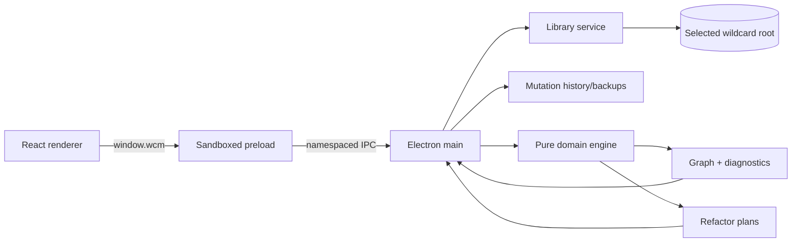
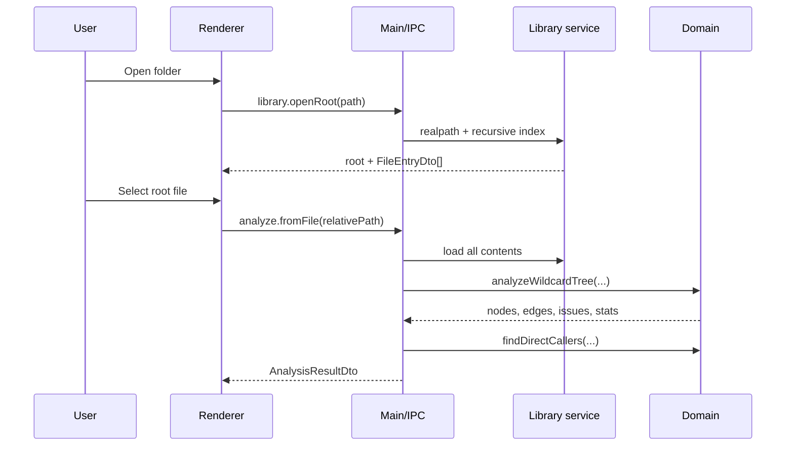

# Architecture

## System shape

Wildcards Manager is a single-package Electron application with a pure domain
core.



The wildcard directory—not application state—is canonical for **content**.
Settings pointers and UI prefs live under Electron `userData`; per-library
datasets (lists, categories, catalogs, hashes, thumbnails) live in folder
sidecars beside each wildcards / LoRA / checkpoint root.

## Trust boundaries

### Renderer (`src/renderer`)

React owns presentation and ephemeral UI state:

- file search/filter;
- graph focus and layout;
- selected node/source;
- modal previews and confirmations;
- editor buffer;
- simulation overlay.

It has no Node.js integration or direct filesystem access. The BrowserWindow
uses `contextIsolation: true`, `nodeIntegration: false`, and `sandbox: true`.

### Preload (`src/preload`)

The preload bridge exposes one typed object, `window.wcm`, through
`contextBridge`. It maps capability-oriented methods to fixed IPC channel names
from `src/shared/contracts.ts`; it does not expose generic IPC primitives.

Capabilities are grouped as library, analyze, file, expand, simulate, refactor,
history, UI settings, and watch.

### Main process (`src/main`)

The main process:

- authorizes and remembers the selected folder;
- reads/writes wildcard files;
- registers/validates IPC requests;
- starts/stops the filesystem watcher;
- loads settings and recent roots;
- turns pure refactor plans into grouped mutations;
- manages undo/redo and backups;
- delegates graph/expansion/simulation to the domain engine.

### Domain (`src/domain`)

The domain layer has no Electron or UI imports. It operates on `LibraryFile`
values and returns data/plans. This keeps parsing, graph construction,
expansion, simulation, and refactoring independently testable.

## Data flow: open and analyze



The graph builder indexes keys, parses active lines, resolves references, and
walks dependencies iteratively. A traversal-path array detects true recursion;
a separate fully-expanded set prevents duplicate work.

The domain graph defaults to a 5,000-node cap. The renderer independently limits
the drawing to the focus path plus a depth- and breadth-capped descendant cone.

## Graph representation

Node kinds:

- `root`: selected file;
- `file`: resolved text wildcard;
- `yamlKey`: validated global mapping path owned by a structured file;
- `glob`: pattern fan-out;
- `missing`: unresolved target.

The main analysis service adds synthetic direct-caller nodes at depth `-1`.

Edges preserve `from`, `to`, one-based line/column, source snippet, and cycle
status. Duplicate edges are distinguished by source position.

## Parsing and resolution pipeline

1. `parseRefs.ts` normalizes text lines, extracts `__…__`, and attaches
   line/column.
2. `structured.ts` validates YAML/JSON and flattens nested mappings into global
   keys while preserving host files and source locations.
3. `parseVariants.ts` validates depth-aware braces, pipes, and `$$`.
4. `resolveWildcard.ts` indexes text files plus structured keys and performs
   exact, case-insensitive, and glob resolution.
5. `buildGraph.ts` creates graph nodes/edges and aggregates issues.
6. `analyze.ts` calculates counts.
7. `analyzeService.ts` adds callers and maps domain types to IPC DTOs.

`# NO VALIDATION` is handled in parsing/graph/reference-stat paths: valid
references remain traversable while diagnostics and unresolved targets owned by
that file are suppressed.

## Write safety and path containment

All reads/writes flow through `libraryService`:

1. the selected root is resolved with `realpath`;
2. candidate paths are resolved;
3. `path.relative(realRoot, candidate)` must not start with `..` or be absolute;
4. writes/deletes require `.txt`, `.yaml`, `.yml`, or `.json`;
5. writes create a process-specific temporary sibling and rename it over the
   target.

This protects the renderer from arbitrary path access. Symlink/path behavior
still relies on the operating-system filesystem and should be covered by future
security tests.

## Refactor planning and application

Rename, delete, consolidate, absorb, missing cleanup, and cycle fixes are split
into:

- **pure plan:** validate preconditions, calculate rewritten text, affected
  files/counts, collisions, and warnings;
- **service preview:** map the plan to a DTO for the modal;
- **mutation:** re-run/validate the plan and apply all file operations as one
  history entry.

Exact wildcard tokens are rewritten case-insensitively. Globs are never
rewritten; plans report currently matching glob users.

## Mutation history and backups

`applyMutation(label, ops)`:

1. collapses duplicate target paths (last operation wins);
2. snapshots every before state;
3. constructs the desired after state;
4. attempts a timestamped backup;
5. applies file operations;
6. pushes one entry onto the undo stack and clears redo.

History is process memory, capped at 50, and reset on library open. Undo restores
before snapshots; redo restores after snapshots.

Backups are stored under:

```text
userData/backups/<sha1-root-prefix>/<timestamp>_<id>/
```

Only files that existed before are copied; `manifest.json` records all paths and
whether each existed. Backup failure is swallowed intentionally and does not
block mutation.

## Expansion and simulation

`expand.ts` tokenizes literal, variant, and wildcard segments:

- random expansion uses a Mulberry32 seed and weighted sampling;
- exhaustive expansion uses generators and bounded collection;
- combination arithmetic saturates at one billion;
- recursion uses active key paths and a default depth cap of 25;
- structured scalar/list values use the same expansion pipeline as text lines.

Simulation reuses random traversal but records visits instead of output text.
`simulateBalance.ts` derives sibling-relative scores used by the renderer.

## Settings, library sidecars, and filesystem watching

`settingsStore.ts` atomically persists **AppData** pointers and prefs:

- up to 12 recent roots;
- last root and selected file;
- details-panel width;
- simulation iterations and seed;
- Civitai site, API key, download folder **paths**, browse UI prefs, and window
  bounds.

Per-library **datasets** are written next to the user’s folders, for example:

| Location | Contents |
| --- | --- |
| Sibling `<wildcardsBasename>.wcm/library.json` | Archive / Maybe / Notify / marked-installed, LoRA download categories |
| Same sibling `validation.json`, `backups/` | Validation cache, mutation backups |
| Same sibling `cache/` | Paged Civitai catalog, slim AutoV2 index, hash-miss cache |
| `<lora or checkpoint>/!.wcm/models.json` | Hashes, ratings, manual Civitai links |
| `!Thumbnails/` under model roots | Cover-crop catalog thumbs (`w512-…`) plus full CDN bytes for new downloads (`full-…`) |
| `<lora or checkpoint>/!.wcm/download-queue.json` | Persistent download queue |

Wildcards sidecars are **outside** the content root so ComfyUI Dynamic Prompts
does not index them. Legacy in-tree `!.wcm` / `!Cache` under wildcards are
moved to the sibling on launch (`wildcardsSidecarMigration.ts`).
`libraryDataMigration.ts` also moves legacy AppData blobs into these sidecars
(idempotent). Writes to `library.json` refuse to replace non-empty membership /
category lists with empty in-memory snapshots (empty-clobber guard).

LoRA and checkpoint indexes (`loraService` / `checkpointService`) walk the
configured roots with symlink-aware directory traversal (`modelFolderWalk`) so
junctions and folder links to other volumes are included. AutoV2 hashes are
cached in the model-root store; checkpoints may also read sibling stem `.txt`
hash sidecars before full-file hashing.

The watcher tries recursive `fs.watch`, falls back to non-recursive watch, and
debounces notifications by 250 ms. Renderer refresh reloads the file list,
reference stats, history state, and current graph.

## Build and packaging

Electron-Vite emits separate bundles:

```text
out/main/index.js
out/preload/index.cjs
out/renderer/index.html + assets
```

Electron Builder packages those bundles plus `sample_wildcards/` as an external
resource. Configured targets are Windows x64 NSIS, macOS x64/arm64 DMG, and Linux
x64 AppImage.

## Testing boundaries

Vitest currently runs `src/domain/**/*.test.ts` in Node. Coverage includes graph
analysis/parser/resolution, expansion/simulation, refactor plans, cycle fixes,
and sample-library health. There are no automated renderer, IPC integration, or
packaged-app end-to-end tests yet.

See [development.md](development.md) for commands and contribution guidance.
